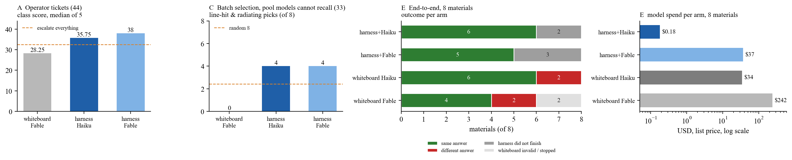

# Atomost benchmarks

Benchmarks of the AI systems Atomost builds for materials research, and checks of the physics those systems compute. Each benchmark
is a folder with a human-facing report, the figures and grading tables it is built from, its design and the deliverables of every arm
that was compared. Labels and graders are frozen before any run; grades come from code (the pipeline's own gates and validators, fixed
rules), never from a model judge; every report lists what it does not show.

The repository holds three families:

- **cophon harness benchmarks** (`cophon-bench-v*`). cophon is the team's coherent-phonon terahertz materials stack; its harness is the
  kernel pipeline as the team runs it: a sealed first-principles pipeline with code gates after every stage, a rulebook of past failures,
  a prior for choosing materials, a supervisor and an operator model that answers its tickets. The question: does the same model do
  better inside the harness than working alone, and does the harness lift a cheap model to the level of a frontier one?
- **cophon experiment benchmarks** (`experiment-benchmarks/`). The theory itself, checked against published experiments.
- **atomost-bench** (`atomost-bench-v*`). atomost, the governance layer every agent session of the team starts through.

| Benchmark | System | Date | What it measures | Report |
|---|---|---|---|---|
| [cophon-bench v1](cophon-bench-v1/) | cophon harness | 2026-10-18 (v1.0.1) | v0's two questions measured instead of inferred: end to end on 8 materials with four arms each (inside the harness or alone, Haiku 5.5 or Fable 5.1), 7 operator tickets raised after the v0 freeze, a selection pool grown by 10 randomly drawn materials, 5 repeats of every answer | [中文报告](cophon-bench-v1/report/REPORT.md) · [English summary](cophon-bench-v1/report/SUMMARY.en.md) |
| [cophon-bench v0](cophon-bench-v0/) | cophon harness | 2026-10-15 (v0.1) | the coherent-phonon kernel pipeline as a harness: the same model inside vs on a whiteboard, and whether the harness lifts the cheapest model to the level of the strongest one working alone | [中文报告](cophon-bench-v0/report/REPORT.md) · [English summary](cophon-bench-v0/report/SUMMARY.en.md) |
| [experiment benchmarks](experiment-benchmarks/) | cophon theory | 2026-08-31 to 2026-10-11 (round 1) | the theory itself: under the same material and pump conditions as published experiments on NbOI₂, monolayer MoS₂ and InP, does the computed kernel predict which mode is driven, along which axis it radiates and where the driving peaks; new predictions on record for experiments not yet done | [README](experiment-benchmarks/README.md) |
| [atomost-bench v2](atomost-bench-v2/) | atomost | 2026-10-27 | v1's 30 items rerun after the seven defects it found were fixed: does each fix work, do the criteria still hold (two arms, Haiku 5.5 and Opus 5.5, 360 runs) | [English summary](atomost-bench-v2/report/SUMMARY.en.md) · [中文报告](atomost-bench-v2/report/REPORT.md) |
| [atomost-bench v1](atomost-bench-v1/) | atomost | 2026-10-27 | atomost's second round: rules checked by a hook when a session acts and memories delivered when it touches what they are about, against one long resident index; 30 task items in three projects, three arms, Haiku 5.5 and Opus 5.5, 540 runs | [English summary](atomost-bench-v1/report/SUMMARY.en.md) · [中文报告](atomost-bench-v1/report/REPORT.md) |
| [atomost-bench v0](atomost-bench-v0/) | atomost | 2026-10-17 | atomost, the layer every agent session of the team starts through: does a fresh session follow the team's rules with no memory, the pre-atomost native memory, or the curated atomost memory home (43 frozen items, Haiku 5.5 and Opus 5.5, 774 runs); replays of strategist wake policies and of the console's failure alerts | [English summary](atomost-bench-v0/report/SUMMARY.en.md) · [中文报告](atomost-bench-v0/report/REPORT.md) |

## cophon harness benchmarks

### cophon-bench v1 in one figure

Eight materials end to end, each with four arms on the same sealed cell (harness + Haiku 5.5, harness + Fable 5.1, Haiku alone, Fable
alone); 51 operator tickets, 7 of them raised after the v0 freeze; a batch-selection pool of 47 materials, 10 of them drawn at random and
newly computed; five models, 5 repeats; 1417 offline answers, 16 whiteboard sessions, 205 node-hours, $694 at list price. Inside the
harness every model scores higher on the operator tickets (35.75–38.25 vs 27.25–31.75 of 44) and on the 7 hold-out tickets, and
harness + Haiku beats every model working alone. On the 33 pool materials the models cannot recall, the harness puts 4 laser-line hits
among its 8 picks against 0–1 for the models alone, mostly through its prior (the prior alone gets 5). End to end, all 11 harness arms
that finished give the sealed baseline's answer, against 10 of 14 whiteboard arms (both models fall into a CdS trap the harness rulebook
records, and pick a different top peak among KNbO3's three near-equal ones); but 5 of the 16 harness arms stopped at Wannier-related
gates, while Haiku working alone finished all eight materials. v1 therefore revises v0's end-to-end claim: on the five materials every
arm finished, the harness used 0.5–0.75× the compute of the whiteboard arms, and nothing was saved once its unfinished arms are counted.
LUMI closed on 2026-10-17 before v1 ended; two whiteboard Fable cells and the grading of the Wannier task's third round are missing.
The end-to-end grades can be re-checked from this repository alone (`cophon-bench-v1/regrade/`). Every gap:
[cophon-bench-v1/report/SUMMARY.en.md](cophon-bench-v1/report/SUMMARY.en.md).

### cophon-bench v0

Five tasks (A operator tickets, B Wannier projection, C batch selection, D kernel-peak prediction, E end to end), five models (Haiku 5.5,
Sonnet 5.5, Opus 5.5, Fable 5.1, DeepSeek v4 flash), 1856 model answers, 75 node-hours on LUMI. Inside the harness the cheapest model
beats the strongest model working alone on operations (36.25 vs 28.5 of 44) and on the Wannier step (14 vs 11 of 16 materials), and
reaches the same end-to-end physics with 3.6× less compute and 30× less model spend. Wall-clock, batch selection beyond a biased pool
and peak prediction from cheap data are *not* shown; the report's appendix A lists every gap and every harness defect the benchmark found.
The end-to-end figures rest on three materials; v1 measured them on eight and revised the compute saving (above).

## atomost-bench

### v1 and v2 in one paragraph

atomost's second round stopped loading every memory into a resident index: a standing rule became a rule file checked by a hook at the moment a session acts (remind, ask, deny, block once), and a memory carries triggers so a pointer is sent only when the session touches its path, command, name or topic. v1 gave 30 small real jobs in three projects, where the rule or memory matters halfway through, to Haiku 5.5 and Opus 5.5 under three arms (540 runs, $38.81 at list price); v2 reran them after the fixes (360 runs, $26.81). The resident context shrinks by about 1,700 tokens (12–13%); tokens per run change by −2% to +4%, not measurably; rules are kept no less often, and more often in both versions (v2: Haiku 67→80, Opus 81→88 of about 90, counting a blocked-then-corrected attempt as kept), but an untouched arm drifted by 6 runs between the two days, so only "not down" is claimed. The firm evidence is per item: a log rule resident in every arm held in 0 of 12 runs and the blocking hook held 6 of 6; off-topic deliveries fell from 21% to 3% with no needed delivery lost. Grading is mechanical, every run ran in a throwaway copy, and the real projects' ledgers got 0 rows. Details and every gap: [v1](atomost-bench-v1/report/SUMMARY.en.md), [v2](atomost-bench-v2/report/SUMMARY.en.md).

### v0 in one paragraph

The same model started in a project folder with three different memories: a cheap model (Haiku 5.5) follows the team's rules 76% of the time with no memory and 93–97% with project memory; the curated atomost memory answers with 26–28% fewer tokens than the uncurated native one; a memory that mixes every project's rules costs more than no memory at all ($0.174 vs $0.110 per answer, $0.080 with the atomost home, all at 100% correct). atomost does not make answers more accurate: the strong model (Opus 5.5) scores 97% with no memory by searching the project files. Strategist sessions woken on change cost $49 over 10 days against about $996 for an hourly round (replay). Details and every gap: [atomost-bench-v0/report/SUMMARY.en.md](atomost-bench-v0/report/SUMMARY.en.md).

## What is and is not in this repository

cophon harness benchmarks. Published: reports, figures, grading tables (with per-answer detail), the designs, the freeze notes and
freeze lists, the end-to-end timelines, the harness arms' per-material reports / gates / figures / cost, the whiteboard arms' task
sheets, notes, reports, job logs, inputs and graded kernel files, the isolation-audit script. From v1 also the harness arms' graded
kernel files, the baselines' peaks and a re-grader that needs only Python and numpy.

Held privately (available for diligence on request): the harness's prompts and ticket texts, the frozen labels of the ticket and
selection tasks, the pipeline code (kernel_pipeline), raw model answers, the whiteboard sessions' full transcripts, the raw wannier90
outputs of pillar B and the bulk outputs of the calculations. Cluster project ids, user names and local paths are scrubbed from the
published text.

atomost-bench. Published: reports (public editions), English summaries, figures (v0), grading tables (item ids, answer letters or outcomes, tokens and cost per run; no item text), designs, freeze notes, runner, grader and fence scripts; for v1 and v2 the checksum of the private frozen-file list. Held privately (available for diligence on request): the item texts and project fixtures (they contain the team's internal rules), the frozen memory copies and file lists, per-run answers and transcripts, replay data, build scripts and atomost's code. A few internal research settings are described generically.

Experiment benchmarks: published are the comparison reports, figures, scripts and metrics, and two small data tables taken from papers
(seven points digitised from Trovatello et al. 2020; the public-domain InP optical constants of Aspnes & Studna 1983), each with its
citation. Not published: the papers and other third-party files (cited by DOI or arXiv number instead), and the kernel files and phonon
data the scripts read.

## 中文

这个仓库放 Atomost 为材料研发搭建的 AI 系统的能力基准，以及对这些系统所算物理的实验检验。每个基准一个目录：人文报告、图、判分表、
设计文件、每一臂的交付件。标签与判分器在任何运行之前冻结，判分只用代码，不用模型当裁判；每份报告都写明它没有证明什么。现在有三类：

- cophon 的 harness 基准（`cophon-bench-v0/`、`cophon-bench-v1/`）。cophon 是团队的相干声子太赫兹材料技术栈，harness 是团队实际运行的
  生成核流水线：封存的第一性原理流程、每一步之后的代码门、过往失败攒成的规则库、选材先验、监督器和回答工单的操作员模型。问的是同一个
  模型放进 harness 是否比单干强，以及 harness 能否把便宜模型抬到前沿模型的水平。最新的是 v1，报告见 `cophon-bench-v1/report/REPORT.md`：
  它把 v0 里靠推断的地方换成了测量，也修正了 v0 关于端到端算力的结论。
- cophon 的实验对照基准（`experiment-benchmarks/`）：检验理论本身，在和已发表实验相同的材料与泵浦条件下，算出的结果能不能预言实验测到的
  东西，并写下了等待实验检验的新预测。
- atomost-bench（`atomost-bench-v0/`、`v1/`、`v2/`）：测的是团队所有 AI 会话都经过的治理层 atomost（项目记忆家、参谋会话、记账、手机提醒）。
  v0 测记忆本身；v1 测第二轮的做法（规矩在动手时由规则管、记忆在碰到时送到，不再全部常驻），v2 是修完 v1 查出的毛病后的复测。
  最新的报告见 `atomost-bench-v2/report/REPORT.md`。

© Atomost. All rights reserved; contact the maintainers for reuse.
