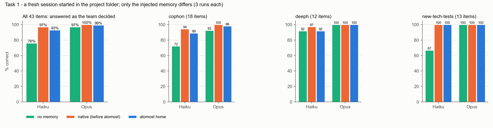
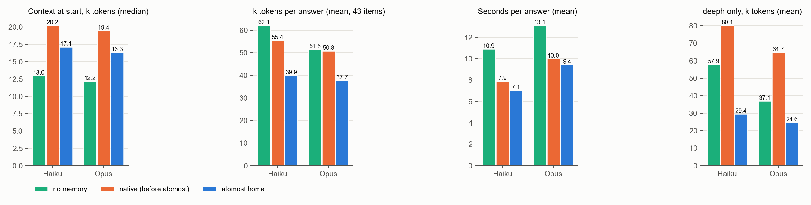
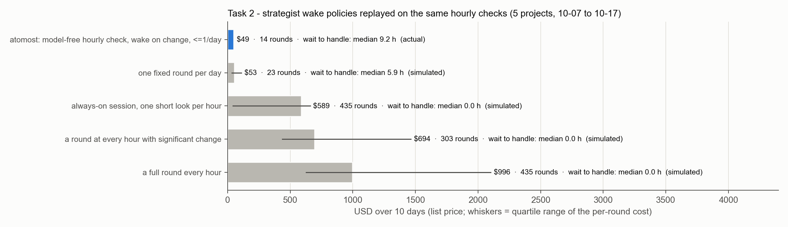
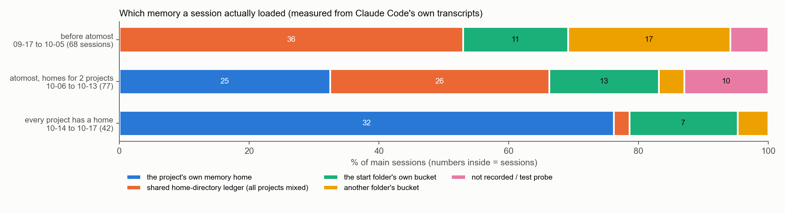

# atomost-bench v0：atomost 治理层的第一组能力基准

版本 v0（2026-10-17）· memory-control 项目 · atomost v1.41
作者：Claude Opus 5.5（agent），所有者审阅前的版本。本文为公开版：题目原文、记忆副本、每次运行的答案与完整记录不公开，尽调时可申请查看；第 7 节（对外措辞）只在内部版里。数字全部出自 `tables/`（T1.md、t1_detail.json、T2.md、T3.md）和 `results/`；图由 `../atomost_bench/figures_v0.py` 从这些表画出。

---

## 一页读完

atomost 是我们 4 人团队在一台工作站上管 AI 会话的那一层：每个会话从它启动，自动挂到所属项目的记忆、记录和花费账上；每个项目有一个常驻的参谋会话整理记忆；手机上能看到全部会话，需要人时会报警。这份基准测的就是这一层，不是哪个项目的研发流水线。三道题，774 次模型运行，标价 57 美元，另有两道题只回放历史记录、不调用模型。

图 1 · 题 1：同一个模型在项目文件夹里新开会话，只换注入的记忆，回答 43 道"按团队的规矩该怎么做"的情境题。每题每组 3 次。

- **记忆让低端模型按团队的规矩办事。** Haiku 5.5 没有记忆时答对 76%（43 题里 30 到 35 道），接上 atomost 的记忆家答对 93%，接上接管前的原生记忆答对 97%。没有记忆时它有 25 次直接放弃、选了"先问人"。高端的 Opus 5.5 没有记忆也答对 97%，它会自己翻项目文件，代价是更多 token 和时间。
- **atomost 整理过的记忆更省。** 和接管前的原生记忆比，每次回答的 token 少 28%（Haiku）和 26%（Opus），Opus 每次花费少 25%；和没有记忆比，token 少 36% 和 27%，用时从 10.9 秒降到 7.1 秒（Haiku）。
- **混在一起的记忆比没有记忆还糟。** deeph 接管前加载的是全机共享的总账本（87 条，各项目混着）。它让 Opus 每次回答花 0.174 美元，没有记忆时 0.110 美元，换成 atomost 的记忆家后 0.080 美元；token 从 6.5 万降到 2.5 万（−62%），三组答对率都是 100%。
- **整理也丢了东西。** atomost 组答得比原生组略差（93% 对 97%），差在两处：一条规矩整理时丢了（D12）；一条规矩被并进了"项目概况"文件的正文，索引那一行没提它，Haiku 就没去翻（C07）。这两处都是可改的整理规矩，见第 3 节和第 8 节。
- **没有人编答案。** 4 道虚构前提题，三组、两个模型、每次都回答"资料里查不到，先问人"。
- **后台的 AI 劳动按需叫醒。** 参谋会话由不花钱的脚本每小时检查一次，10 天 435 次检查只叫醒 14 次，花 49 美元；同一份记录下，每小时跑一轮约 996 美元（模拟）。代价是平均要等 9 小时才处理，见第 4 节。
- **报警能认出"这个会话需要人"，但人不一定来。** 历史回放：规则在出事的第一条记录就能报警，可人平均 33 分钟后才接手；报警上线后，两个无人值守的参谋仍卡了 11 和 24 小时，见第 5 节。

---

## 1. atomost 是什么，为什么测

团队 4 个人，在一台工作站上同时推进 10 个项目（几条材料计算的研究线，加上市场材料和这套治理本身）。每天碰到 3 到 4 个项目，开着十个左右的 Claude 会话，用三家的模型（Anthropic 的 Haiku / Sonnet / Opus / Fable、DeepSeek、OpenAI Codex）。atomost 是这些会话的入口和治理层，10-06 上线，到今天 v1.41。它做五件事：

1. **会话出生**：敲 `claude` 先经过 atomost，判定项目、登记、带上该项目的记忆家；任何一步出错，原命令照样跑，atomost 从不拦启动。
2. **记忆**：一个项目一个记忆家。会话按 Claude 自己的机制写记忆；每个项目的常驻参谋会话负责归组、缩短、合并、归档，人随时在手机上改。
3. **记录**：每个项目一套只追加的决定日志和运行日志，加检查点时重写的 README，其余放 records/。
4. **观测**：每个会话的花费按项目入账（v1.41 修正了计费），状态、登记率、记忆家的大小与体检。
5. **人机接口**：手机和浏览器控制台，能看全部会话；会话提问、等许可、报错、跑太久时报警。另有每天的机器体检和飞书日报。

owner 要的是对外讲得出、经得起查的数字，四个方向：AI 调度、人机互相赋能、上下文管理、token 节省。atomost 以前只有"上线了什么"，没有"带来了什么"的对照测量，所以做这组基准。

## 2. 怎么测

规矩照 cophon 的两份基准：题目和答案键在任何运行之前冻结（`FREEZE.sha256`，318 个文件，跑完复核无改动）；判分全部机械，不用模型当裁判；每格 3 次；基准只测不改，发现的 atomost 缺陷记下来交给后续版本。

- **题 1（上下文管理 + 人机互相赋能）**
  - 做法：同一个模型在项目自己的文件夹里无头启动，只换 Claude Code 注入的记忆目录。会话可以用 Read / Grep / Glob 查项目文件夹。全局 CLAUDE.md 三组都会加载，是常量。
  - 三组记忆：
    - 无记忆；
    - 接管前的原生状态：cophon 和 new-tech-tests 是各自根目录的旧桶；deeph 是它当时实际加载的全机总账本；
    - atomost 的记忆家。
  - 43 道题都来自 owner 定过或确认过的规矩，只取冻结日以前的规矩，因为在那之后的规矩，原生状态下的会话日后也能学到。每题附原文原话。出题后我逐题审过：删了一道判分标准来自 agent 结论的题；原生副本里拿掉了冻结日之后修改的 5 个文件。设计见 `DESIGN.md`，冻结前的改动见 `FREEZE_NOTE.md`。
- **题 2（AI 调度 + token）**：用参谋计时器 10 天的真实检查记录和每轮真实花费，回放五种叫醒策略。不调用模型。
- **题 3（人机互相赋能）**：把控制台现在的报错识别规则，放回 09-17 以来的全部历史记录上重放。不调用模型。
- **运营实测**：从全机会话记录统计记忆分配、并行规模、登记率等（第 6 节）。这部分不是对照实验。

**隔离审计**：774 次运行共 1,714 次工具调用。带路径的越界读取尝试 58 次，56 次被拒；2 次成功，都在同一次运行里：atomost 组的一个 Haiku 读到了 cophon 的旧记忆桶。原因是 Claude Code 对它自己默认的记忆路径放行，即使我们指定了别的记忆目录。那道题是虚构前提题，它答"先问人"（正确），读到的那条记忆在 atomost 记忆家里也有，对结果没有影响。

## 3. 题 1：新会话接不接得住团队的规矩

| 43 题，每题 3 次 | 无记忆 | 接管前的原生记忆 | atomost 记忆家 |
|---|---|---|---|
| **Haiku 5.5** 答对率（每遍答对数） | 76.0%（30 / 33 / 35） | 96.9%（41 / 41 / 43） | 93.0%（40 / 40 / 40） |
| 每次回答的 token（平均） | 62,100 | 55,400 | **39,900** |
| 每次花费（平均，Claude Code 自报，标价） | $0.0049 | $0.0049 | **$0.0038** |
| 每次用时（平均） | 10.9 秒 | 7.9 秒 | **7.1 秒** |
| 工具调用（平均） | 3.7 | 2.0 | 1.7 |
| 非虚构题上选"先问人"（放弃） | 25 次 | 3 次 | 9 次 |
| **Opus 5.5** 答对率 | 96.9%（41 / 42 / 42） | 100% | 99.2%（42 / 43 / 43） |
| 每次回答的 token（平均） | 51,500 | 50,800 | **37,700** |
| 每次花费（平均） | $0.138 | $0.167 | **$0.125** |
| 每次用时（平均） | 13.1 秒 | 10.0 秒 | **9.4 秒** |
| 开场上下文（中位，Haiku / Opus） | 13.0k / 12.2k | 20.2k / 19.4k | 17.1k / 16.3k |

图 2 · 题 1 的开场上下文、每次回答的 token 和用时，最右是 deeph 单独看（它的原生记忆是全机总账本）。

**按题型拆开**（Haiku；Opus 每种题型都在 93% 以上）：

| 题型 | 题数 | 无记忆 | 原生 | atomost |
|---|---|---|---|---|
| 两边都有这条规矩 | 20 | 62% | 98% | 95% |
| 只在 atomost 里（原生会话看不到的别的桶） | 14 | 88% | 93% | **100%** |
| 只在原生里（整理时丢了） | 5 | 80% | 100% | 60% |
| 虚构前提（正确答案是"先问人"） | 4 | 100% | 100% | 100% |

**deeph（原生 = 全机总账本）**：

| 12 题 | 无记忆 | 总账本 | atomost |
|---|---|---|---|
| Haiku 答对率 / 每次 token | 91.7% / 57,900 | 97.2% / 80,100 | 91.7% / **29,400** |
| Opus 答对率 / 每次 token / 每次花费 | 100% / 37,100 / $0.110 | 100% / 64,700 / $0.174 | 100% / **24,600** / **$0.080** |

**怎么读**

- 记忆的价值主要体现在低端模型上：Haiku 没有记忆时常常放弃，或者在项目文件里找错地方。cophon 和 new-tech-tests 两个项目里，它只答对 70%；接上任何一份记忆都能到 93% 以上。高端模型自己会翻项目文件（项目的决定日志、README、CLAUDE.md 里写着很多规矩），没有记忆也答得对，只是多花 token 和时间。所以对 Opus，这一版测出的是"省"，不是"准"。
- atomost 记忆家比原生记忆省，原因是整理过的索引更短（开场少约 3,000 token），而且会话找东西少走弯路（工具调用 2.0 → 1.7）。混合总账本的反面例子最清楚：87 条各项目的规矩塞在一起，会话要读得更多才能确认哪条是自己项目的。
- atomost 组 Haiku 输给原生组的那 1.7 道题，原因可以点名：
  - C07（一条"某个计算分支暂不做"的决定）三次全错。原生桶的索引里有一行专门写着这条决定；atomost 的整理把它并进了"项目概况"文件的正文，索引那一行没提它，Haiku 主要靠开场的索引办事，就没去翻。这违反了全局规则"一条记忆一个短文件，索引那一行就是规矩本身"。合并时如果把多条规矩并进一个概况文件，弱模型就看不见它们。
  - D12（一条"新方法采纳前先在存档历史上回放打分"的规矩）三次全错：这条在把 deeph 搬出总账本时没有带过来。
  - C15、C14、C16 各错一次：C15 的那条记忆至今写在 cophon 记忆家外面（doctor 从 10-08 起报 BAD）。
- "只在 atomost 里"的 14 道题，是 atomost 把散在别的桶里的规矩收进同一个家的直接效果：Haiku 100% 对原生 93%。但这一组原生组也不差，因为很多规矩同时写在项目文件里。
- 低端模型接上 atomost 记忆（93%），没有追上不带记忆的高端模型（97%），但每次回答的花费只有后者的约 1/36（$0.0038 对 $0.138）。

## 4. 题 2：后台的 AI 劳动按需叫醒，账怎么算（AI 调度 + token）

图 3 · 同一份每小时检查记录，换五种叫醒策略。蓝色是实际发生的，灰色是在同一记录上回放的模拟。

每个项目有一个常驻的参谋会话，负责整理记忆、读项目的变化。它不是一直开着模型在看：每小时由一个不花模型钱的脚本检查一次，变化够显著才叫醒它，而且每天最多自动叫醒一次。10-07 到 10-17，五个项目一共检查了 435 次，自动叫醒 14 次，花 48.86 美元（v1.41 的算法，标价）。这 10 天参谋们一共做了 806 次记忆动作，处理了 41 条记忆素材。

用同一份检查记录回放其他策略：
- 每小时跑一轮：约 996 美元（按每轮花费的四分位，626 到 2,101 美元）；
- 每个有显著变化的小时跑一轮：约 694 美元；
- 常驻会话每小时看一眼：约 589 美元（缓存一直热约 44 美元，全冷约 659 美元）；
- 每天固定跑一轮：约 53 美元。

所以按事件叫醒比"每小时一轮"省 95%，比"有变化就跑"省 93%，和"每天一轮"花得差不多。

代价是等待。从检查到显著变化，到参谋真的处理，中位数 9.2 小时，比"每天一轮"的模拟（5.9 小时）还长。最长的几次等待都来自故障，不是策略本身：
- cophon 的参谋屏幕连续 3 天没有输入框，53 次该叫醒的没叫成；
- 10-16 那次叫醒一开始就撞上 Fable 额度，什么也没做，却用掉了当天唯一一次自动叫醒，变化于是等了 47 小时。

这两处是 atomost 的缺陷，写在第 8 节。

## 5. 题 3：事故回放（人机互相赋能）

这一题把控制台现在的报错识别规则（v1.32 / v1.32.1）放回历史记录上重放，不是观察到的提速。

- 9 月 17 日以来，主会话里一共有 27 段连续失败、55 条失败回复。其中 41 条是用量或额度到了上限，这类失败不产生输出，不花 token。
- 交互会话里有 19 段等到了人来处理。从"规则能报警"到"人第一次动手"，中位数 33 分钟（四分位 12 到 49 分钟），最长 6.8 小时，19 段合计 21 小时。规则在出事后的第一条记录就能报警。
- 唯一一次真正烧钱的空转是 10-14 一个理论推导会话：8 次回答都在 64k 输出上限处被截断，全部花在思考上，没有写出一个字，合计 51.2 万输出 token，约 10.65 美元。规则在每一圈结束前约 36 分钟就能报警；如果人立刻接手，最多能省下 6 次截断（约 38 万 token、8 美元）。
- 但报警上线以后，有两个参谋会话照样卡了 11.1 小时和 24.2 小时：一次卡在夜里，一次没有人去看。这和早上测到的结果一致：有提醒以后，人的回应并没有变快（回合结束到人下一句话的中位数从 7.5 分钟变成 20 分钟，混杂因素是并行项目变多）。

结论：atomost 能在出事的第一时间认出"这个会话需要人"，这一半做到了；人看不看、多久看，atomost 目前管不到。

## 6. 运营实测（不是基准，是全机会话记录的计数）

图 4 · 每个会话实际加载了哪份记忆。数据来自 Claude Code 自己写的会话记录，09-17 以来的全部主会话。

- **记忆分配**：上线前（09-17 到 10-05）68 个会话，没有一个用到项目自己的记忆家。53% 在读家目录的总账本，那本账混着各项目的规矩，19 到 25 KB，09-20 一度达到 Claude 加载上限的 102%，超出部分被截掉。原因是 Claude 自己 08-23 建了一个空的 `~/.git`，v1.29 查明并修掉。10-14 起每个项目都有了记忆家，42 个会话里 32 个用的是自己项目的记忆家；经 atomost 启动的 15 个全对；子代理 480 次全部跟随父会话。漏掉的都是绕过 atomost 启动的。
- **记忆整理**：AI 自己写的记忆 3 周里从加载上限的 13% 长到 74%，两处合并成一个家时到 91%。参谋会话 26 分钟把它压到 40%，内容靠合并和转成 12 份记录保住，现在 37%。全机记忆账上 937 次动作，86% 是参谋做的，人通过命令做了 87 次。
- **并行规模**（日均，上线前 19 天对上线后 10 天）：碰到的项目 2.2 → 3.9，活跃的交互会话 5.3 → 10.0，同时开着的会话峰值 3.3 → 4.5（最高 8）。同一时刻真正在算的峰值约 3 个，没变。
- **登记率**：10-06 当天 0/17；之后 58 次登记启动、1 次绕过（98.3%）。
- **决定留痕**：6 个项目的决定日志 10 天左右记了约 490 条，每条写明谁拍板、为什么、否掉了什么。
- **花费统计**：v1.41 修了两个方向相反的错（每条回复按内容块重复计费；子代理整块漏算）。同一份数据只算 Claude：近 7 天从 9,447 美元改为 4,351 美元，近 30 天从 18,980 美元改为 28,021 美元。

## 8. 基准过程中发现的 atomost 缺陷（只记不改，交给后续版本）

1. **家外的记忆**：cophon 有 3 条记忆写在家外（记忆家建好以后，长会话还在往旧桶里写），doctor 从 10-08 起一直报 BAD 没人处理。题 1 的 C15 考的就是其中一条，atomost 组因此答不出来。
2. **参谋叫不醒**：cophon 的参谋屏幕连续 3 天没有输入框，53 次叫醒落空，没有报警。
3. **一次失败的叫醒占掉当天名额**：10-16 那次撞额度、0 次回复，却算作当天的自动叫醒，变化等了 47 小时。应当只在成功回复后才计入每天一次的上限。
4. **报警没有接到人**：两个参谋卡了 11 和 24 小时。参谋这类无人值守的会话，报警需要升级渠道，比如飞书私信，而不只是控制台的徽章。
5. **全局 CLAUDE.md 回胀**：从 2.0 KB 长回 9.3 KB（约 2,350 token），常驻预算被它一家占了 94%。瘦身稿已出，待 owner 批准。
6. **theory-validator 的记忆索引**约 4,600 token，超出自己定的 2,500 预算，也越过 Claude 的"该压缩了"提示线，没有参谋整理过。
7. **价目表缺行**：claude-haiku-5-5、claude-sonnet-5-5、claude-opus-4-8 没有价目行，按默认价算；opus-5-5 的价格仍标"待核"。
8. **花费统计的两个错**：v1.41 已修。
9. **合并把规矩藏进了正文**（题 1 的 C07）：参谋整理时把一条"某个计算分支暂不做"的决定并进了"项目概况"文件，索引那一行没提它，低端模型三次全错。合并规则应当加一条：一条规矩并进别的文件时，索引那一行要点名它，或者干脆不并。这条该写进参谋说明书（`tools/atomost/roles/strategist.md` 的记忆整理一节）。
10. **搬家漏带**（题 1 的 D12）：deeph 从总账本搬进自己的记忆家时，"新方法采纳前先在存档历史上回放打分"这条没有带过来。

## 9. 这份基准没有证明什么

- 题目偏容易：出题的子代理知道答案在哪；很多规矩同时写在项目文件里，Opus 不靠记忆也能找到。下一版要出项目文件里查不到、只在记忆里的规矩题，并加大题量。
- 原生组是"冻结在接管那一刻的原生状态"，不是完美的反事实。cophon 和 new-tech-tests 用的是根目录自己的桶，这是原生状态里最有利的一种，只占接管前会话的 16%；最常见的是总账本（53%），只在 deeph 上测了。
- 样本小：43 题 × 3 次 × 两个模型。差一两道题的比较不要当真。
- 每道题是一次决定，不是完整的工作。"记忆让一次完整的研发任务做得更好"没有测。
- 题 2 的模拟用的是实际轮次的花费分布；题 3 是规则回放，不是观察到的提速。
- 美元都是标价，订阅账号不按标价结账。

## 附录：文件与复跑（公开仓库只含 report/、tables/、design/；下表里其余的文件私有，尽调可查）

| 内容 | 位置 |
|---|---|
| 设计、冻结、冻结前改动 | `DESIGN.md`、`FREEZE.sha256`、`FREEZE_NOTE.md` |
| 题目与出题说明 | `items/items.json`、`items/ITEMS_NOTES.md`、`items/dropped_before_freeze.json` |
| 三组记忆的副本 | `arms/<项目>/{none,native,atomost}/`；冻结前拿掉的文件在 `arms_removed/` |
| 每次运行的答案、用量与完整记录 | `results/<组>/<模型>/rep<N>/<题>.json` 与 `.transcript.jsonl` |
| 判分表 | `tables/T1.md`、`tables/t1_detail.json`、`tables/T2.md`、`tables/T3.md` |
| 回放数据 | `results/t2/`、`results/t3/` |
| 脚本 | `../atomost_bench/t1_bench.py`（prompts / run / grade）、`t2_wake_policies.py`、`t3_incident_replay.py`、`figures_v0.py` |
| 运营实测的脚本与报告 | 私有，尽调可查 |

复跑：`python3 ../atomost_bench/t1_bench.py run --arms none,native,atomost --models haiku --reps 3`，然后 `python3 ../atomost_bench/t1_bench.py grade`；作图用 `python3 ../atomost_bench/figures_v0.py`。
