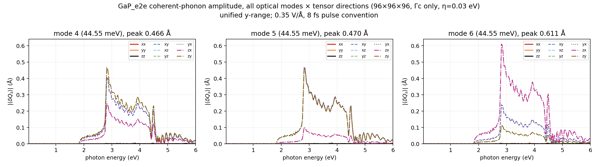
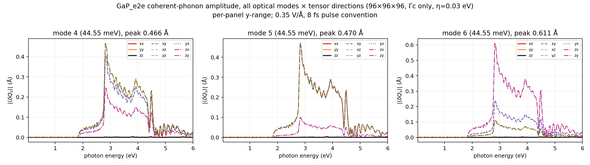
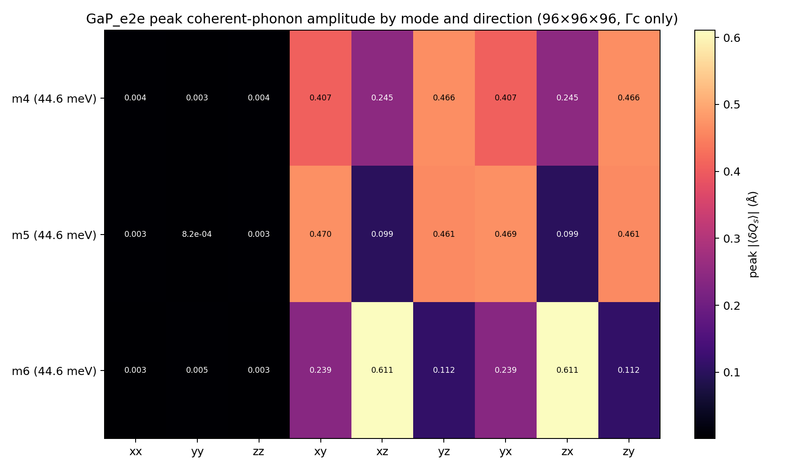
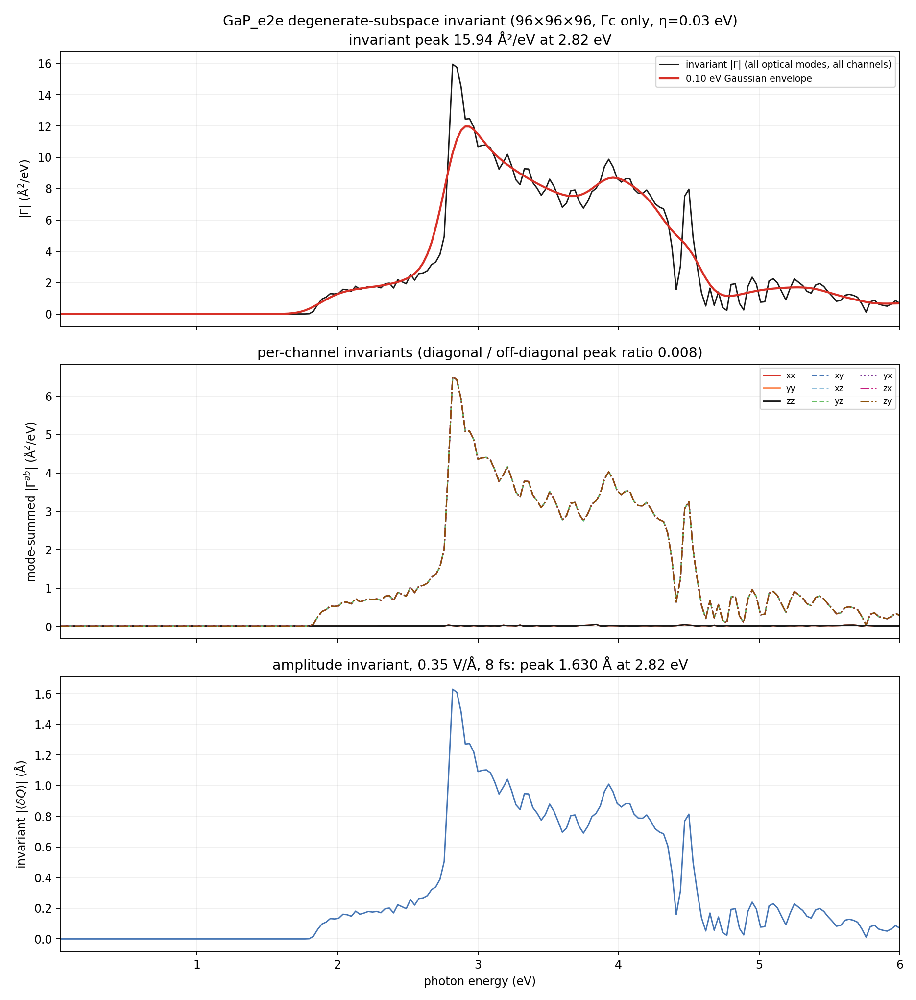
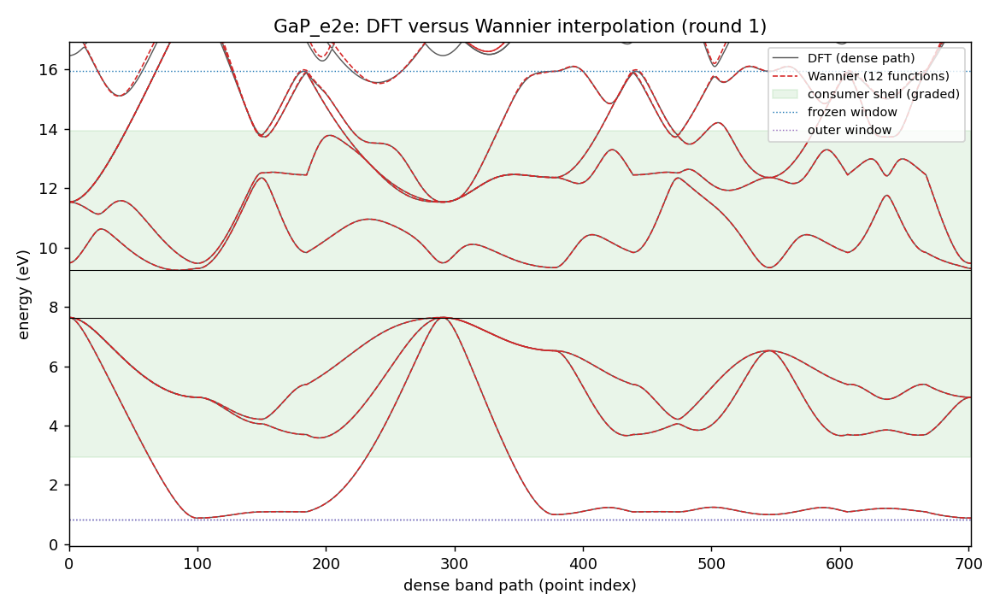
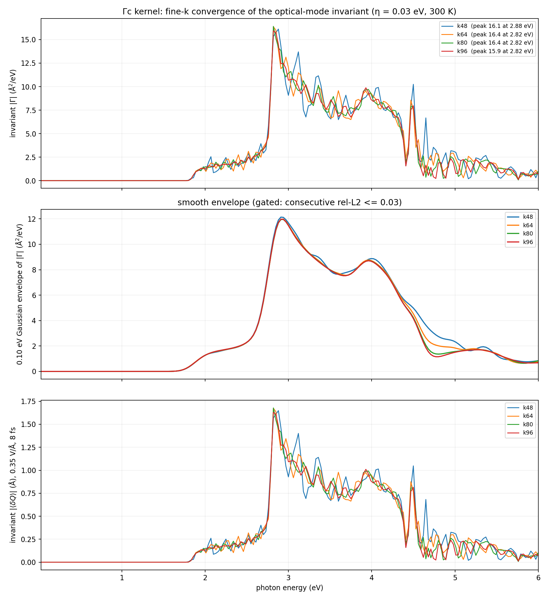
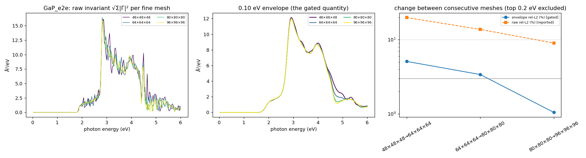

# GaP_e2e coherent-phonon report — Gamma-only DFPT, scalar Wannier state, 0.03–6 eV Γc kernel

Generated 2026-10-14T20:32:53+02:00 by `workflow/lib/report.py` from the files under `<cophon>/benchmarks/cophon_bench/e2e_library/GaP_e2e`. Every number below is read from a result or gate file; nothing is typed in by hand.

**Outcome: GaP_e2e has a Γc coherent-phonon kernel on the 96×96×96 fine k-mesh.** 3 optical Γ-point modes (44.55, 44.55, 44.55 meV) over 0.03–6.00 eV at 300 K with 0.03 eV smearing. The basis-independent invariant peaks at 2.82 eV (15.94 Ų/eV); under the 0.35 V/Å, 8 fs pulse convention the invariant amplitude peak is 1.630 Å at 2.82 eV (largest single mode 0.611 Å). First non-zero response at 1.77 eV. Between the last two meshes (k80 → k96) the 0.10 eV envelope changes by 1.04 % (limit 3 %; raw spectrum 9.0 %), so the kernel is converged on the envelope.

Scope: Γc only (no Γe vertex correction), scalar-relativistic, PBE gap, Gamma-only DFPT (one q-point, `ldisp = .true.`, `nq = 1 1 1`); velocities from EPW's `vme = 'dipole'` route (the full velocity i[H,r], non-local pseudopotential commutator included, computed on the coarse mesh and Wannier-interpolated; origin-free).

## Standard all-mode result (96×96×96)

| Quantity (96×96×96, 0.03 eV smearing, 300 K) | Value |
|---|---|
| Invariant \|Γ\| peak | 15.94 Ų/eV at 2.82 eV |
| Envelope (0.10 eV) peak | 11.97 Ų/eV at 2.91 eV |
| Invariant amplitude peak (0.35 V/Å, 8 fs) | 1.630 Å at 2.82 eV |
| Per-mode amplitude peaks (basis-dependent split) | 0.466 / 0.470 / 0.611 Å |
| Mode-summed channel peaks, diagonal (xx, yy, zz) | 0.05–0.05 Ų/eV |
| Mode-summed channel peaks, off-diagonal (xy, xz, yz, yx, zx, zy) | 6.51–6.51 Ų/eV |
| Diagonal / off-diagonal peak ratio | 0.008 |
| First non-zero response | 1.77 eV |
| Photon grid | 0.03–6.00 eV, 200 points |

## Electronic structure and Wannier state

| Quantity | Value |
|---|---|
| PBE band edges (VBM / CBM) | 7.641 / 9.232 eV (gap 1.591 eV) |
| Consumer shell (must be interpolated well) | 2.93 … 13.94 eV |
| Frozen / outer window | 0.83 … 15.94 eV / 0.83 … 31.94 eV |
| Wannier functions | 12 (Ga:s;p, P:p;d); recipe source: v1.1 |
| Accepted Wannier round | round 1 (1 round gate on file, including any before an electron recompute); max spread 2.90 Ų, band RMS 2.2 meV, worst 19.7 meV in the shell (limits 10 Ų, 50 / 25 meV) |
| EPW-side interpolation (same shell, from the EPW1 Wannier files) | RMS 2.2 meV, worst 19.8 meV → PASS |

## Γ-point phonons (DFPT)

| Mode | ω (cm⁻¹) | ω (meV) |
|---|---:|---:|
| optical 4 | 359.32 | 44.55 |
| optical 5 | 359.32 | 44.55 |
| optical 6 | 359.32 | 44.55 |

Acoustic sum rule applied (dynmat.x); acoustic modes after ASR -0.00, -0.00, 0.00 cm⁻¹ (raw -3.25, -3.25, -3.25 cm⁻¹). ε∞ diagonal 10.70, 10.70, 10.70; largest |Z*| 2.17; polar: True. Gate: PASS. Softness: stiff (tier 0).

## Velocity-route check

Wannier centres sit up to 2.36 Å from the cell origin (b·r max 0.47); EPW's `wannier` velocity route would carry an origin-dependent error of about 4 % at worst (2.5 % on average) for this cell.

| Adopted mesh | Production route | Other route | Envelope difference | Tensor difference | Invariant peak (production / other) | Forbidden-channel ratio (production / other) | Verdict |
|---|---|---|---:|---:|---|---|---|
| k96 | dipole | wannier | 0.6 % (limit 5 %) | 2.5 % | 15.94 / 15.93 Ų/eV | 0.008 / 0.025 | PASS |

Reading: the two velocity routes agree.

## Fine-k convergence

Convergence is judged on the 0.10 eV Gaussian envelope of the invariant (gate: consecutive rel-L2 <= 0.03); the raw rel-L2 is reported, not gated.

| Meshes | raw rel-L2 | raw Pearson | envelope rel-L2 | envelope peak | gate |
|---|---:|---:|---:|---|---|
| 48×48×48 → 64×64×64 | 0.199 | 0.967 | 0.051 | 12.13 → 11.98 Ų/eV, 2.91 → 2.94 eV | FAIL |
| 64×64×64 → 80×80×80 | 0.138 | 0.984 | 0.034 | 11.98 → 11.95 Ų/eV, 2.94 → 2.94 eV | FAIL |
| 80×80×80 → 96×96×96 | 0.090 | 0.993 | 0.010 | 11.95 → 11.97 Ų/eV, 2.94 → 2.91 eV | PASS |

Per-mesh overlay of the raw invariant, its envelope, and the change between consecutive meshes (the top 0.2 eV of the window is excluded from the gate):

## What was done

1. **intake**: ACCEPTED — GaP sg 216 nbnd 29
2. **relax**: ACCEPTED, job 22819844 (debug, COMPLETED) — max force 0.0 Ry/bohr, pressure 27.87 kbar (cell PBEsol, ions PBE)
3. **electron**: ACCEPTED, job 22819935 (debug, COMPLETED) — gap 1.591 eV; PDOS 5 shells; trim: 6 bands excluded (gap 2.695 eV); v1.1 recipe from the superset stage
4. **wannier**: ACCEPTED, job 22820445 (small, COMPLETED) — round 1: score 0.073 <= 0.9 (W7); wout_present=ok; final_state=ok; num_wann_in_wout=ok; spread_max=ok; plateau_drift=ok; localisation_converged=ok; ran_out_of_steps=ok; all_done=ok; comparison_present=ok; comparator_build=ok; dense_reference_certified=ok; band_rms_meV=ok; band_worst_meV=ok; grids_equal=ok; num_wann_compared=ok; scor
5. **phonon**: ACCEPTED, job 22820030 (debug, COMPLETED) — max 359.32 cm-1; polar=True; softness stiff -> tier 0
6. **epw1**: ACCEPTED, job 22820902 (standard, COMPLETED) — restart written; EPW bands within the shell bars
7. **kernel**: ACCEPTED, job 22841246 (debug, COMPLETED) — converged at k96: envelope change 0.0104 <= 0.03 with previous 0.0339 <= 0.1; velocity-route check PASS (envelope 0.6 %, tensor 2.5 %)
8. **report**: PENDING
9. **anharmonic**: SKIPPED — tier 0: softness stiff (anharmonic off by config)
10. **rekernel**: SKIPPED — tier 0: softness stiff (anharmonic off by config)
11. **superset**: ACCEPTED, job 22820028 (small, COMPLETED) — superset 18 functions; round-1 recipe v1.1 default: 12 functions (reduced), Pmin 8

Wannier recipe (round 1, source v1.1: ["Pmin (kept bands at or below target top + 2 eV = 15.94 eV, worst k) = 8; PDOS picks ['Ga:p', 'Ga:s', 'P:p'] = 7", 'added P:d: P = 12']): 12 functions, projections ['Ga:s;p', 'P:p;d'], exclude_bands [1, 2, 3, 4, 5, 6], outer window [0.8324, 31.9351] eV, frozen window [0.8324, 15.941] eV, consumer shell [2.932, 13.941] eV.

Electronic policy: ecutwfc 80 Ry, ecutrho 320 Ry, SCF mesh [10, 10, 10], NSCF mesh [10, 10, 10], nbnd 29, relax `vc`, spacegroup F-43m (216), nat 2.

## Validation gates

| Gate file | Status | Key numbers | Reasons |
|---|---|---|---|
| `gate_electron` | PASS | — | — |
| `gate_epw1` | PASS | — | — |
| `gate_kernel_k48` | PASS | — | — |
| `gate_kernel_k64` | PASS | — | — |
| `gate_kernel_k80` | PASS | — | — |
| `gate_kernel_k96` | PASS | — | — |
| `gate_kernel_k96_eta030` | PASS | — | — |
| `gate_phonon` | PASS | optical_max_cm1 359.3; acoustic_cm1_asr [-0.0, -0.0, 0.0]; max_abs_zstar 2.172; polar True | — |
| `gate_relax` | PASS | — | — |
| `gate_relax_ions` | PASS | — | — |
| `gate_route_check` | PASS | — | — |
| `gate_superset` | PASS | — | — |
| `gate_wannier_round1` | PASS | — | — |

Standing limits: Wannier spreads <= 10 Ų, band RMS <= 50 meV and worst <= 25 meV in the consumer shell, Γ acoustic modes within 1 cm⁻¹ after ASR, envelope rel-L2 <= 0.03.

## Scope, limits, and next safe action

- **Γc only.** The triangle term Γc is computed; the vertex correction Γe is absent.
- **Scalar-relativistic, PBE gap.** No spin-orbit coupling and no gap correction; the onset follows the PBE gap, so absolute peak positions cannot be compared with experiment without a scissor.
- **Gamma-only DFPT.** Phonons are computed at q = 0 only; the LO–TO splitting is not resolved at exactly Γ and no off-Γ stability check exists in this route.
- **Forbidden-channel residual.** Diagonal / off-diagonal mode-summed peak ratio 0.008; which channels are symmetry-forbidden depends on the point group and must be judged for this material.
- **Convergence.** Envelope rel-L2 0.0104 and raw rel-L2 0.090 between 80×80×80 and 96×96×96.

## Run record

- Workflow baseline at creation: v2.0.4 (sealed 2026-10-14, manifest `999632d99ae5…`, tree clean)
- Cell policy: measured (cell relaxed with PBEsol, internal coordinates and every later stage with PBE); production cell: pbesol; PBEsol cell kept: measured lattice unavailable (COD query failed: URLError: <urlopen error [Errno 104] Connection reset by peer>)
- Phonon tier: 0 (softness stiff, lowest optical mode 359.32 cm⁻¹, threshold 60.0 cm⁻¹)
- Material workflow dir: `<cophon>/benchmarks/cophon_bench/e2e_library/GaP_e2e`
- LUMI run root: `/scratch/project_<id>/<user>/theory2code/cphon/runs/GaP_e2e/wf`
- Job ledger: `JOB_LEDGER.md` (one row per submitted job)
- Jobs: electron 22819935 (debug, COMPLETED); epw1 22820902 (standard, COMPLETED); kernel 22841246 (debug, COMPLETED); phonon 22820030 (debug, COMPLETED); relax 22819844 (debug, COMPLETED); superset 22820028 (small, COMPLETED); wannier 22820445 (small, COMPLETED)
- Kernel files (SHA-256): k48 `a27aef5b9376…`; k64 `d66b3b97e00b…`; k80 `f554b3c664bf…`; k96 `0529a2ec1a19…`
- 2026-10-14T19:59:56+02:00: kernel:PENDING — k64 accepted; ladder continues with k80
- 2026-10-14T20:00:01+02:00: kernel:SUBMIT — job 22840138 on debug in /scratch/project_<id>/<user>/theory2code/cphon/runs/GaP_e2e/wf/kernel
- 2026-10-14T20:08:12+02:00: kernel:COLLECTED — k80: 41 files pulled
- 2026-10-14T20:08:12+02:00: kernel:PENDING — k80 accepted; ladder continues with k96
- 2026-10-14T20:08:17+02:00: kernel:SUBMIT — job 22840505 on debug in /scratch/project_<id>/<user>/theory2code/cphon/runs/GaP_e2e/wf/kernel
- 2026-10-14T20:20:30+02:00: kernel:COLLECTED — k96: 51 files pulled
- 2026-10-14T20:20:30+02:00: kernel:PENDING — converged at k96: envelope change 0.0104 <= 0.03 with previous 0.0339 <= 0.1; velocity-route check queued at k96
- 2026-10-14T20:20:36+02:00: kernel:SUBMIT — job 22841246 on debug in /scratch/project_<id>/<user>/theory2code/cphon/runs/GaP_e2e/wf/kernel
- 2026-10-14T20:32:51+02:00: kernel:COLLECTED — k96_eta030: 61 files pulled
- 2026-10-14T20:32:51+02:00: kernel:ACCEPTED — converged at k96: envelope change 0.0104 <= 0.03 with previous 0.0339 <= 0.1; velocity-route check PASS (envelope 0.6 %, tensor 2.5 %)
