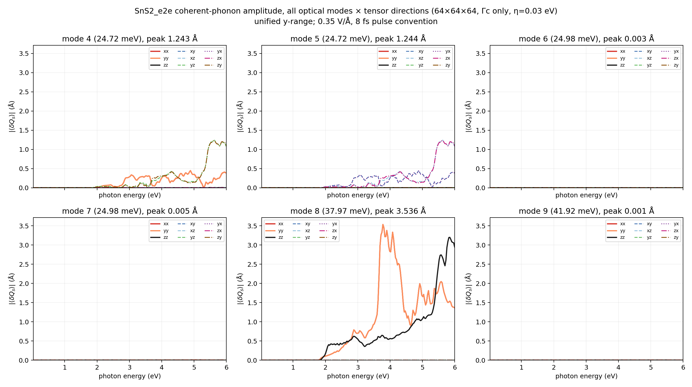
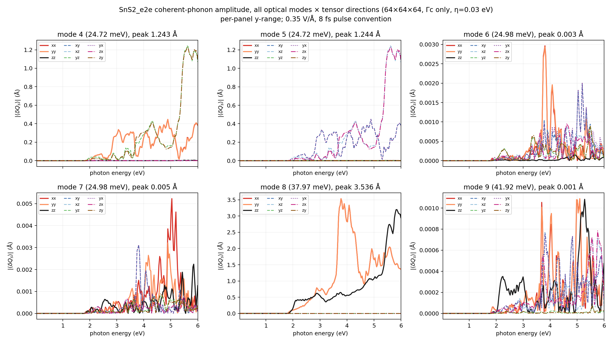
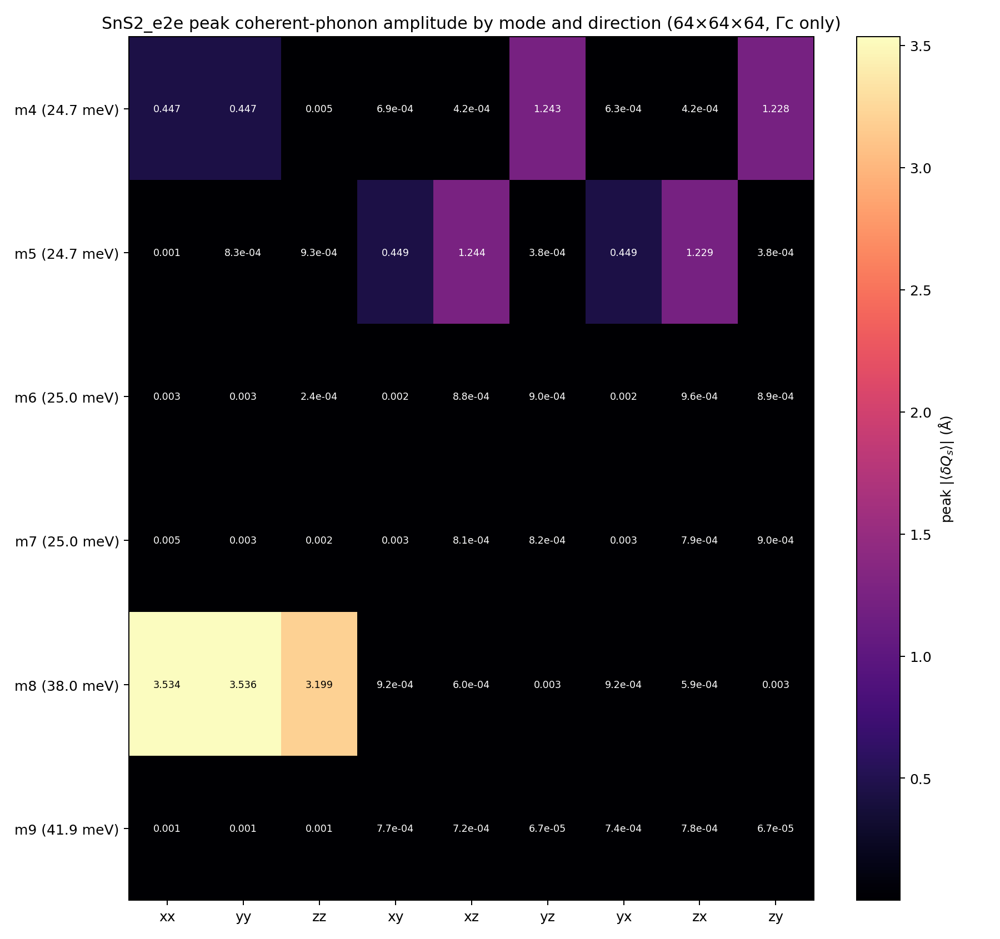
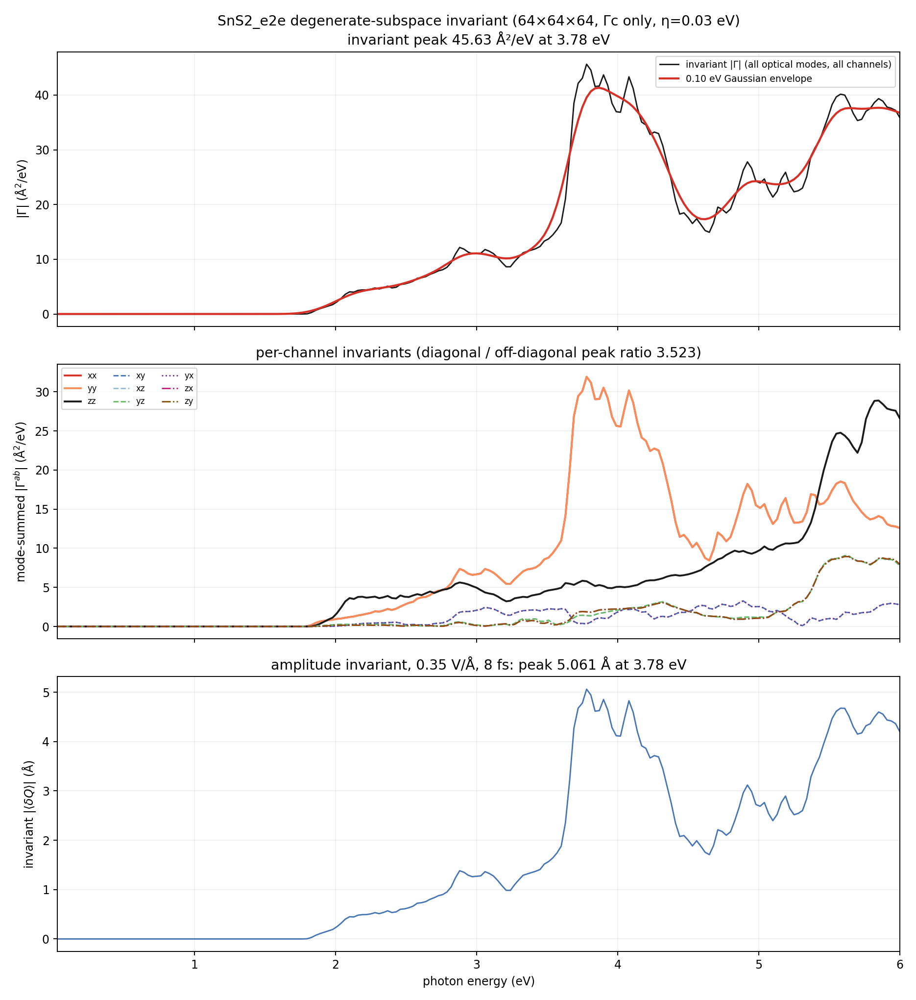
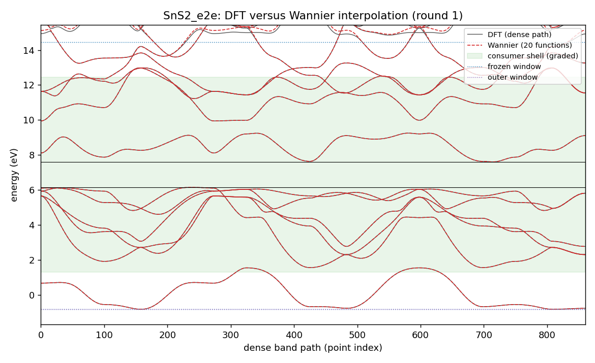
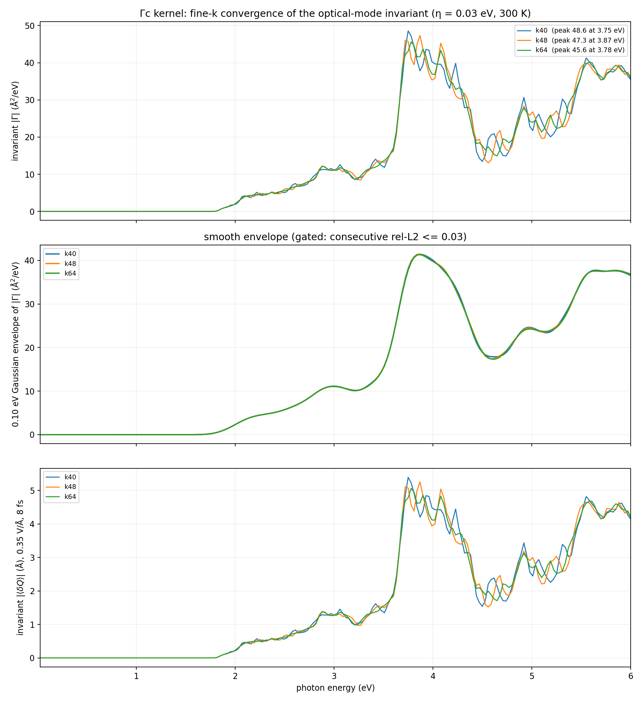
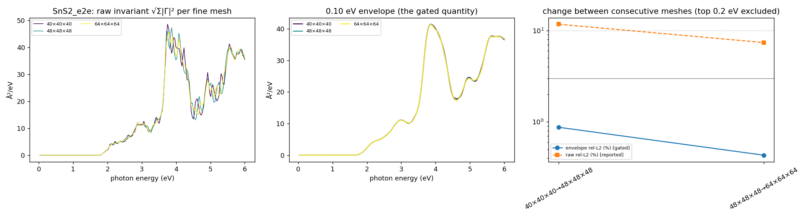

# SnS2_e2e coherent-phonon report — Gamma-only DFPT, scalar Wannier state, 0.03–6 eV Γc kernel

Generated 2026-10-14T21:37:21+02:00 by `workflow/lib/report.py` from the files under `<cophon>/benchmarks/cophon_bench/e2e_library/SnS2_e2e`. Every number below is read from a result or gate file; nothing is typed in by hand.

**Outcome: SnS2_e2e has a Γc coherent-phonon kernel on the 64×64×64 fine k-mesh.** 6 optical Γ-point modes (24.72, 24.72, 24.98, 24.98, 37.97, 41.92 meV) over 0.03–6.00 eV at 300 K with 0.03 eV smearing. The basis-independent invariant peaks at 3.78 eV (45.63 Ų/eV); under the 0.35 V/Å, 8 fs pulse convention the invariant amplitude peak is 5.061 Å at 3.78 eV (largest single mode 3.536 Å). First non-zero response at 1.77 eV. Between the last two meshes (k48 → k64) the 0.10 eV envelope changes by 0.43 % (limit 3 %; raw spectrum 7.4 %), so the kernel is converged on the envelope.

Scope: Γc only (no Γe vertex correction), scalar-relativistic, PBE gap, Gamma-only DFPT (one q-point, `ldisp = .true.`, `nq = 1 1 1`); velocities from EPW's `vme = 'dipole'` route (the full velocity i[H,r], non-local pseudopotential commutator included, computed on the coarse mesh and Wannier-interpolated; origin-free).

## Standard all-mode result (64×64×64)

| Quantity (64×64×64, 0.03 eV smearing, 300 K) | Value |
|---|---|
| Invariant \|Γ\| peak | 45.63 Ų/eV at 3.78 eV |
| Envelope (0.10 eV) peak | 41.33 Ų/eV at 3.87 eV |
| Invariant amplitude peak (0.35 V/Å, 8 fs) | 5.061 Å at 3.78 eV |
| Per-mode amplitude peaks (basis-dependent split) | 1.243 / 1.244 / 0.003 / 0.005 / 3.536 / 0.001 Å |
| Mode-summed channel peaks, diagonal (xx, yy, zz) | 28.88–31.93 Ų/eV |
| Mode-summed channel peaks, off-diagonal (xy, xz, yz, yx, zx, zy) | 3.27–9.06 Ų/eV |
| Diagonal / off-diagonal peak ratio | 3.523 |
| First non-zero response | 1.77 eV |
| Photon grid | 0.03–6.00 eV, 200 points |

## Electronic structure and Wannier state

| Quantity | Value |
|---|---|
| PBE band edges (VBM / CBM) | 6.151 / 7.603 eV (gap 1.452 eV) |
| Consumer shell (must be interpolated well) | 1.30 … 12.45 eV |
| Frozen / outer window | -0.81 … 14.45 eV / -0.81 … 26.44 eV |
| Wannier functions | 20 (Sn:s;p, S:p;d); recipe source: v1.1 |
| Accepted Wannier round | round 1 (1 round gate on file, including any before an electron recompute); max spread 2.72 Ų, band RMS 1.4 meV, worst 9.8 meV in the shell (limits 10 Ų, 50 / 25 meV) |
| EPW-side interpolation (same shell, from the EPW1 Wannier files) | RMS 1.4 meV, worst 9.9 meV → PASS |

## Γ-point phonons (DFPT)

| Mode | ω (cm⁻¹) | ω (meV) |
|---|---:|---:|
| optical 4 | 199.34 | 24.72 |
| optical 5 | 199.34 | 24.72 |
| optical 6 | 201.67 | 25.00 |
| optical 7 | 201.67 | 25.00 |
| optical 8 | 306.22 | 37.97 |
| optical 9 | 338.25 | 41.94 |

Acoustic sum rule applied (dynmat.x); acoustic modes after ASR -0.00, -0.00, 0.00 cm⁻¹ (raw 5.96, 6.13, 6.13 cm⁻¹). ε∞ diagonal 8.39, 8.39, 5.63; largest |Z*| 4.91; polar: True. Gate: PASS. Softness: stiff (tier 0).

## Velocity-route check

Wannier centres sit up to 5.58 Å from the cell origin (b·r max 0.97); EPW's `wannier` velocity route would carry an origin-dependent error of about 16 % at worst (6.6 % on average) for this cell — above the warning level.

| Adopted mesh | Production route | Other route | Envelope difference | Tensor difference | Invariant peak (production / other) | Forbidden-channel ratio (production / other) | Verdict |
|---|---|---|---:|---:|---|---|---|
| k64 | dipole | wannier | 3.1 % (limit 5 %) | 7.4 % | 45.63 / 45.59 Ų/eV | 3.523 / 3.337 | PASS |

Reading: the two velocity routes agree.

## Fine-k convergence

Convergence is judged on the 0.10 eV Gaussian envelope of the invariant (gate: consecutive rel-L2 <= 0.03); the raw rel-L2 is reported, not gated.

| Meshes | raw rel-L2 | raw Pearson | envelope rel-L2 | envelope peak | gate |
|---|---:|---:|---:|---|---|
| 40×40×40 → 48×48×48 | 0.117 | 0.987 | 0.009 | 41.44 → 41.44 Ų/eV, 3.87 → 3.87 eV | PASS |
| 48×48×48 → 64×64×64 | 0.074 | 0.995 | 0.004 | 41.44 → 41.33 Ų/eV, 3.87 → 3.87 eV | PASS |

Per-mesh overlay of the raw invariant, its envelope, and the change between consecutive meshes (the top 0.2 eV of the window is excluded from the gate):

## What was done

1. **intake**: ACCEPTED — SnS2 sg 164 nbnd 33
2. **relax**: ACCEPTED, job 22819885 (debug, COMPLETED) — max force 4.13e-06 Ry/bohr, pressure 21.57 kbar (cell PBEsol, ions PBE)
3. **electron**: ACCEPTED, job 22819970 (debug, COMPLETED) — gap 1.452 eV; PDOS 5 shells; trim: 7 bands excluded (gap 4.064 eV); v1.1 recipe from the superset stage
4. **wannier**: ACCEPTED, job 22820444 (small, COMPLETED) — round 1: score 0.14 <= 0.9 (W7); wout_present=ok; final_state=ok; num_wann_in_wout=ok; spread_max=ok; plateau_drift=ok; localisation_converged=ok; ran_out_of_steps=ok; all_done=ok; comparison_present=ok; comparator_build=ok; dense_reference_certified=ok; band_rms_meV=ok; band_worst_meV=ok; grids_equal=ok; num_wann_compared=ok; scor
5. **phonon**: ACCEPTED, job 22820119 (debug, COMPLETED) — max 338.25 cm-1; polar=True; softness stiff -> tier 0
6. **epw1**: ACCEPTED, job 22821598 (standard, COMPLETED) — restart written; EPW bands within the shell bars
7. **kernel**: ACCEPTED, job 22843666 (standard, COMPLETED) — converged at k64: envelope change 0.0043 <= 0.03 with previous 0.0087 <= 0.1; velocity-route check PASS (envelope 3.1 %, tensor 7.4 %)
8. **report**: PENDING
9. **anharmonic**: SKIPPED — tier 0: softness stiff (anharmonic off by config)
10. **rekernel**: SKIPPED — tier 0: softness stiff (anharmonic off by config)
11. **superset**: ACCEPTED, job 22820116 (small, COMPLETED) — superset 22 functions; round-1 recipe v1.1 default: 20 functions (reduced), Pmin 12

Wannier recipe (round 1, source v1.1: ['superset: d dropped from Sn (27 functions > 26 kept bands)', "Pmin (kept bands at or below target top + 2 eV = 14.45 eV, worst k) = 12; PDOS picks ['S:p', 'Sn:p', 'Sn:s'] = 10", 'added S:d: P = 20']): 20 functions, projections ['Sn:s;p', 'S:p;d'], exclude_bands [1, 2, 3, 4, 5, 6, 7], outer window [-0.814, 26.4403] eV, frozen window [-0.814, 14.451] eV, consumer shell [1.303, 12.451] eV.

Electronic policy: ecutwfc 72 Ry, ecutrho 288 Ry, SCF mesh [10, 10, 6], NSCF mesh [10, 10, 6], nbnd 33, relax `vc`, spacegroup P-3m1 (164), nat 3.

## Validation gates

| Gate file | Status | Key numbers | Reasons |
|---|---|---|---|
| `gate_electron` | PASS | — | — |
| `gate_epw1` | PASS | — | — |
| `gate_kernel_k40` | PASS | — | — |
| `gate_kernel_k48` | PASS | — | — |
| `gate_kernel_k64` | PASS | — | — |
| `gate_kernel_k64_eta030` | PASS | — | — |
| `gate_phonon` | PASS | optical_max_cm1 338.2; acoustic_cm1_asr [-0.0, -0.0, 0.0]; max_abs_zstar 4.913; polar True | — |
| `gate_relax` | PASS | — | — |
| `gate_relax_ions` | PASS | — | — |
| `gate_route_check` | PASS | — | — |
| `gate_superset` | PASS | — | — |
| `gate_wannier_round1` | PASS | — | — |

Standing limits: Wannier spreads <= 10 Ų, band RMS <= 50 meV and worst <= 25 meV in the consumer shell, Γ acoustic modes within 1 cm⁻¹ after ASR, envelope rel-L2 <= 0.03.

## Scope, limits, and next safe action

- **Γc only.** The triangle term Γc is computed; the vertex correction Γe is absent.
- **Scalar-relativistic, PBE gap.** No spin-orbit coupling and no gap correction; the onset follows the PBE gap, so absolute peak positions cannot be compared with experiment without a scissor.
- **Gamma-only DFPT.** Phonons are computed at q = 0 only; the LO–TO splitting is not resolved at exactly Γ and no off-Γ stability check exists in this route.
- **Forbidden-channel residual.** Diagonal / off-diagonal mode-summed peak ratio 3.523; which channels are symmetry-forbidden depends on the point group and must be judged for this material.
- **Convergence.** Envelope rel-L2 0.0043 and raw rel-L2 0.074 between 48×48×48 and 64×64×64.

## Run record

- Workflow baseline at creation: v2.0.4 (sealed 2026-10-14, manifest `999632d99ae5…`, tree clean)
- Cell policy: measured (cell relaxed with PBEsol, internal coordinates and every later stage with PBE); production cell: pbesol; PBEsol cell kept: measured lattice unavailable (COD query failed: URLError: <urlopen error [Errno 104] Connection reset by peer>)
- Phonon tier: 0 (softness stiff, lowest optical mode 199.34 cm⁻¹, threshold 60.0 cm⁻¹)
- Material workflow dir: `<cophon>/benchmarks/cophon_bench/e2e_library/SnS2_e2e`
- LUMI run root: `/scratch/project_<id>/<user>/theory2code/cphon/runs/SnS2_e2e/wf`
- Job ledger: `JOB_LEDGER.md` (one row per submitted job)
- Jobs: electron 22819970 (debug, COMPLETED); epw1 22821598 (standard, COMPLETED); kernel 22843666 (standard, COMPLETED); phonon 22820119 (debug, COMPLETED); relax 22819885 (debug, COMPLETED); superset 22820116 (small, COMPLETED); wannier 22820444 (small, COMPLETED)
- Kernel files (SHA-256): k40 `343d98420f34…`; k48 `364e83d52ef1…`; k64 `614d26ca690b…`
- 2026-10-14T20:09:53+02:00: kernel:PENDING — k40 accepted; ladder continues with k48
- 2026-10-14T20:09:59+02:00: kernel:SUBMIT — job 22840529 on debug in /scratch/project_<id>/<user>/theory2code/cphon/runs/SnS2_e2e/wf/kernel
- 2026-10-14T20:22:11+02:00: kernel:COLLECTED — k48: 31 files pulled
- 2026-10-14T20:22:11+02:00: kernel:PENDING — k48 accepted; ladder continues with k64
- 2026-10-14T20:22:18+02:00: kernel:SUBMIT — job 22841327 on standard in /scratch/project_<id>/<user>/theory2code/cphon/runs/SnS2_e2e/wf/kernel
- 2026-10-14T21:02:48+02:00: kernel:COLLECTED — k64: 41 files pulled
- 2026-10-14T21:02:48+02:00: kernel:PENDING — converged at k64: envelope change 0.0043 <= 0.03 with previous 0.0087 <= 0.1; velocity-route check queued at k64
- 2026-10-14T21:02:54+02:00: kernel:SUBMIT — job 22843666 on standard in /scratch/project_<id>/<user>/theory2code/cphon/runs/SnS2_e2e/wf/kernel
- 2026-10-14T21:37:19+02:00: kernel:COLLECTED — k64_eta030: 51 files pulled
- 2026-10-14T21:37:19+02:00: kernel:ACCEPTED — converged at k64: envelope change 0.0043 <= 0.03 with previous 0.0087 <= 0.1; velocity-route check PASS (envelope 3.1 %, tensor 7.4 %)
