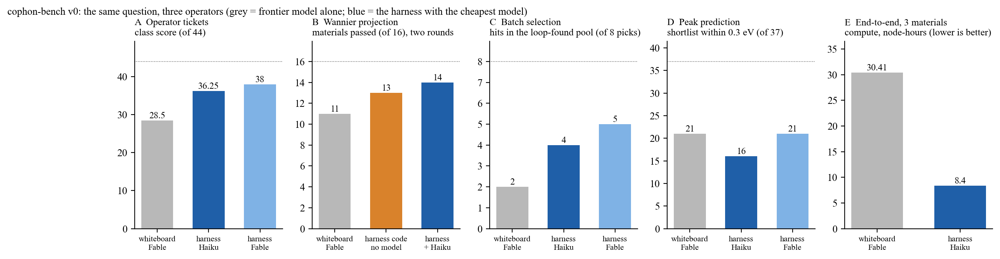
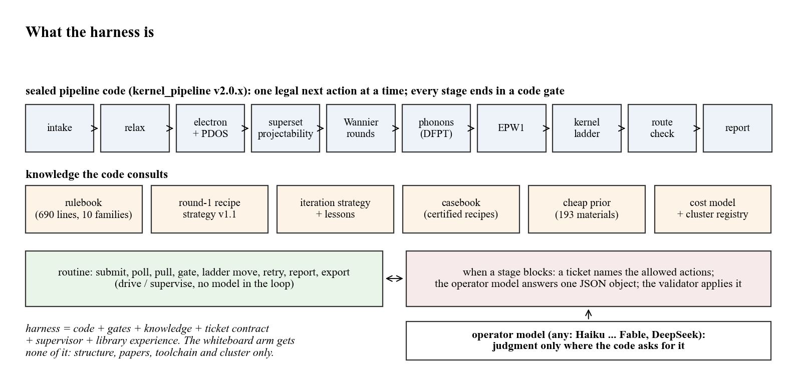
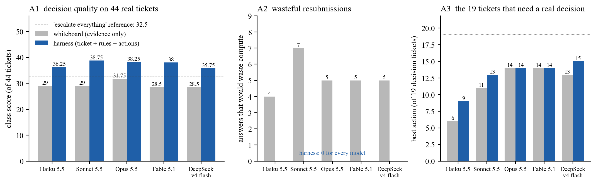
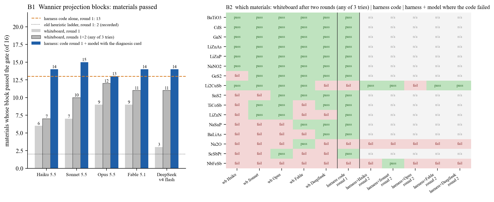
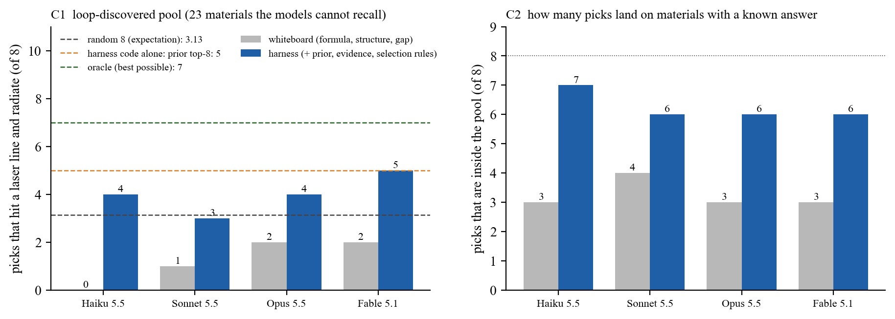
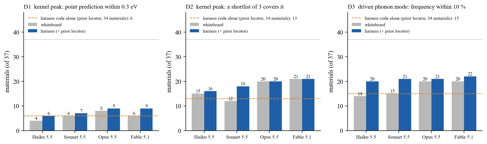
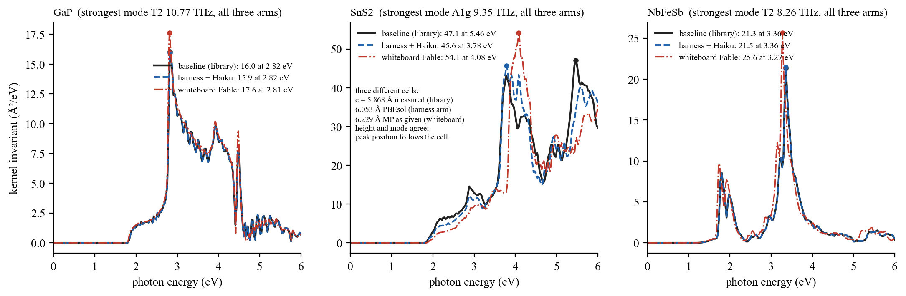
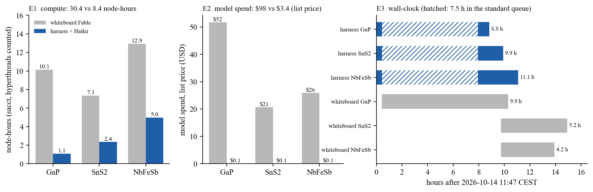
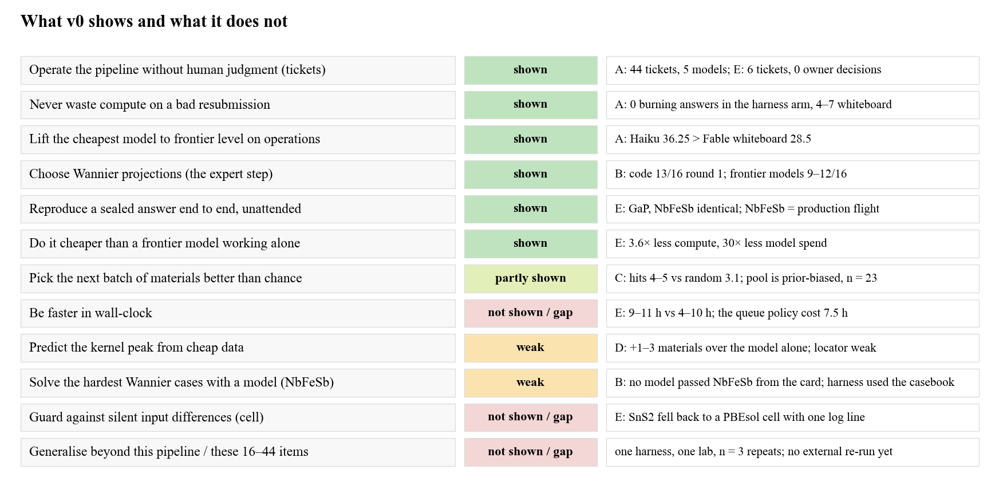

# cophon-bench v0：相干声子太赫兹材料 AI 研发系统的第一组能力基准

版本 v0.1（第一个关键点，2026-10-15）· Atomost · cophon 项目 · 线 5（基准）
作者：Claude Fable 5.1（agent），所有者审阅前的版本；所有数字出自 `tables/` 下冻结的判分表，图由 `cophon_bench/figures_v0.py` 从这些表生成。

---

## 一页读完

我们做了一套流水线式的"harness"，让一个大模型在它里面当操作员，把一个晶体从结构一路算到光致相干声子生成核。这份基准回答两个问题：同一个模型，放进 harness 和不放进去，差多少；harness 里换最便宜的模型，能不能达到最强模型单干的水平。五道题、五个模型、两种臂，共 1856 份模型答案、75 节点时集群计算、三条无人值守的端到端飞行，结果如下。



图 1 · 五道题的主指标，同一问题三种答法：灰色是最强模型（Fable 5.1）单干，深蓝是 harness 加最便宜的模型（Haiku 5.5），浅蓝是 harness 加 Fable。A 运维决策、B Wannier 投影、C 选材、D 峰位预测、E 端到端。

- 运维决策（A，44 张真实工单）：harness 里的 Haiku 36.25 分，白板的 Fable 28.5 分，满分 44。白板臂每个模型都有 4 到 7 张票会白白重提计算，harness 臂五个模型一张都没有。
- Wannier 投影（B，16 个材料）：harness 的代码配方不用模型第 1 轮过 13 个；最强的白板模型两轮后 11 到 12 个；harness 里 Haiku 两轮 14 个。
- 选材（C，循环自己发现的 23 个材料）：白板 Fable 8 个里命中 2 个，harness 里的 Haiku 命中 4 个，harness 加 Fable 命中 5 个。
- 峰位预测（D，37 个材料）：差别小。harness 让每个模型多对 1 到 3 个，前沿模型白板已经和 harness 的定位器一样好。
- 端到端（E，三个材料）：两边都算到了同样的物理，harness 加 Haiku 用了 8.4 节点时、3.4 美元模型费、零次人工判断；白板 Fable 用了 30.4 节点时、98 美元、前沿模型。墙钟不是 harness 的赢面，排队吃掉了 7.5 小时。

两个角度的结论：角度一（harness 加 Claude 对白板 Claude）在 A、B、E 上成立，在 C 上部分成立，在 D 上不成立；角度二（harness 把低端模型抬到前沿水平）在 A、B、E 上成立。这份基准没有证明的东西列在附录 A。

---

## 1. 项目背景

Atomost 的 cophon 项目在找能做太赫兹源的材料。物理图像是这样的：一束飞秒激光打进晶体，光子能量落在电子跃迁的共振区时，电子会把一部分能量交给晶格，驱动某一支光学声子整齐地振动；如果这支声子带电荷，振动就向外辐射太赫兹波。哪种材料、哪个光子能量、驱动哪支声子、驱动得多强，由一个叫生成核的量 Γ(ω) 决定。它可以从第一性原理算出来（Hu、Guo、Li、Wang、Chang 的理论与作者的 EPW 实现），但算一次要经过弛豫、电子结构、Wannier 插值、声子、电声耦合、核的网格收敛等十来个阶段，每个阶段都有人工经验在里面。2026 年 7 月我们算出第一个核，到 9 月中旬手工加 agent 做了约 5 个材料；9 月 18 日起把流程封成代码，到 10 月 13 日库里有 50 个核。

项目分四条线：方法预研（休眠）、从结构到核的生产流水线（本基准的对象，线 2）、声子介导的二阶非线性响应（线 3）、器件出耦（外部论证中）。所有者 10 月 14 日提出，线 2 的流水线和它上面的主动学习循环要提升为"相干声子太赫兹材料 AI 研发系统"的一部分。这个系统不训练大模型，它是 harness 级的：能力在流程、规则、经验和判据里，模型只在几个判断点出力。要说服投资人和我们自己，先要有基准。本报告是第一组。

## 2. harness 是什么



图 2 · harness 的组成。上排是封存的流水线代码的十个阶段，每个阶段结束于一道代码判据（门）；中排是代码在决策点查阅的知识；下排是无人值守的例行循环，以及阶段卡住时发给操作员模型的工单。模型只在工单处出力。

把图 2 讲成话：

- 流水线代码（kernel_pipeline v2.0.x）读一个状态文件，推出唯一合法的下一步，执行它，再看结果。每个阶段的产出要过一道门：弛豫的力和压力、Wannier 插值带与 DFT 带的偏差、声子的声学和规则、核的网格收敛。门是代码，不是模型的意见。
- 代码查阅的知识：690 行规则库（十族规则，每条有编号，提案必须引用）；第 1 轮 Wannier 配方策略 v1.1（从投影度表直接写出投影块，不用模型）；失败后的迭代策略与经验记录；案例库（历史上过了门的配方，可移植到同类材料）；193 个材料的廉价 prior（电子结构阶段算出的共振位置、被驱动模式、激光线匹配与成本估计）；成本模型与集群注册表。
- 例行循环（supervise）自己提交、轮询、拉回、过门、沿梯子走、重试、写报告、导出。循环里没有模型。
- 工单合同：某阶段卡住时，代码写一张工单，列出诊断和允许的动作（同轮重提、改参数重跑、提案、临时接受、等待、升级给所有者……）。操作员模型在全新的短上下文里读工单，回一个 JSON 对象；校验器验过才应用。模型答错格式或答了不允许的动作，校验器拒绝。
- 操作员模型可以是任何模型。本基准用了 Haiku 5.5、Sonnet 5.5、Opus 5.5、Fable 5.1 和 DeepSeek v4 flash。

白板臂拿到什么：晶体结构、论文正文与补充材料、作者的实现笔记、同一套 QE/EPW 工具链与超算、同样的算力上限。拿不到的：流水线代码、规则、策略、案例库、prior、工单、材料库里的经验。这样比出来的差距才是 harness 的差距，而不是有没有超算的差距。

## 3. 基准怎么设计

三条规矩贯穿五道题。标签和判分代码在任何白板运行之前冻结（sha256 清单在 `FREEZE.sha256`）；判分一律用流水线自己的门和校验器，不用模型当裁判；每道题每个模型每臂答三次取中位。急，所以尽量用池子里已有的答案，不为基准新算核：A、C、D 零算力，B 只跑分钟级的串行 wannier90，E 是三个便宜材料的活飞。

| 题 | 问什么 | 池子 | 白板臂拿到 | harness 臂拿到 | 判分 | 算力 |
|---|---|---|---|---|---|---|
| A 运维决策 | 流程卡在某阶段，下一步做什么 | 44 张真实工单（19 张 10-12 以前，25 张 10-13/14 的活工单） | 同样的证据（作业日志尾、门文件、配方）和一套通用动作词表 | 工单、规则、允许的动作 | 每张票一个"最佳动作"集、"可接受"集、"错误"集；最佳 1 分、可接受 0.5、错 0、不答 −1 | 0 |
| B Wannier 投影 | 给材料的投影度证据表，定投影块 | 16 个材料（10-12 实验留下的重叠矩阵） | 证据表 | 代码配方 v1.1 先答；失败后模型拿诊断卡按规则 IT1–IT6 定下一轮 | wannier90 跑出来的分数 ≤ 0.9、散开度 ≤ 10 Ų（流水线的门） | 332 个块，24 个作业，35.8 节点时 |
| C 选材 | 从候选池挑 8 个最可能成为实用太赫兹源的材料 | 37 个已算出核的材料 | 化学式、结构、带隙 | 另加 prior、证据、选材规则 | 筛选基线 v2 定义 v2.1 的主分、promising 标记、"激光线命中且辐射" | 0 |
| D 峰位预测 | 预测核峰的光子能量和被驱动模式 | 37 个材料 | 结构与化学 | 另加 prior 的带边定位器 | 点预测 ±0.3 eV、短名单（≤3）±0.3 eV、模式频率 ±10% | 0 |
| E 端到端 | 从结构算到核 | GaP、SnS2、NbFeSb（答案封在库里） | 结构、论文、工具链、超算、20 节点时上限 | 流水线 + Haiku 当操作员，无人值守 | 峰位 ±0.15 eV、峰高 ±25%、同一支模式（±5%）算同一答案；Wannier 用流水线的门复判；节点时按 sacct | 39 节点时 |

公平性的几点说明。A 的白板答案是自由文本，按冻结的映射表映射到工单的动作类再判。B 的白板投影块只允许超集范围内的壳层（每元素 s/p/d 加间隙 s），超出的也跑，只是另算重叠矩阵。E 的白板臂是无头会话，在仓库之外的独立目录里启动，任务书写明禁区，每 30 分钟扫一次完整的工具调用记录查隔离；三份转录 321 轮、297 次工具调用，0 次碰到禁区。E 两臂的节点时同按超算账单（CPUTimeRAW/128，超线程也算进去，是保守上界）。

## 4. 结果

### 4.1 运维决策（A）



图 3 · 44 张真实工单。A1 类别分；虚线是"所有票都升级给所有者"这个保守策略的得分。A2 会白白重提计算的答案数。A3 只看 19 张必须自己拿主意的决策票时的最佳动作数。

harness 臂五个模型挤在 35.75 到 38.75 分，白板臂 28.5 到 31.75 分，中间隔着"全部升级"的 32.5。差距有三层。第一层是边界：44 张票里 25 张的最佳动作就是升级，这是流水线的设计（构建层和所有者的事不让操作员碰），白板模型不知道边界，常常在该停下问人的时候去重提。第二层是算力：白板臂每个模型 4 到 7 张票会白烧算力，harness 臂零张。第三层是判断本身：只看 19 张决策票，前沿模型在白板和 harness 里一样好（Fable 14 对 14，Opus 14 对 14），Sonnet 从 11 到 13，Haiku 从 6 到 9，DeepSeek 从 13 到 15。老实说，在"判断"上 harness 对前沿模型的增量很小；它的价值在 A 里是边界、合法性和零浪费，以及把 Haiku 和 Sonnet 拉近前沿。

过程里出过一件事要交代：第一次并表时 77 个答案是空的，51 个是 Claude 订阅的 5 小时额度用尽后的空回复，8 个被 6 轮工具上限截断，18 个是 DeepSeek 的推理吃光了输出长度。全部重答后才出表，原件留在 `results/a/_bad_r1/`。

### 4.2 Wannier 投影（B）

Wannier 投影块是整条流水线最需要专家经验的一步：选错了，插值带对不上 DFT 带，后面的电声耦合全错。B 题把 16 个材料的投影度证据表给模型，让它定投影块，再用流水线的门判。



图 4 · B1 每个模型过门的材料数：白板第 1 轮、白板两轮累计（三次里任一次过）、harness（代码第 1 轮 13 个，加上模型拿诊断卡做第 2 轮）。橙色虚线是 harness 代码不用模型的 13，点线是旧版启发式梯子的 2。B2 逐材料：左五列白板两轮，中间一列 harness 代码第 1 轮，右五列代码失败的三个材料由各模型拿诊断卡再做。

代码配方 v1.1 不用模型第 1 轮过 13 个，白板最强的模型第 1 轮过 9 个、拿到自己的打分结果再答一轮后 11 到 12 个；Haiku 白板两轮只有 7 个，harness 里是 14 个。按材料看，五个白板模型都做对的只有 6 个简单 sp 体系；含 d 壳层或空隙态的 NbFeSb、ScSbPt、BaLiAs、Na2O 这类，白板几乎全军覆没。harness 把"模型的判断"只留给代码失败的 3 个材料，其中 Li2CuSb 四个模型拿诊断卡都做出来了，Na2O 五个模型都没做出来（实验记录里它是第 3 轮才过，本次只跑了两轮），NbFeSb 只有 Sonnet 三次里过了一次。

要记两笔不漂亮的账。最后两个块两次没出结果，查看工作目录才发现是集群节点的启动故障挂死了打包作业，第三次重提 12 分钟就跑完了（都没过门）；打包作业每一步该有自己的超时，这是 harness 的待改项。DeepSeek 第 1 轮 48 份答案 28 份解析不出格式，第 2 轮按格式答出来后从 3 个跳到 11 个，这个跳跃主要是格式，不是判断。

### 4.3 选材（C）



图 5 · 从候选池挑 8 个。C1 只看主动学习循环自己发现的 23 个材料（模型记不住这些），命中数是"有商用激光线共振且被驱动模式辐射"的个数；三条虚线是随机 8 个的期望、harness 代码按 prior 分数取前 8、以及按新版评分的最优 8 个（神谕）。C2 模型挑的 8 个里落在池内（答案已知）的个数。

全池 37 个材料里有 LiNbO3、KNbO3、BaTiO3、NbOI2 这类模型记得住的明星材料，白板模型靠记忆就能拿分；剔除后只看循环自己发现的 23 个，白板模型 8 个里只有 3 到 4 个落在池内，命中 0 到 2 个；harness 臂 6 到 7 个落在池内，命中 3 到 5 个，prior 本身的前 8 命中 5 个，最优可能是 7 个。角度二在这里成立（Haiku 4 对 Fable 白板 2），但要看到两件事：prior 的前 8 一个 promising 都没有（prior 优化的是"商用线共振乘辐射"，不是新版评分的主分），这是 prior 的已知局限；池子本身是循环按旧 prior 挑出来算的，promising 的材料 37 个里只有 4 个、23 个里只有 1 个，题目的区分度低，模型挑到池外的材料没有真值、只能不计分。这一条在附录 A 里展开。

### 4.4 峰位预测（D）



图 6 · 预测核峰的光子能量和被驱动声子模式，37 个材料。虚线是 harness 的 prior 定位器不用模型的成绩（34 个有数据）。

这是 harness 增量最小的一道题。点预测多对 1 到 3 个，模式频率多对 2 到 6 个，峰位误差中位从约 1.0 eV 降到约 0.7 eV。前沿模型白板的短名单（21 对 37）已经和 prior 定位器（13 对 34）持平或更好。诚实的结论是：现在的定位器在这个池上不强（9 月分析的那批材料上是 10 对 12），D 不能拿来证明"harness 远超模型"，但 harness 加 Haiku（6 / 16 / 20）和白板 Fable（6 / 21 / 20）相当这一点成立。

### 4.5 端到端（E）

三个材料，答案封在库里，模型拿不到：GaP（2 原子闪锌矿，易）、SnS2（3 原子层状，中）、NbFeSb（3 原子半 Heusler，难：代码配方第 1 轮不过，历史上要靠诊断卡）。harness 臂是流水线加 Haiku 当操作员，无人值守；白板臂是 Fable 的无头会话，自己从结构算到核。



图 7 · 三个材料的核不变量谱（所有模式、所有通道的平方和开方），三条曲线：库里的基线、harness 加 Haiku、白板 Fable。白板的核文件用流水线自己的解析器重算，不用它报告里的数。

| 材料 | 臂 | 峰位 / 峰高（Ų/eV）/ 最强模式 | 对基线 | Wannier | 核网格 | 节点时 | 墙钟 | 人工触碰 | 模型花费 |
|---|---|---|---|---|---|---|---|---|---|
| GaP | harness + Haiku | 2.82 eV / 15.9 / T2 10.77 THz | 同一答案 | 12 个函数，代码配方第 1 轮过 | k96 收敛，两路复核过 | 1.08 | 8 h 49 min（7.5 h 排队） | 0 判断、1 写入 | ≈$0.1 |
| GaP | 白板 Fable | 2.81 / 17.6 / T2 10.735 THz | 同一答案 | 7 套试错后 10 个 SCDM 函数；复判过 | 192³（八级） | 10.1 | 9 h 53 min | 0 | $51.7（108 轮） |
| SnS2 | harness + Haiku | 3.78 / 45.6 / A1g 9.18 THz | 峰高、模式同；峰位差 1.68 eV（晶胞不同，见下） | 20 个函数，代码配方第 1 轮过 | k64 收敛，复核过 | 2.35 | 9 h 55 min（7.5 h 排队） | 0 判断、1 写入 | ≈$0.1 |
| SnS2 | 白板 Fable | 4.08 / 54.1 / A1g 9.20 THz | 峰高 +15%、模式同；峰位差 1.38 eV（晶胞又不同） | 3 套试错后 17 个函数；复判过 | 120×120×60（三级） | 7.35 | 5 h 11 min | 0 | $20.7（87 轮） |
| NbFeSb | harness + Haiku | 3.36 / 21.5 / T2 8.26 THz | 同一答案 | 24 个函数，配方来自案例库，第 1 轮过 | k64 收敛，复核过 | 4.97 | 11 h 05 min（7.5 h 排队） | 0 判断、1 写入 | ≈$0.1 |
| NbFeSb | 白板 Fable | 3.275 / 25.6 / T2 7.89 THz | 同一答案（峰高 +20%、模式 −4.5%，贴着容差边） | 3 套模型试后 22 个函数；复判过 | 96³（五级加交叉核对） | 12.9 | 4 h 11 min | 0 | $25.9（126 轮） |

基线：GaP 2.82 eV / 16.0 / T2 10.77 THz；SnS2 5.46 / 47.1 / A1g 9.35 THz；NbFeSb 3.36 / 21.3 / T2 8.26 THz。



图 8 · 成本。E1 节点时，E2 模型花费（list 价），E3 墙钟时间线，斜线段是 harness 臂的 EPW 作业在超算 standard 分区排队的 7.5 小时。

读数。角度二：Haiku 当操作员把三个材料从结构跑到核，全程没出一个错。流程只问了它六个同一种问题（EPW 排队过长怎么办），它六次都答"诊断"，和 Fable 影子一致。最硬的 NbFeSb 第 1 轮就过了 Wannier 门，因为配方取自案例库；这是 harness 攒下的经验在起作用，不是模型聪明。NbFeSb 的 harness 核与同一天同机同配方的生产飞行一字不差（21.49 对 21.49），这是可复现性的直接证据。角度一：三个材料白板 Fable 都算到了同样的物理，峰高、模式三个都对，GaP 和 NbFeSb 按规则是同一答案。差别在成本、模型档次和可复现性：节点时 30.4 对 8.4，模型费 98 美元对 3.4 美元（harness 的 3.4 还大半是影子模型），白板要前沿模型，harness 用最便宜的。白板的过程值得一看：GaP 七套 Wannier 试错、两次 EPW 起步失败自己修好；NbFeSb 做了五级网格加放大和自适应展宽交叉核对，报告质量不低。它贵、慢、不可复现、无人把关，但不是做不出来。

墙钟不是 harness 的赢面。白板 4 到 10 小时，harness 9 到 11 小时，大头是流水线把 EPW 派去 standard 分区排了 7.5 小时的队，白板走 small 分区和晚间的 standard 几乎没排。

SnS2 的峰位三次不同，原因是三个不同的晶胞。库里用的是 9 月底从晶体学数据库查到的实测晶胞（c = 5.868 Å）；harness 臂这次查询网络失败，流水线按规则退回 PBEsol 弛豫的晶胞（6.053 Å），只在日志记了一行；白板直接用 Materials Project 给的结构不弛豫（6.229 Å）。层状材料层间距差 3 到 6%，导带就变，峰位从 5.46 跑到 3.78 和 4.08 eV，而峰高（47 / 46 / 54）和 A1g 模式（9.2 到 9.35 THz）三次一样。这不是流程算错，但暴露了 harness 一个该改的地方：实测晶胞查不到时不该静默退回，该开票或在报告里醒目标出；下一版基准要把晶胞一起封进题目。我们没有按同一晶胞重跑（要再排一次 7 小时的队，结论已经清楚）。

### 4.6 费用与算力

| 项 | 数 |
|---|---|
| 模型答案 | 1856 份（A、B、C、D 全部轮次与重答，E 的工单中继） |
| 模型花费（list 价） | $519（A $314、B $145、C/D $56、E 中继 $3.4）；按模型 Fable $369、Opus $105、Sonnet $40、Haiku $2、DeepSeek $2 |
| 白板 E 三个会话 | $98.3（GaP $51.7、SnS2 $20.7、NbFeSb $25.9） |
| 超算（LUMI，sacct） | B 35.8 节点时（24 个作业）；E harness 臂 8.4；E 白板臂 30.4；A/C/D 零；合计 74.6 节点时 |
| 人工 | E 的 harness 臂：3 次应用答案、0 次所有者判断；白板臂 0 |

Claude 的调用走所有者的订阅，不按 list 价结账，但订阅的 5 小时额度窗是实打实的瓶颈，10 月 14 日两次用尽，共 91 个答案要重答。

## 5. 结论

角度一（harness 加 Claude 对白板 Claude）：在运维决策上，同一个模型进 harness 高 6.5 到 9.5 分，且不再白烧算力；在 Wannier 投影上，harness 的代码配方不用模型就超过任何白板模型两轮的成绩；在端到端上，同样的物理用 3.6 倍少的算力、30 倍少的模型费和可复现的过程得到。在选材上 harness 有增量但池子偏向，在峰位预测上没有明显增量。

角度二（harness 抬低端模型）：Haiku 在 harness 里的运维决策分超过白板的 Fable，Wannier 投影两轮 14 个材料对白板 Fable 的 11 个，端到端三个材料零错误、答案与前沿模型影子一致。这些数说明能力主要在 harness 里，模型可以换成最便宜的。

这组基准证明的是"在这条流水线、这批材料、这几个模型上"的事。它没有证明的事见附录 A。

---

## 附录 A · 能力边界与 harness 的不足



图 9 · v0 展示了什么、没展示什么。绿色有证据，黄色证据弱或部分，红色没有证据或是已知缺口。

### A.1 这份基准不能证明的

1. **墙钟更快。** 没有证明，甚至相反。harness 的队列策略把 EPW 派去 standard 分区，排了 7.5 小时；白板 4 到 10 小时。v2.0.3 已经支持 reservation 和按分区选择，v1 要把队列感知的分区选择纳入基准。
2. **选材比随机好多少。** 只能说 4 到 5 对随机 3.1，样本是 23 个材料，而且池子是循环按旧 prior 挑出来算的，promising 的只有 1 个。要去掉偏向，只能从 193 个 prior 材料里按不依赖 prior 的方式（随机或按化学分层）抽一批新算核来扩池，每个材料 1 到 5 节点时，10 个约 30 到 50 节点时。这违反 v0 的"不新算"约束，列为 v1 第一项，由所有者定。
3. **从廉价数据预测核峰。** prior 定位器在这个池上只有 6 / 34 的点预测，前沿模型白板已经与它持平。这是 prior 的弱点，不是 harness 的强项。
4. **模型拿诊断卡能解最难的 Wannier 案例。** NbFeSb 没有一个模型从诊断卡做出来（Sonnet 三次一次），harness 在端到端里靠的是案例库。迭代策略缺"d 壳层加空隙态"这类材料的教训。B 只跑了两轮，记录里第 3 轮才过的 Na2O 没给机会。
5. **harness 加 Fable 的端到端臂。** 没有单独跑：Haiku 的六个答案与 Fable 影子零分歧，两臂按设计等价，这是推断不是测量。
6. **推广到别的流水线、别的实验室。** 一个 harness、一个实验室、每题三次重复、44 张票、16 个材料、37 个材料、3 条飞行，模型版本是 2026-10-14 的快照。没有外部复跑。
7. **物理上对不对。** 基准判的是"与封存答案一致"，不是"与实验一致"。实验对标（NbOI2 模式与极化轴、MoS2 谱形、InP E1）是另一项工作，不在本基准里。核的绝对幅度没有实验锚点。
8. **省了多少人的时间。** 只记了"人工触碰"次数，没有记人的时间。

### A.2 过程里发现的 harness 不足

1. **晶胞静默退回。** 实测晶胞查不到时退回 PBEsol 晶胞只记一行日志，SnS2 的峰位因此移了 1.7 eV。该开票或醒目标出；基线要把晶胞封进去。
2. **打包作业一步挂死吃掉整个墙钟。** 两个 Wannier 块的 pw2wannier90 步在 srun 启动时失败（节点互连故障），作业挂到 6 小时墙钟到期，两次。每一步该有自己的超时，启动失败即退出。
3. **Wannier 任务的成本估计偏低。** 1 小时的包超时杀掉了 7 个任务，重打成 6 小时的包才跑完；全模式（要重算重叠矩阵）的任务该按更长的时间估。
4. **多峰谱按单一最大值判分脆。** SnS2 的谱有两个相近的峰，晶胞一变最大值就跳到另一个。v1 用包络或前两个峰判。
5. **订阅额度用尽时的空回复。** 运行器把它当答案写了文件，51 个答案作废重答。冻结后加了保护，报告"读法"段和 `FREEZE_NOTE.md` 披露了这两处冻结后的改动（解析容错、额度保护，判分标准未动）。
6. **白板隔离是程序性的，不是沙箱。** 无头会话在本机权限下做不了文件系统沙箱，也去不掉用户级全局指令文件（它提到 HPC 手册的路径）。隔离靠任务书禁区、独立目录和完整转录的事后审计；审计 0 命中，但这是审计而不是隔离。
7. **vme 选项。** 白板 GaP 选了原点依赖的 vme='wannier'（流水线规则是 'dipole' 并两路复核），这次没伤到结果；它说明规则库里的这一条确实是经验，不是常识。

### A.3 v1 要做的

把晶胞封进每道题；扩选材池（新算一批非 prior 挑的材料）；B 加第 3 轮；E 加 harness 加 Fable 臂和 2 到 3 个更难的材料，分区按队列选；打包作业每步超时；晶胞退回开票；多峰判分；把标签、判分器和复跑说明整理到可以让外部复跑的程度。

---

## 附录 B · 复现与文件索引

本目录（`benchmarks/cophon-bench-v0/`）是自包含的：

```
report/REPORT.md, report/SUMMARY.en.md, report/figures/     本报告、英文摘要、图（由 ../cophon_bench/figures_v0.py 生成）
REPORT_v0.md                                                 技术版记录（随结果逐段写成，含过程与更正）
E_DESIGN.md                                                  端到端题的设计
FREEZE.sha256, FREEZE_v0.1.sha256, FREEZE_NOTE.md            冻结清单与冻结后改动的披露
labels/                                                      冻结的标签：A 的工单与答案集，B 的 16 个材料证据表与记录，C/D 的材料真值
prompts/                                                     发给模型的提示（每题每臂）
results/a, results/cd, results/b, results/e                  模型答案、B 的提案与卡、E 的工单中继与白板交付件（results/b/runs 的原始 wannier90 输出只在本机）
tables/                                                      判分表：A_table, A_best, B_table, B_detail, B_cumulative_r2, C_table, D_table
e2e_library/                                                 E 的 harness 臂材料库（GaP_e2e, SnS2_e2e, NbFeSb_e2e）与时间线 E_TIMELINE.log
whiteboard/<M>/                                              白板臂的任务书、笔记、报告、作业日志、完整转录（隔离审计的证据）
logs/                                                        运行脚本与日志（含隔离审计脚本 wb_audit.py）
```

判分器在 `benchmarks/cophon_bench/`：`pillar_a.py`、`pillar_b.py`、`pillars_cd.py`，运行器 `run_models.py`，B 的集群运行时 `b_runtime/`，E 的工单中继 `ticket_relay.py`。重跑判分不需要集群：

```
PY=kernel_pipeline/.venv/bin/python; V=benchmarks/cophon-bench-v0
$PY benchmarks/cophon_bench/pillar_a.py grade  $V/results/a $V/tables --ext benchmarks/cophon_bench/tickets_ext
$PY benchmarks/cophon_bench/pillar_b.py grade  $V/labels $V/results/b/proposals_r2.json $V/results/b/runs $V/tables
$PY benchmarks/cophon_bench/pillars_cd.py grade $V/labels $V/results/cd $V/tables
$PY benchmarks/cophon_bench/figures_v0.py
```

项目的日常记录在仓库根目录的 `DECISION.log`、`RUNNING.log`（2026-10-14 与 10-15 的条目），基准方案在 `records/2026-10-14/0905-AI研发系统基准方案-意图-资产盘点-提速方案.md`。
