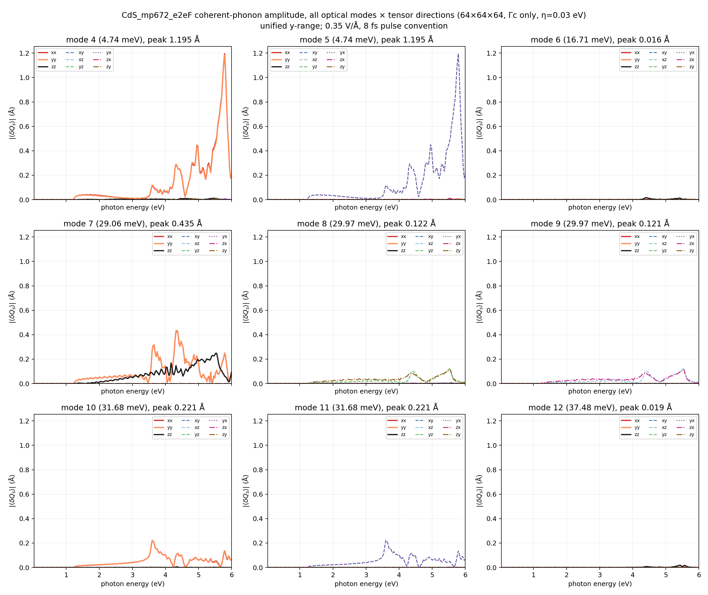
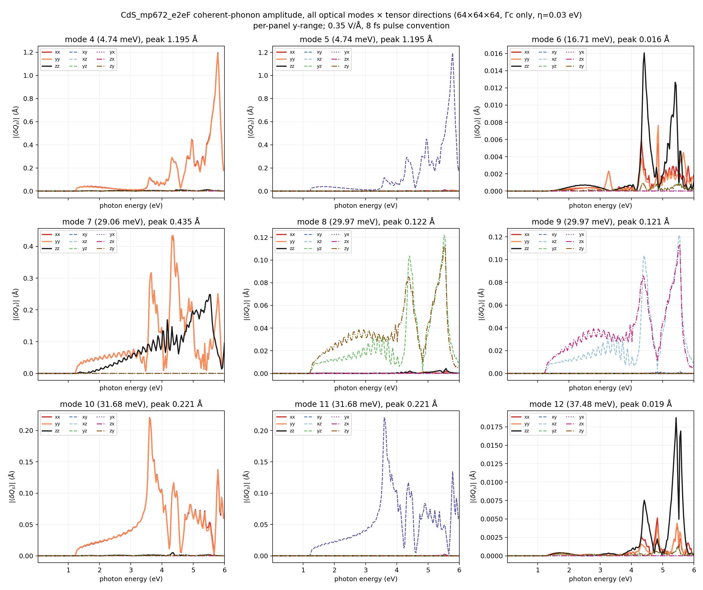
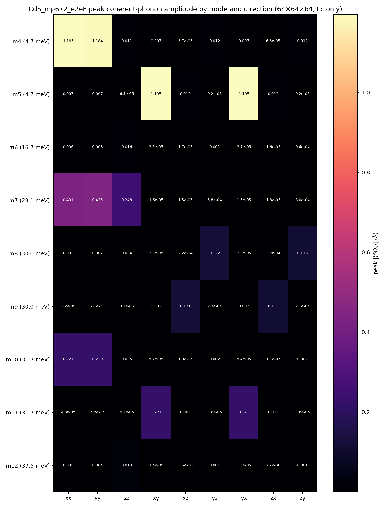
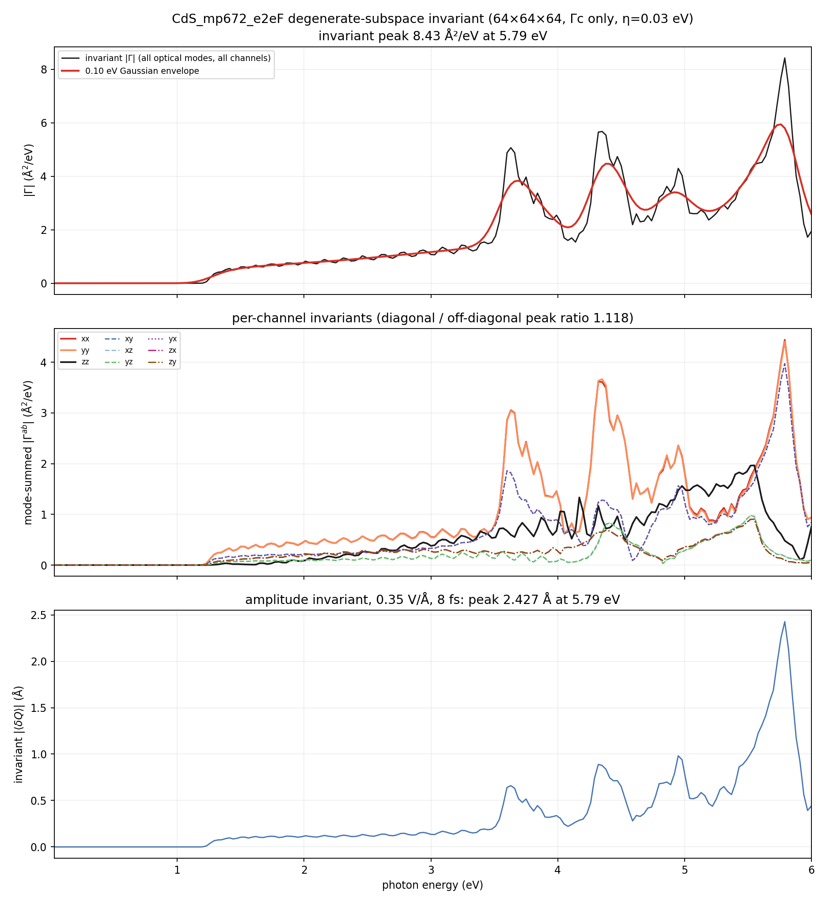
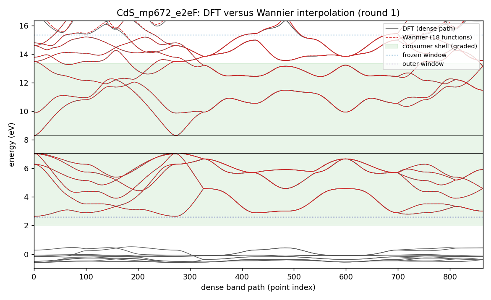
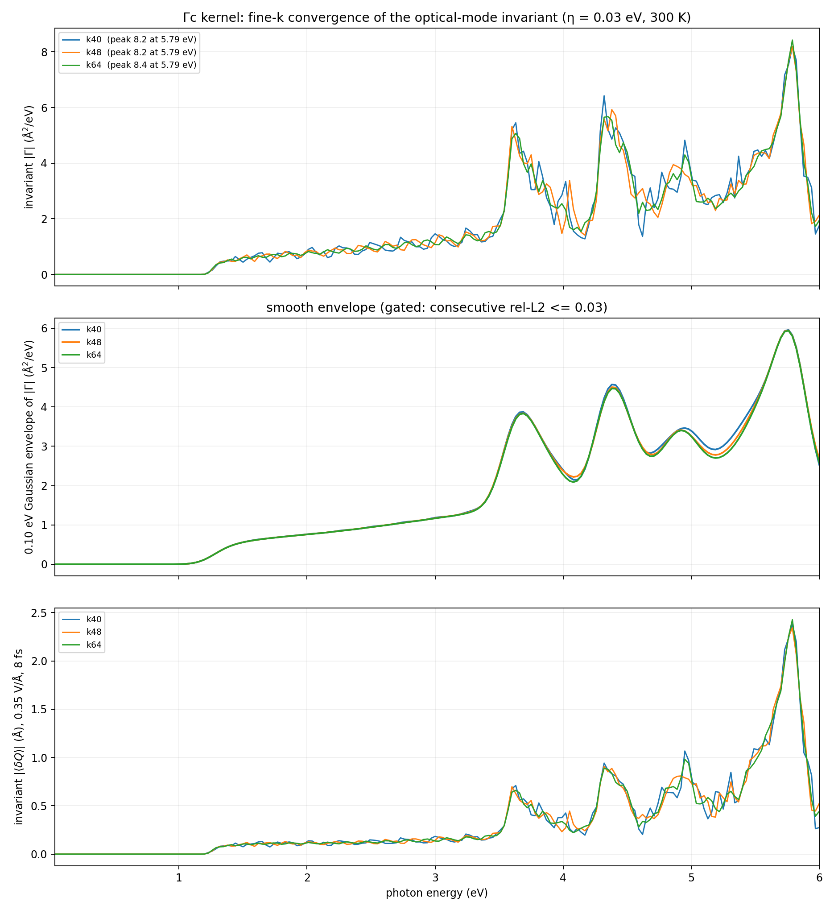
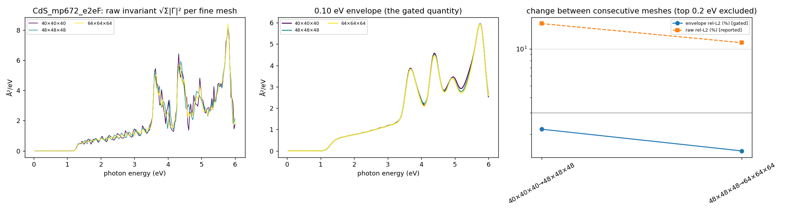

# CdS_mp672_e2eF coherent-phonon report — Gamma-only DFPT, scalar Wannier state, 0.03–6 eV Γc kernel

Generated 2026-10-15T13:52:07+02:00 by `workflow/lib/report.py` from the files under `<cophon>/benchmarks/cophon-bench-v1/e2e_library/CdS_mp672_e2eF`. Every number below is read from a result or gate file; nothing is typed in by hand.

**Outcome: CdS_mp672_e2eF has a Γc coherent-phonon kernel on the 64×64×64 fine k-mesh.** 9 optical Γ-point modes (4.74, 4.74, 16.71, 29.06, 29.97, 29.97, 31.68, 31.68, 37.48 meV) over 0.03–6.00 eV at 300 K with 0.03 eV smearing. The basis-independent invariant peaks at 5.79 eV (8.43 Ų/eV); under the 0.35 V/Å, 8 fs pulse convention the invariant amplitude peak is 2.427 Å at 5.79 eV (largest single mode 1.195 Å). First non-zero response at 1.17 eV. Between the last two meshes (k48 → k64) the 0.10 eV envelope changes by 1.46 % (limit 3 %; raw spectrum 11.2 %), so the kernel is converged on the envelope.

Scope: Γc only (no Γe vertex correction), scalar-relativistic, PBE gap, Gamma-only DFPT (one q-point, `ldisp = .true.`, `nq = 1 1 1`); velocities from EPW's `vme = 'dipole'` route (the full velocity i[H,r], non-local pseudopotential commutator included, computed on the coarse mesh and Wannier-interpolated; origin-free).

## Standard all-mode result (64×64×64)

| Quantity (64×64×64, 0.03 eV smearing, 300 K) | Value |
|---|---|
| Invariant \|Γ\| peak | 8.43 Ų/eV at 5.79 eV |
| Envelope (0.10 eV) peak | 5.94 Ų/eV at 5.76 eV |
| Invariant amplitude peak (0.35 V/Å, 8 fs) | 2.427 Å at 5.79 eV |
| Per-mode amplitude peaks (basis-dependent split) | 1.195 / 1.195 / 0.016 / 0.435 / 0.122 / 0.121 / 0.221 / 0.221 / 0.019 Å |
| Mode-summed channel peaks, diagonal (xx, yy, zz) | 1.97–4.44 Ų/eV |
| Mode-summed channel peaks, off-diagonal (xy, xz, yz, yx, zx, zy) | 0.90–3.97 Ų/eV |
| Diagonal / off-diagonal peak ratio | 1.118 |
| First non-zero response | 1.17 eV |
| Photon grid | 0.03–6.00 eV, 200 points |

## HARMONIC-ONLY result (rule T7)

**Read this before the numbers.** This is a soft-mode (tier-1) material, but the anharmonic renormalisation could not be trusted: the quartic force-constant fit on 8 displaced configurations at 0.04 Å softened the soft mode at zero temperature at every cutoff (4.0 Å: zero-point shift -1.2 cm⁻¹, all modes real at 0 K, lowest at 300 K -0.0 cm⁻¹; 3.5 Å: zero-point shift -1.2 cm⁻¹, all modes real at 0 K, lowest at 300 K -0.0 cm⁻¹; 3.0 Å: zero-point shift -1.2 cm⁻¹, all modes real at 0 K, lowest at 300 K -0.0 cm⁻¹), which the trust gate reads as a fitting artefact rather than physics (the loop would report an instability the harmonic DFPT does not show). The kernel below is the harmonic one, a complete baseline; the renormalised kernel was not computed. The owner's remedy is a larger displacement set, not a looser gate: `cophon waive CdS_mp672_e2eF anh_configs --configs 16 --reason ... (optionally --disp-a 0.060), then cophon retry CdS_mp672_e2eF anharmonic --step anh_forces --reason ...`.

## Electronic structure and Wannier state

| Quantity | Value |
|---|---|
| PBE band edges (VBM / CBM) | 7.068 / 8.309 eV (gap 1.241 eV) |
| Consumer shell (must be interpolated well) | 2.01 … 13.37 eV |
| Frozen / outer window | 2.59 … 15.37 eV / 2.59 … 22.79 eV |
| Wannier functions | 18 (Cd:s, S:p;d); recipe source: casebook |
| Accepted Wannier round | round 1 (1 round gate on file, including any before an electron recompute); max spread 4.63 Ų, band RMS 2.6 meV, worst 14.9 meV in the shell (limits 10 Ų, 50 / 25 meV) |
| EPW-side interpolation (same shell, from the EPW1 Wannier files) | RMS 2.6 meV, worst 14.9 meV → PASS |

## Γ-point phonons (DFPT)

| Mode | ω (cm⁻¹) | ω (meV) |
|---|---:|---:|
| optical 4 | 39.17 | 4.86 |
| optical 5 | 39.17 | 4.86 |
| optical 6 | 134.94 | 16.73 |
| optical 7 | 234.50 | 29.07 |
| optical 8 | 241.96 | 30.00 |
| optical 9 | 241.96 | 30.00 |
| optical 10 | 255.54 | 31.68 |
| optical 11 | 255.54 | 31.68 |
| optical 12 | 302.32 | 37.48 |

Acoustic sum rule applied (dynmat.x); acoustic modes after ASR -0.00, 0.00, 0.00 cm⁻¹ (raw 6.31, 8.13, 8.13 cm⁻¹). ε∞ diagonal 6.13, 6.13, 6.22; largest |Z*| 2.20; polar: True. Gate: PASS. Softness: soft (tier 1).

## Tier 1: anharmonic Γ phonons

Classified **soft** at the phonon gate (lowest optical mode 39.17 cm⁻¹, threshold 60 cm⁻¹); so the tier-1 stage ran: supercell force sets, least-squares force constants (Pheasy and ALAMODE), self-consistent renormalisation at 0, 100, 300 K, and the renormalised Γ dynamical matrix at 300 K injected into a second EPW run (rekernel).

Lattice check (the same DFPT at the PBE cell; the production cell is the cell policy's):

| optical mode | production cell (cm⁻¹) | PBE cell (cm⁻¹) | shift |
|---|---:|---:|---:|
| 4 | 39.17 | 44.22 | -5.05 |
| 5 | 39.17 | 44.22 | -5.05 |
| 6 | 134.94 | 129.59 | +5.35 |
| 7 | 234.50 | 213.75 | +20.75 |
| 8 | 241.96 | 221.32 | +20.64 |
| 9 | 241.96 | 221.32 | +20.64 |
| 10 | 255.54 | 233.43 | +22.11 |
| 11 | 255.54 | 233.43 | +22.11 |
| 12 | 302.32 | 282.05 | +20.27 |

Force sets: anh: 8 configurations of 32 atoms at 0.04 Å (supercell 2x2x2, mesh 4x4x3, estimate 1.55 node-h); harm: 4 configurations of 32 atoms at 0.01 Å (supercell 2x2x2, mesh 4x4x3, estimate 0.78 node-h).

## Velocity-route check

Wannier centres sit up to 6.97 Å from the cell origin (b·r max 1.31); EPW's `wannier` velocity route would carry an origin-dependent error of about 28 % at worst (15.5 % on average) for this cell — above the warning level.

| Adopted mesh | Production route | Other route | Envelope difference | Tensor difference | Invariant peak (production / other) | Forbidden-channel ratio (production / other) | Verdict |
|---|---|---|---:|---:|---|---|---|
| k64 | dipole | wannier | 1.5 % (limit 5 %) | 16.0 % | 8.43 / 8.32 Ų/eV | 1.118 / 1.112 | PASS |

Reading: the two velocity routes agree.

## Fine-k convergence

Convergence is judged on the 0.10 eV Gaussian envelope of the invariant (gate: consecutive rel-L2 <= 0.03); the raw rel-L2 is reported, not gated.

| Meshes | raw rel-L2 | raw Pearson | envelope rel-L2 | envelope peak | gate |
|---|---:|---:|---:|---|---|
| 40×40×40 → 48×48×48 | 0.161 | 0.974 | 0.022 | 5.96 → 5.95 Ų/eV, 5.76 → 5.76 eV | PASS |
| 48×48×48 → 64×64×64 | 0.112 | 0.987 | 0.015 | 5.95 → 5.94 Ų/eV, 5.76 → 5.76 eV | PASS |

Per-mesh overlay of the raw invariant, its envelope, and the change between consecutive meshes (the top 0.2 eV of the window is excluded from the gate):

## What was done

1. **intake**: ACCEPTED — CdS sg 186 nbnd 65
2. **relax**: ACCEPTED, job 22861540 (debug, COMPLETED) — max force 2.271e-05 Ry/bohr, pressure -0.34 kbar
3. **electron**: ACCEPTED, job 22861762 (debug, COMPLETED) — gap 1.241 eV; PDOS 5 shells; trim: 20 bands excluded (gap 2.141 eV); v1.1 recipe from the superset stage
4. **wannier**: ACCEPTED, job 22862589 (small, COMPLETED) — round 1: score 0.195 <= 0.9 (W7); wout_present=ok; final_state=ok; num_wann_in_wout=ok; spread_max=ok; plateau_drift=ok; localisation_converged=ok; ran_out_of_steps=ok; all_done=ok; disentanglement_settled=ok; comparison_present=ok; comparator_build=ok; dense_reference_certified=ok; band_rms_meV=ok; band_worst_meV=ok; grids_equal=ok
5. **phonon**: ACCEPTED, job 22862182 (debug, COMPLETED) — max 302.32 cm-1; polar=True; softness soft -> tier 1
6. **epw1**: ACCEPTED, job 22863775 (small, COMPLETED) — restart written; EPW bands within the shell bars
7. **kernel**: ACCEPTED, job 22871033 (small, COMPLETED) — converged at k64: envelope change 0.0146 <= 0.03 with previous 0.0220 <= 0.1; velocity-route check PASS (envelope 1.5 %, tensor 16.0 %)
8. **report**: PENDING
9. **anharmonic**: SKIPPED, job 22867657 (small, COMPLETED) — HARMONIC-ONLY (T7): quartic fit untrusted at every cutoff (4.0 Å: -1.2 cm⁻¹, real True; 3.5 Å: -1.2 cm⁻¹, real True; 3.0 Å: -1.2 cm⁻¹, real True); the renormalised kernel is not computed; owner remedy: larger displacement set (cophon waive CdS_mp672_e2eF anh_configs --configs 16 --reason ... (optionally --disp-a 0.060), then cophon retry CdS_mp672_e2eF anharmonic --step anh_forces --reason ...)
10. **rekernel**: SKIPPED — harmonic-only (T7): no trusted anharmonic surface to inject
11. **superset**: ACCEPTED, job 22862174 (small, COMPLETED) — superset 36 functions; round-1 recipe casebook (CdS_mp672_kp): 18 functions (reduced), Pmin 14

Wannier recipe (round 1, source casebook: CdS_mp672_kp): 18 functions, projections ['Cd:s', 'S:p;d'], exclude_bands [1, 2, 3, 4, 5, 6, 7, 8, 9, 10, 11, 12, 13, 14, 15, 16, 17, 18, 19, 20], outer window [2.5947, 22.7901] eV, frozen window [2.5947, 15.368] eV, consumer shell [2.009, 13.368] eV.

Electronic policy: ecutwfc 102 Ry, ecutrho 408 Ry, SCF mesh [9, 9, 5], NSCF mesh [9, 9, 5], nbnd 65, relax `fixed`, spacegroup P6_3mc (186), nat 4.

## Validation gates

| Gate file | Status | Key numbers | Reasons |
|---|---|---|---|
| `gate_anharmonic_anh` | PASS | — | — |
| `gate_anharmonic_harm` | PASS | — | — |
| `gate_anharmonic_lattice_check` | PASS | — | — |
| `gate_electron` | PASS | — | — |
| `gate_epw1` | PASS | — | — |
| `gate_kernel_k40` | PASS | — | — |
| `gate_kernel_k48` | PASS | — | — |
| `gate_kernel_k64` | PASS | — | — |
| `gate_kernel_k64_eta030` | PASS | — | — |
| `gate_phonon` | PASS | optical_max_cm1 302.3; acoustic_cm1_asr [-0.0, 0.0, 0.0]; max_abs_zstar 2.204; polar True | — |
| `gate_relax` | PASS | — | — |
| `gate_route_check` | PASS | — | — |
| `gate_superset` | PASS | — | — |
| `gate_wannier_round1` | PASS | — | — |

Standing limits: Wannier spreads <= 10 Ų, band RMS <= 50 meV and worst <= 25 meV in the consumer shell, Γ acoustic modes within 1 cm⁻¹ after ASR, envelope rel-L2 <= 0.03.

## Scope, limits, and next safe action

- **Γc only.** The triangle term Γc is computed; the vertex correction Γe is absent.
- **Scalar-relativistic, PBE gap.** No spin-orbit coupling and no gap correction; the onset follows the PBE gap, so absolute peak positions cannot be compared with experiment without a scissor.
- **Gamma-only DFPT.** Phonons are computed at q = 0 only; the LO–TO splitting is not resolved at exactly Γ and no off-Γ stability check exists in this route.
- **Forbidden-channel residual.** Diagonal / off-diagonal mode-summed peak ratio 1.118; which channels are symmetry-forbidden depends on the point group and must be judged for this material.
- **Convergence.** Envelope rel-L2 0.0146 and raw rel-L2 0.112 between 48×48×48 and 64×64×64.

## Run record

- Workflow baseline at creation: v2.0.12 (sealed 2026-10-15, manifest `e8050e6a9f5b…`, tree clean)
- Cell policy: pbesol (cell relaxed with PBEsol, internal coordinates and every later stage with PBE); production cell: input
- Phonon tier: 1 (softness soft, lowest optical mode 39.17 cm⁻¹, threshold 60.0 cm⁻¹)
- Material workflow dir: `<cophon>/benchmarks/cophon-bench-v1/e2e_library/CdS_mp672_e2eF`
- LUMI run root: `/scratch/project_<id>/<user>/theory2code/cphon/runs/CdS_mp672_e2eF/wf`
- Job ledger: `JOB_LEDGER.md` (one row per submitted job)
- Jobs: anharmonic 22867657 (small, COMPLETED); electron 22861762 (debug, COMPLETED); epw1 22863775 (small, COMPLETED); kernel 22871033 (small, COMPLETED); phonon 22862182 (debug, COMPLETED); relax 22861540 (debug, COMPLETED); superset 22862174 (small, COMPLETED); wannier 22862589 (small, COMPLETED)
- Kernel files (SHA-256): k40 `0e36126595b3…`; k48 `4b637683e4f8…`; k64 `5807786cdaf3…`
- 2026-10-15T12:52:26+02:00: anharmonic:CUTOFF — 3.0 Å: rejected (worst zero-point shift -1.167942316724499, real True, converged True)
- 2026-10-15T12:52:26+02:00: anharmonic:HARMONIC_ONLY — T7: quartic fit untrusted at every cutoff (4.0 Å: -1.2 cm⁻¹, real True; 3.5 Å: -1.2 cm⁻¹, real True; 3.0 Å: -1.2 cm⁻¹, real True); the baseline completes harmonic-only; remedy: cophon waive CdS_mp672_e2eF anh_configs --configs 16 --reason ... (optionally --disp-a 0.060), then cophon retry CdS_mp672_e2eF anharmonic --step anh_forces --reason ...
- 2026-10-15T12:52:26+02:00: anharmonic:SKIPPED — HARMONIC-ONLY (T7): quartic fit untrusted at every cutoff (4.0 Å: -1.2 cm⁻¹, real True; 3.5 Å: -1.2 cm⁻¹, real True; 3.0 Å: -1.2 cm⁻¹, real True); the renormalised kernel is not computed; owner remedy: larger displacement set (cophon waive CdS_mp672_e2eF anh_configs --configs 16 --reason ... (optionally --disp-a 0.060), then cophon retry CdS_mp672_e2eF anharmonic --step anh_forces --reason ...)
- 2026-10-15T12:52:26+02:00: rekernel:SKIPPED — harmonic-only (T7): no trusted anharmonic surface to inject
- 2026-10-15T13:12:17+02:00: kernel:COLLECTED — k64: 41 files pulled
- 2026-10-15T13:12:17+02:00: kernel:PENDING — converged at k64: envelope change 0.0146 <= 0.03 with previous 0.0220 <= 0.1; velocity-route check queued at k64
- 2026-10-15T13:12:21+02:00: ROUTE — kernel: small — estimated start in 0.9 h; standard 17.13 h; small 0.88 h
- 2026-10-15T13:12:25+02:00: kernel:SUBMIT — job 22871033 on small in /scratch/project_<id>/<user>/theory2code/cphon/runs/CdS_mp672_e2eF/wf/kernel
- 2026-10-15T13:52:03+02:00: kernel:COLLECTED — k64_eta030: 51 files pulled
- 2026-10-15T13:52:03+02:00: kernel:ACCEPTED — converged at k64: envelope change 0.0146 <= 0.03 with previous 0.0220 <= 0.1; velocity-route check PASS (envelope 1.5 %, tensor 16.0 %)
