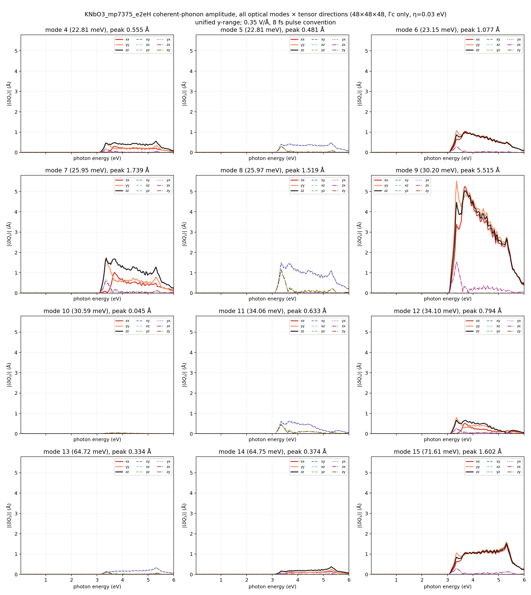
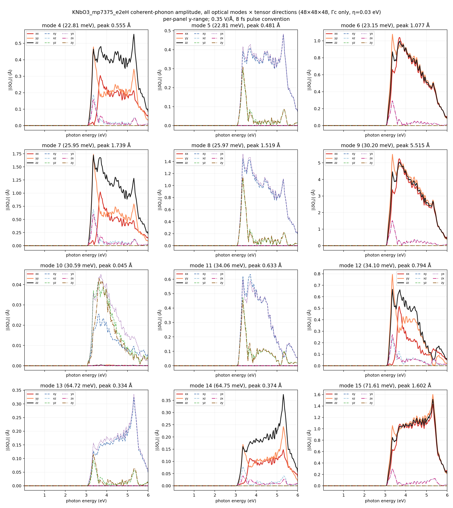
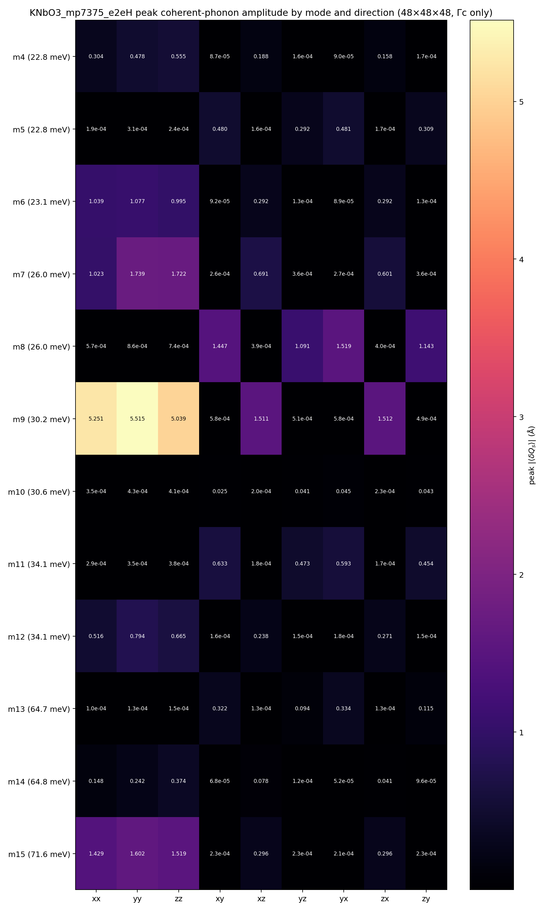
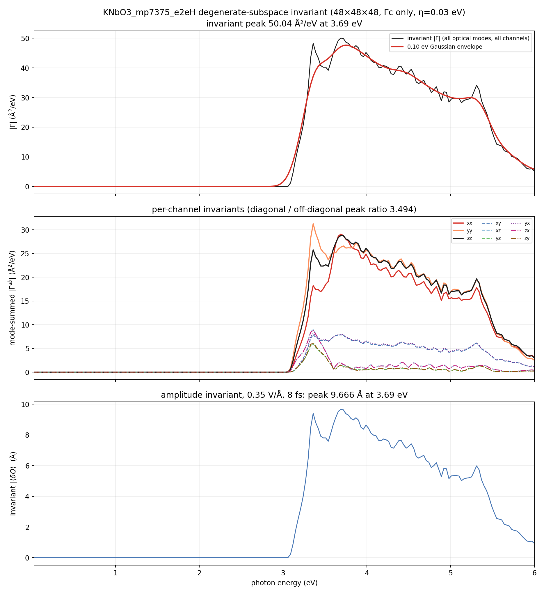
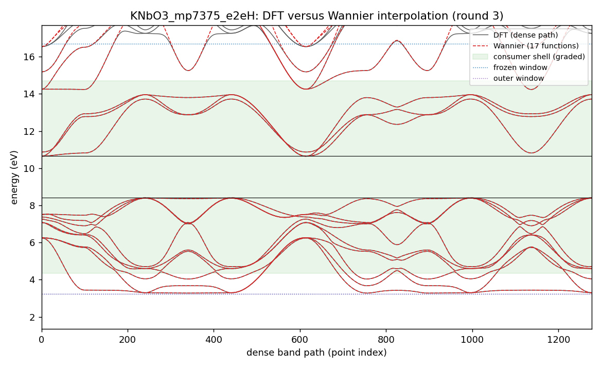
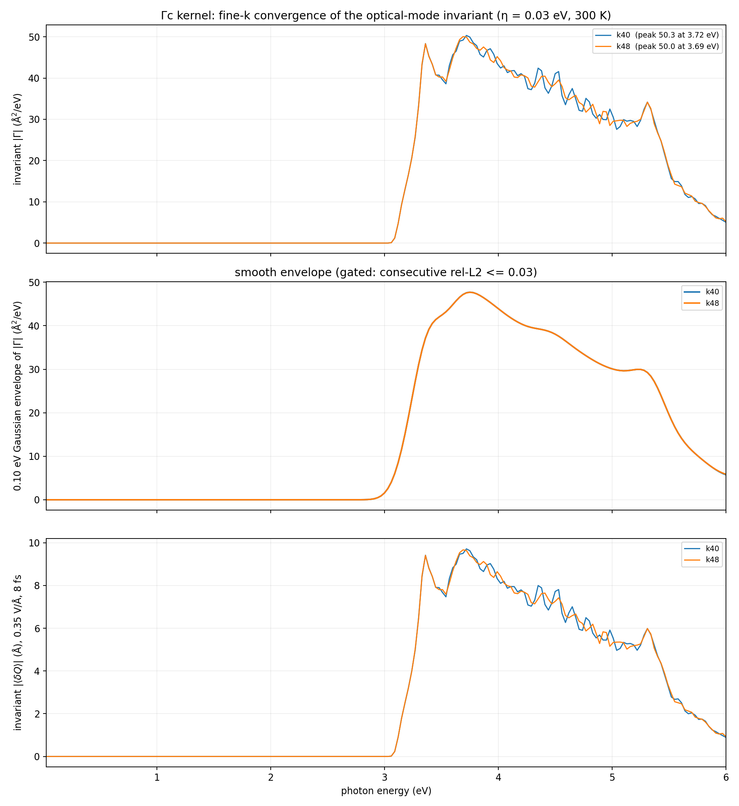
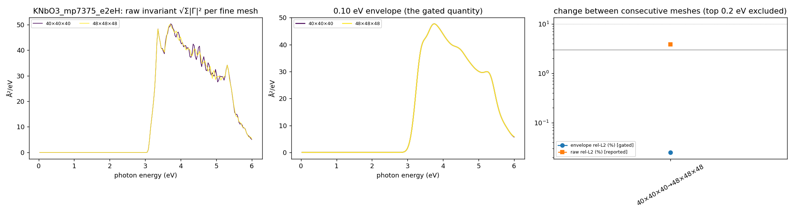

# KNbO3_mp7375_e2eH coherent-phonon report — Gamma-only DFPT, scalar Wannier state, 0.03–6 eV Γc kernel

Generated 2026-10-15T20:28:31+02:00 by `workflow/lib/report.py` from the files under `<cophon>/benchmarks/cophon-bench-v1/e2e_library/KNbO3_mp7375_e2eH`. Every number below is read from a result or gate file; nothing is typed in by hand.

**Outcome: KNbO3_mp7375_e2eH has a Γc coherent-phonon kernel on the 48×48×48 fine k-mesh.** 12 optical Γ-point modes (22.81, 22.81, 23.15, 25.95, 25.97, 30.20, 30.59, 34.06, 34.10, 64.72, 64.75, 71.61 meV) over 0.03–6.00 eV at 300 K with 0.03 eV smearing. The basis-independent invariant peaks at 3.69 eV (50.04 Ų/eV); under the 0.35 V/Å, 8 fs pulse convention the invariant amplitude peak is 9.666 Å at 3.69 eV (largest single mode 5.515 Å). First non-zero response at 3.03 eV. Between the last two meshes (k40 → k48) the 0.10 eV envelope changes by 0.03 % (limit 3 %; raw spectrum 3.9 %), so the kernel is converged on the envelope.

Scope: Γc only (no Γe vertex correction), scalar-relativistic, PBE gap, Gamma-only DFPT (one q-point, `ldisp = .true.`, `nq = 1 1 1`); velocities from EPW's `vme = 'dipole'` route (the full velocity i[H,r], non-local pseudopotential commutator included, computed on the coarse mesh and Wannier-interpolated; origin-free).

## Standard all-mode result (48×48×48)

| Quantity (48×48×48, 0.03 eV smearing, 300 K) | Value |
|---|---|
| Invariant \|Γ\| peak | 50.04 Ų/eV at 3.69 eV |
| Envelope (0.10 eV) peak | 47.69 Ų/eV at 3.75 eV |
| Invariant amplitude peak (0.35 V/Å, 8 fs) | 9.666 Å at 3.69 eV |
| Per-mode amplitude peaks (basis-dependent split) | 0.555 / 0.481 / 1.077 / 1.739 / 1.519 / 5.515 / 0.045 / 0.633 / 0.794 / 0.334 / 0.374 / 1.602 Å |
| Mode-summed channel peaks, diagonal (xx, yy, zz) | 28.78–31.26 Ų/eV |
| Mode-summed channel peaks, off-diagonal (xy, xz, yz, yx, zx, zy) | 5.96–8.95 Ų/eV |
| Diagonal / off-diagonal peak ratio | 3.494 |
| First non-zero response | 3.03 eV |
| Photon grid | 0.03–6.00 eV, 200 points |

## Electronic structure and Wannier state

| Quantity | Value |
|---|---|
| PBE band edges (VBM / CBM) | 8.407 / 10.647 eV (gap 2.240 eV) |
| Consumer shell (must be interpolated well) | 4.35 … 14.71 eV |
| Frozen / outer window | 3.23 … 16.71 eV / 3.23 … 24.00 eV |
| Wannier functions | 17 (K:s, Nb:s;d, O:p, f=0.0000,0.0000,0.5000:s); recipe source: card_proposal |
| Accepted Wannier round | round 3 (3 round gates on file, including any before an electron recompute); max spread 3.10 Ų, band RMS 0.4 meV, worst 5.3 meV in the shell (limits 10 Ų, 50 / 25 meV) |
| EPW-side interpolation (same shell, from the EPW1 Wannier files) | RMS 0.4 meV, worst 5.3 meV → PASS |

## Γ-point phonons (DFPT)

| Mode | ω (cm⁻¹) | ω (meV) |
|---|---:|---:|
| optical 4 | 183.96 | 22.81 |
| optical 5 | 183.96 | 22.81 |
| optical 6 | 186.69 | 23.15 |
| optical 7 | 209.52 | 25.98 |
| optical 8 | 209.52 | 25.98 |
| optical 9 | 243.63 | 30.21 |
| optical 10 | 248.03 | 30.75 |
| optical 11 | 275.97 | 34.22 |
| optical 12 | 275.99 | 34.22 |
| optical 13 | 521.43 | 64.65 |
| optical 14 | 521.45 | 64.65 |
| optical 15 | 576.95 | 71.53 |

Acoustic sum rule applied (dynmat.x); acoustic modes after ASR -0.00, 0.00, 0.00 cm⁻¹ (raw -4.09, -3.65, -3.54 cm⁻¹). ε∞ diagonal 5.27, 5.55, 5.41; largest |Z*| 8.37; polar: True. Gate: PASS. Softness: stiff (tier 0).

## Velocity-route check

Wannier centres sit up to 6.14 Å from the cell origin (b·r max 1.20); EPW's `wannier` velocity route would carry an origin-dependent error of about 24 % at worst (12.4 % on average) for this cell — above the warning level.

| Adopted mesh | Production route | Other route | Envelope difference | Tensor difference | Invariant peak (production / other) | Forbidden-channel ratio (production / other) | Verdict |
|---|---|---|---:|---:|---|---|---|
| k48 | dipole | wannier | 8.6 % (limit 5 %) | 9.0 % | 50.04 / 46.75 Ų/eV | 3.494 / 3.445 | NOTE |

Reading: routes differ, but b.r_max = 1.20 > 0.5: the 'wannier' route carries an origin-dependent error of about 24 % for this cell; comparison uninformative.

## Fine-k convergence

Convergence is judged on the 0.10 eV Gaussian envelope of the invariant (gate: consecutive rel-L2 <= 0.03); the raw rel-L2 is reported, not gated.

| Meshes | raw rel-L2 | raw Pearson | envelope rel-L2 | envelope peak | gate |
|---|---:|---:|---:|---|---|
| 40×40×40 → 48×48×48 | 0.039 | 0.999 | 0.000 | 47.71 → 47.69 Ų/eV, 3.75 → 3.75 eV | PASS |

Per-mesh overlay of the raw invariant, its envelope, and the change between consecutive meshes (the top 0.2 eV of the window is excluded from the gate):

## What was done

1. **intake**: ACCEPTED — KNbO3 sg 160 nbnd 50
2. **relax**: ACCEPTED, job 22861585 (debug, COMPLETED) — max force 4.105e-05 Ry/bohr, pressure -0.16 kbar
3. **electron**: ACCEPTED, job 22861895 (debug, COMPLETED) — gap 2.240 eV; PDOS 7 shells; trim: 11 bands excluded (gap 5.558 eV); v1.1 recipe from the superset stage
4. **wannier**: ACCEPTED, job 22877663 (small, COMPLETED) — round 3: score 0.05 <= 0.9 (W7); wout_present=ok; final_state=ok; num_wann_in_wout=ok; spread_max=ok; plateau_drift=ok; localisation_converged=ok; ran_out_of_steps=ok; all_done=ok; disentanglement_settled=ok; comparison_present=ok; comparator_build=ok; dense_reference_certified=ok; band_rms_meV=ok; band_worst_meV=ok; grids_equal=ok
5. **phonon**: ACCEPTED, job 22862309 (debug, COMPLETED) — max 576.95 cm-1; polar=True; softness stiff -> tier 0
6. **epw1**: ACCEPTED, job 22879204 (small, COMPLETED) — restart written; EPW bands within the shell bars
7. **kernel**: ACCEPTED, job 22881077 (debug, COMPLETED) — converged at k48: first pair 0.0003 <= 0.003 (a tenth of the limit): converged without a second step; velocity-route check NOTE (envelope 8.6 %, tensor 9.0 %)
8. **report**: PENDING
9. **anharmonic**: SKIPPED — tier 0: softness stiff
10. **rekernel**: SKIPPED — tier 0: softness stiff
11. **superset**: ACCEPTED, job 22862602 (small, COMPLETED) — superset 26 functions; round-1 recipe v1.1 default: 17 functions (reduced), Pmin 17

Wannier recipe (round 3, source card_proposal: ): 17 functions, projections ['K:s', 'Nb:s;d', 'O:p', 'f=0.0000,0.0000,0.5000:s'], exclude_bands [1, 2, 3, 4, 5, 6, 7, 8, 9, 10, 11], outer window [3.2306, 23.9971] eV, frozen window [3.2306, 16.707] eV, consumer shell [4.347, 14.707] eV.

Electronic policy: ecutwfc 84 Ry, ecutrho 336 Ry, SCF mesh [8, 8, 8], NSCF mesh [8, 8, 8], nbnd 50, relax `fixed`, spacegroup R3m (160), nat 5.

## Validation gates

| Gate file | Status | Key numbers | Reasons |
|---|---|---|---|
| `gate_electron` | PASS | — | — |
| `gate_epw1` | PASS | — | — |
| `gate_kernel_k40` | PASS | — | — |
| `gate_kernel_k48` | PASS | — | — |
| `gate_kernel_k48_eta030` | PASS | — | — |
| `gate_phonon` | PASS | optical_max_cm1 577; acoustic_cm1_asr [-0.0, 0.0, 0.0]; max_abs_zstar 8.365; polar True | — |
| `gate_relax` | PASS | — | — |
| `gate_route_check` | NOTE | — | — |
| `gate_superset` | PASS | — | — |
| `gate_wannier_round1` | FAIL | — | PLATEAU_DRIFT; LOCALISATION_NOT_CONVERGED; RAN_OUT_OF_STEPS; SCORE_OVER_LIMIT |
| `gate_wannier_round2` | FAIL | — | PLATEAU_DRIFT; LOCALISATION_NOT_CONVERGED; RAN_OUT_OF_STEPS; SCORE_OVER_LIMIT |
| `gate_wannier_round3` | PASS | — | — |

Standing limits: Wannier spreads <= 10 Ų, band RMS <= 50 meV and worst <= 25 meV in the consumer shell, Γ acoustic modes within 1 cm⁻¹ after ASR, envelope rel-L2 <= 0.03.

## Scope, limits, and next safe action

- **Γc only.** The triangle term Γc is computed; the vertex correction Γe is absent.
- **Scalar-relativistic, PBE gap.** No spin-orbit coupling and no gap correction; the onset follows the PBE gap, so absolute peak positions cannot be compared with experiment without a scissor.
- **Gamma-only DFPT.** Phonons are computed at q = 0 only; the LO–TO splitting is not resolved at exactly Γ and no off-Γ stability check exists in this route.
- **Forbidden-channel residual.** Diagonal / off-diagonal mode-summed peak ratio 3.494; which channels are symmetry-forbidden depends on the point group and must be judged for this material.
- **Convergence.** Envelope rel-L2 0.0003 and raw rel-L2 0.039 between 40×40×40 and 48×48×48.

## Run record

- Workflow baseline at creation: v2.0.12 (sealed 2026-10-15, manifest `e8050e6a9f5b…`, tree clean)
- Cell policy: pbesol (cell relaxed with PBEsol, internal coordinates and every later stage with PBE); production cell: input
- Phonon tier: 0 (softness stiff, lowest optical mode 183.96 cm⁻¹, threshold 60.0 cm⁻¹)
- Material workflow dir: `<cophon>/benchmarks/cophon-bench-v1/e2e_library/KNbO3_mp7375_e2eH`
- LUMI run root: `/scratch/project_<id>/<user>/theory2code/cphon/runs/KNbO3_mp7375_e2eH/wf`
- Job ledger: `JOB_LEDGER.md` (one row per submitted job)
- Jobs: electron 22861895 (debug, COMPLETED); epw1 22879204 (small, COMPLETED); kernel 22881077 (debug, COMPLETED); phonon 22862309 (debug, COMPLETED); relax 22861585 (debug, COMPLETED); superset 22862602 (small, COMPLETED); wannier 22877663 (small, COMPLETED)
- Kernel files (SHA-256): k40 `3d03ecd60c45…`; k48 `dba5770633d6…`
- 2026-10-15T19:57:38+02:00: kernel:COLLECTED — k40: 21 files pulled
- 2026-10-15T19:57:38+02:00: kernel:PENDING — k40 accepted; ladder continues with k48
- 2026-10-15T19:57:40+02:00: ROUTE — kernel: debug — estimated start in 0.1 h; debug 0.05 h; small 1.65 h; standard 12.88 h
- 2026-10-15T19:57:46+02:00: kernel:SUBMIT — job 22880652 on debug in /scratch/project_<id>/<user>/theory2code/cphon/runs/KNbO3_mp7375_e2eH/wf/kernel
- 2026-10-15T20:13:02+02:00: kernel:COLLECTED — k48: 31 files pulled
- 2026-10-15T20:13:02+02:00: kernel:PENDING — converged at k48: first pair 0.0003 <= 0.003 (a tenth of the limit): converged without a second step; velocity-route check queued at k48
- 2026-10-15T20:13:05+02:00: ROUTE — kernel: debug — estimated start in 0.1 h; debug 0.05 h; small 1.6 h; standard 14.37 h
- 2026-10-15T20:13:10+02:00: kernel:SUBMIT — job 22881077 on debug in /scratch/project_<id>/<user>/theory2code/cphon/runs/KNbO3_mp7375_e2eH/wf/kernel
- 2026-10-15T20:28:28+02:00: kernel:COLLECTED — k48_eta030: 41 files pulled
- 2026-10-15T20:28:28+02:00: kernel:ACCEPTED — converged at k48: first pair 0.0003 <= 0.003 (a tenth of the limit): converged without a second step; velocity-route check NOTE (envelope 8.6 %, tensor 9.0 %)
