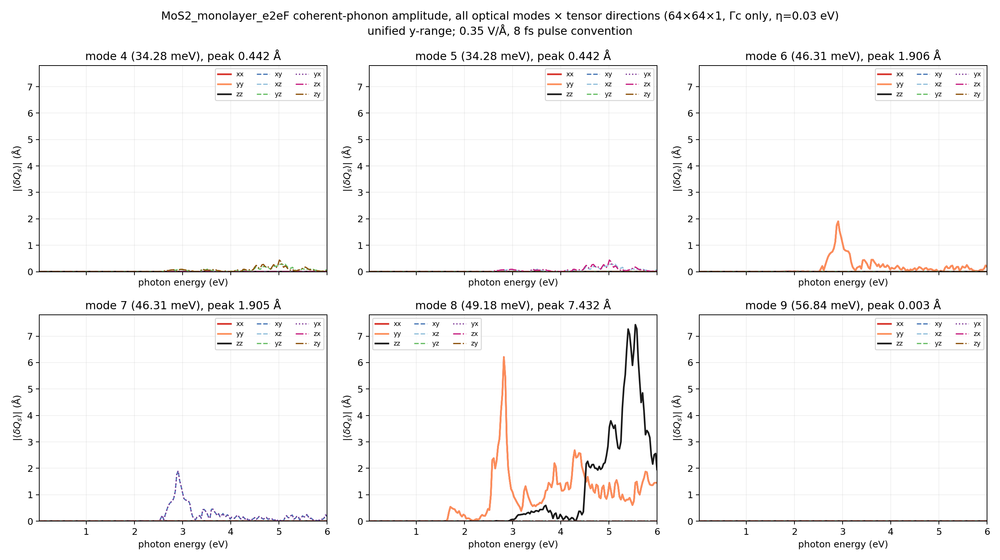
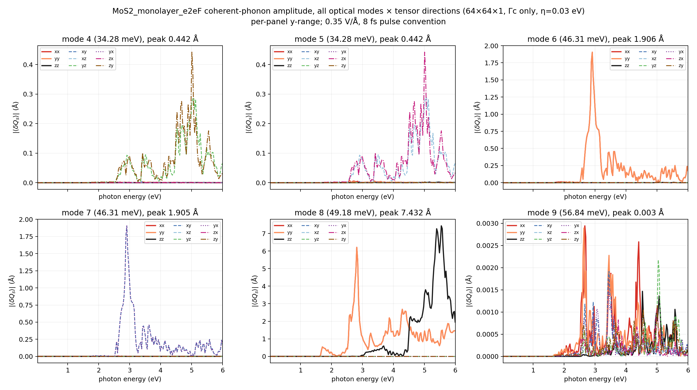
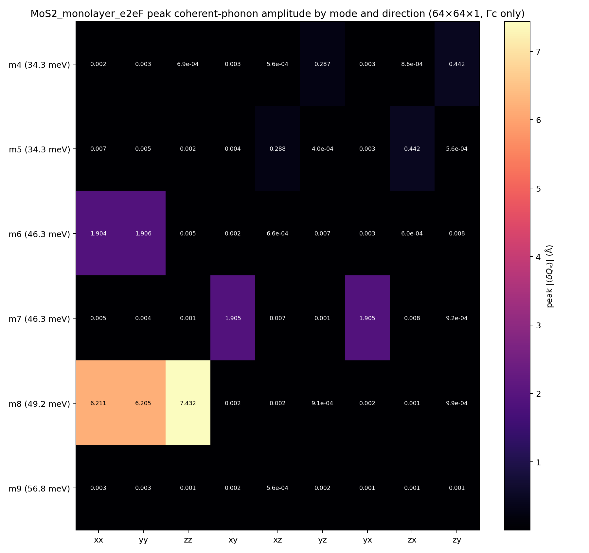
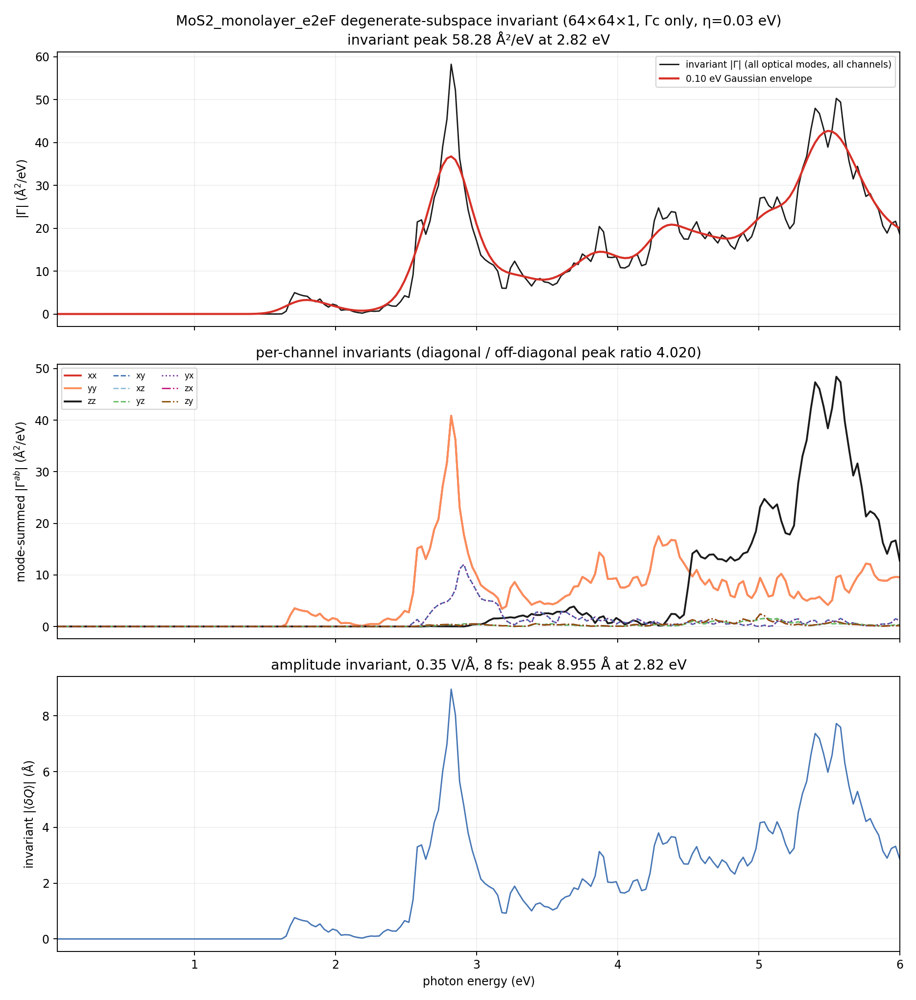
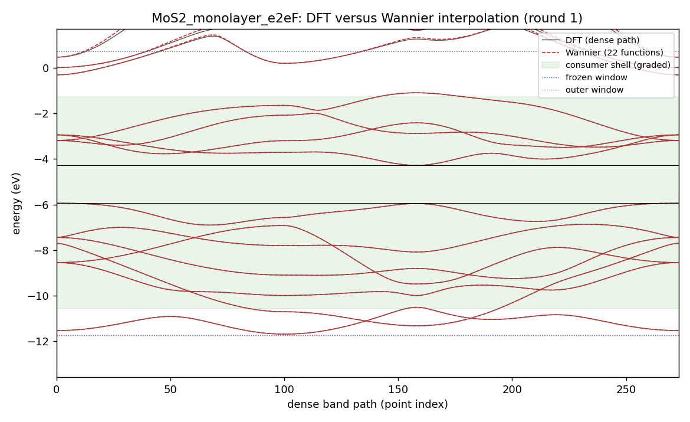
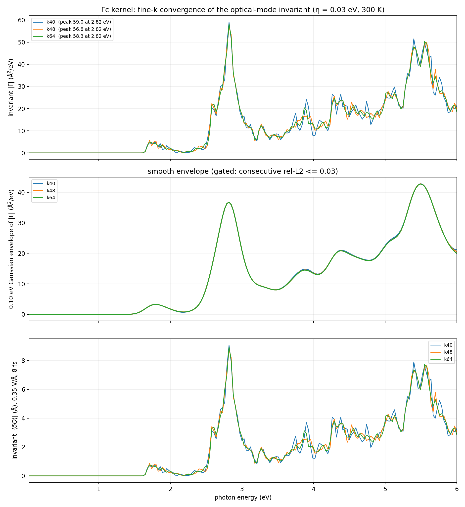
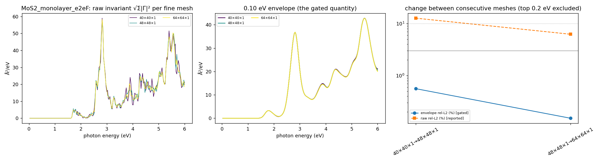

# MoS2_monolayer_e2eF coherent-phonon report — Gamma-only DFPT, scalar Wannier state, 0.03–6 eV Γc kernel

Generated 2026-10-15T13:04:28+02:00 by `workflow/lib/report.py` from the files under `<cophon>/benchmarks/cophon-bench-v1/e2e_library/MoS2_monolayer_e2eF`. Every number below is read from a result or gate file; nothing is typed in by hand.

**Outcome: MoS2_monolayer_e2eF has a Γc coherent-phonon kernel on the 64×64×1 fine k-mesh.** 6 optical Γ-point modes (34.28, 34.28, 46.31, 46.31, 49.18, 56.84 meV) over 0.03–6.00 eV at 300 K with 0.03 eV smearing. The basis-independent invariant peaks at 2.82 eV (58.28 Ų/eV); under the 0.35 V/Å, 8 fs pulse convention the invariant amplitude peak is 8.955 Å at 2.82 eV (largest single mode 7.432 Å). First non-zero response at 1.59 eV. Between the last two meshes (k48 → k64) the 0.10 eV envelope changes by 0.19 % (limit 3 %; raw spectrum 7.5 %), so the kernel is converged on the envelope. The comparison stops at 4.66 eV, the slab's graded photon reach; the spectrum above it is shown but ungraded.

Scope: Γc only (no Γe vertex correction), scalar-relativistic, PBE gap, Gamma-only DFPT (one q-point, `ldisp = .true.`, `nq = 1 1 1`); velocities from EPW's `vme = 'dipole'` route (the full velocity i[H,r], non-local pseudopotential commutator included, computed on the coarse mesh and Wannier-interpolated; origin-free).

## Standard all-mode result (64×64×1)

| Quantity (64×64×1, 0.03 eV smearing, 300 K) | Value |
|---|---|
| Invariant \|Γ\| peak | 58.28 Ų/eV at 2.82 eV |
| Envelope (0.10 eV) peak | 42.72 Ų/eV at 5.49 eV |
| Invariant amplitude peak (0.35 V/Å, 8 fs) | 8.955 Å at 2.82 eV |
| Per-mode amplitude peaks (basis-dependent split) | 0.442 / 0.442 / 1.906 / 1.905 / 7.432 / 0.003 Å |
| Mode-summed channel peaks, diagonal (xx, yy, zz) | 40.81–48.43 Ų/eV |
| Mode-summed channel peaks, off-diagonal (xy, xz, yz, yx, zx, zy) | 1.56–12.05 Ų/eV |
| Diagonal / off-diagonal peak ratio | 4.020 |
| First non-zero response | 1.59 eV |
| Photon grid | 0.03–6.00 eV, 200 points |

## Electronic structure and Wannier state

| Quantity | Value |
|---|---|
| PBE band edges (VBM / CBM) | -5.934 / -4.277 eV (gap 1.657 eV) |
| Consumer shell (must be interpolated well) | -10.58 … -1.28 eV |
| Frozen / outer window | -11.73 … 0.72 eV / -11.73 … 10.63 eV |
| Wannier functions | 22 (Mo:s;d, S:p;d); recipe source: v1.1 |
| Accepted Wannier round | round 1 (1 round gate on file, including any before an electron recompute); max spread 4.92 Ų, band RMS 0.6 meV, worst 2.6 meV in the shell (limits 10 Ų, 50 / 25 meV) |
| EPW-side interpolation (same shell, from the EPW1 Wannier files) | RMS 0.6 meV, worst 2.6 meV → PASS |

## Γ-point phonons (DFPT)

| Mode | ω (cm⁻¹) | ω (meV) |
|---|---:|---:|
| optical 4 | 276.45 | 34.28 |
| optical 5 | 276.45 | 34.28 |
| optical 6 | 373.49 | 46.31 |
| optical 7 | 373.49 | 46.31 |
| optical 8 | 396.65 | 49.18 |
| optical 9 | 458.47 | 56.84 |

Acoustic sum rule applied (dynmat.x); acoustic modes after ASR -0.00, -0.00, 0.00 cm⁻¹ (raw -2.49, 1.87, 1.87 cm⁻¹). ε∞ diagonal 5.79, 5.79, 1.28; largest |Z*| 0.99; polar: True. Gate: PASS. Softness: stiff (tier 0).

## Velocity-route check

Wannier centres sit up to 5.37 Å from the cell origin (b·r max 1.02); EPW's `wannier` velocity route would carry an origin-dependent error of about 17 % at worst (4.7 % on average) for this cell — above the warning level.

| Adopted mesh | Production route | Other route | Envelope difference | Tensor difference | Invariant peak (production / other) | Forbidden-channel ratio (production / other) | Verdict |
|---|---|---|---:|---:|---|---|---|
| k64 | dipole | wannier | 1.3 % (limit 5 %) | 9.9 % | 58.28 / 58.18 Ų/eV | 4.020 / 3.506 | PASS |

Reading: the two velocity routes agree. Envelopes compared up to 4.66 eV, the slab's graded photon reach (the tensor difference is over the full window).

## Fine-k convergence

Convergence is judged on the 0.10 eV Gaussian envelope of the invariant (gate: consecutive rel-L2 <= 0.03); the raw rel-L2 is reported, not gated.

| Meshes | raw rel-L2 | raw Pearson | envelope rel-L2 | envelope peak | gate |
|---|---:|---:|---:|---|---|
| 40×40×1 → 48×48×1 | 0.131 | 0.986 | 0.006 | 42.80 → 42.76 Ų/eV, 5.49 → 5.49 eV | PASS |
| 48×48×1 → 64×64×1 | 0.075 | 0.996 | 0.002 | 42.76 → 42.72 Ų/eV, 5.49 → 5.49 eV | PASS |

Per-mesh overlay of the raw invariant, its envelope, and the change between consecutive meshes (the top 0.2 eV of the window is excluded from the gate):

## What was done

1. **intake**: ACCEPTED — MoS2 sg 187 nbnd 33
2. **relax**: ACCEPTED, job 22865096 (debug, COMPLETED) — max force 5.677e-05 Ry/bohr, pressure 0.02 kbar
3. **electron**: ACCEPTED, job 22865526 (debug, COMPLETED) — gap 1.657 eV; PDOS 5 shells; trim: 6 bands excluded (gap 6.128 eV); v1.1 recipe from the superset stage
4. **wannier**: ACCEPTED, job 22867334 (small, COMPLETED) — round 1: score 0.066 <= 0.9 (W7); wout_present=ok; final_state=ok; num_wann_in_wout=ok; spread_max=ok; plateau_drift=ok; localisation_converged=ok; ran_out_of_steps=ok; all_done=ok; disentanglement_settled=ok; comparison_present=ok; comparator_build=ok; dense_reference_certified=ok; band_rms_meV=ok; band_worst_meV=ok; grids_equal=ok
5. **phonon**: ACCEPTED, job 22867294 (debug, COMPLETED) — max 458.47 cm-1; polar=True; softness stiff -> tier 0
6. **epw1**: ACCEPTED, job 22867998 (small, COMPLETED) — restart written; EPW bands within the shell bars
7. **kernel**: ACCEPTED, job 22870258 (debug, COMPLETED) — converged at k64: envelope change 0.0019 <= 0.03 with previous 0.0064 <= 0.1; velocity-route check PASS (envelope 1.3 %, tensor 9.9 %)
8. **report**: PENDING
9. **anharmonic**: SKIPPED — tier 0: softness stiff
10. **rekernel**: SKIPPED — tier 0: softness stiff
11. **superset**: ACCEPTED, job 22865789 (small, COMPLETED) — superset 27 functions; round-1 recipe v1.1 default: 22 functions (reduced), Pmin 14

Wannier recipe (round 1, source v1.1: ["Pmin (kept bands at or below target top + 2 eV = 0.72 eV, worst k) = 14; PDOS picks ['Mo:d', 'Mo:s', 'S:p'] = 12", 'added S:d: P = 22']): 22 functions, projections ['Mo:s;d', 'S:p;d'], exclude_bands [1, 2, 3, 4, 5, 6], outer window [-11.7326, 10.6313] eV, frozen window [-11.7326, 0.723] eV, consumer shell [-10.577, -1.277] eV.

Electronic policy: ecutwfc 80 Ry, ecutrho 320 Ry, SCF mesh [12, 12, 1], NSCF mesh [12, 12, 1], nbnd 33, relax `fixed`, spacegroup P-6m2 (187), nat 3.

## Validation gates

| Gate file | Status | Key numbers | Reasons |
|---|---|---|---|
| `gate_electron` | PASS | — | — |
| `gate_epw1` | PASS | — | — |
| `gate_kernel_k40` | PASS | — | — |
| `gate_kernel_k48` | PASS | — | — |
| `gate_kernel_k64` | PASS | — | — |
| `gate_kernel_k64_eta030` | PASS | — | — |
| `gate_phonon` | PASS | optical_max_cm1 458.5; acoustic_cm1_asr [-0.0, -0.0, 0.0]; max_abs_zstar 0.9889; polar True | — |
| `gate_relax` | PASS | — | — |
| `gate_route_check` | PASS | — | — |
| `gate_superset` | PASS | — | — |
| `gate_wannier_round1` | PASS | — | — |

Standing limits: Wannier spreads <= 10 Ų, band RMS <= 50 meV and worst <= 25 meV in the consumer shell, Γ acoustic modes within 1 cm⁻¹ after ASR, envelope rel-L2 <= 0.03.

## Scope, limits, and next safe action

- **Γc only.** The triangle term Γc is computed; the vertex correction Γe is absent.
- **Scalar-relativistic, PBE gap.** No spin-orbit coupling and no gap correction; the onset follows the PBE gap, so absolute peak positions cannot be compared with experiment without a scissor.
- **Gamma-only DFPT.** Phonons are computed at q = 0 only; the LO–TO splitting is not resolved at exactly Γ and no off-Γ stability check exists in this route.
- **Forbidden-channel residual.** Diagonal / off-diagonal mode-summed peak ratio 4.020; which channels are symmetry-forbidden depends on the point group and must be judged for this material.
- **Convergence.** Envelope rel-L2 0.0019 and raw rel-L2 0.075 between 48×48×1 and 64×64×1.

## Run record

- Workflow baseline at creation: v2.0.13 (sealed 2026-10-15, manifest `38fbfe4df2f3…`, tree clean)
- Cell policy: pbe (cell relaxed with PBE, internal coordinates and every later stage with PBE); production cell: input
- Phonon tier: 0 (softness stiff, lowest optical mode 276.45 cm⁻¹, threshold 60.0 cm⁻¹)
- Material workflow dir: `<cophon>/benchmarks/cophon-bench-v1/e2e_library/MoS2_monolayer_e2eF`
- LUMI run root: `/scratch/project_<id>/<user>/theory2code/cphon/runs/MoS2_monolayer_e2eF/wf`
- Job ledger: `JOB_LEDGER.md` (one row per submitted job)
- Jobs: electron 22865526 (debug, COMPLETED); epw1 22867998 (small, COMPLETED); kernel 22870258 (debug, COMPLETED); phonon 22867294 (debug, COMPLETED); relax 22865096 (debug, COMPLETED); superset 22865789 (small, COMPLETED); wannier 22867334 (small, COMPLETED)
- Kernel files (SHA-256): k40 `35f0c95782a2…`; k48 `55bedb829b84…`; k64 `140d33cb8c89…`
- 2026-10-15T12:57:56+02:00: kernel:COLLECTED — k48: 31 files pulled
- 2026-10-15T12:57:56+02:00: kernel:PENDING — k48 accepted; ladder continues with k64
- 2026-10-15T12:58:00+02:00: ROUTE — kernel: debug — estimated start in 0.1 h; debug 0.12 h; small 0.57 h; standard 17.22 h
- 2026-10-15T12:58:04+02:00: kernel:SUBMIT — job 22870150 on debug in /scratch/project_<id>/<user>/theory2code/cphon/runs/MoS2_monolayer_e2eF/wf/kernel
- 2026-10-15T13:01:11+02:00: kernel:COLLECTED — k64: 41 files pulled
- 2026-10-15T13:01:11+02:00: kernel:PENDING — converged at k64: envelope change 0.0019 <= 0.03 with previous 0.0064 <= 0.1; velocity-route check queued at k64
- 2026-10-15T13:01:14+02:00: ROUTE — kernel: debug — estimated start in 0.1 h; debug 0.12 h; small 0.61 h; standard 17.18 h
- 2026-10-15T13:01:19+02:00: kernel:SUBMIT — job 22870258 on debug in /scratch/project_<id>/<user>/theory2code/cphon/runs/MoS2_monolayer_e2eF/wf/kernel
- 2026-10-15T13:04:26+02:00: kernel:COLLECTED — k64_eta030: 51 files pulled
- 2026-10-15T13:04:26+02:00: kernel:ACCEPTED — converged at k64: envelope change 0.0019 <= 0.03 with previous 0.0064 <= 0.1; velocity-route check PASS (envelope 1.3 %, tensor 9.9 %)
