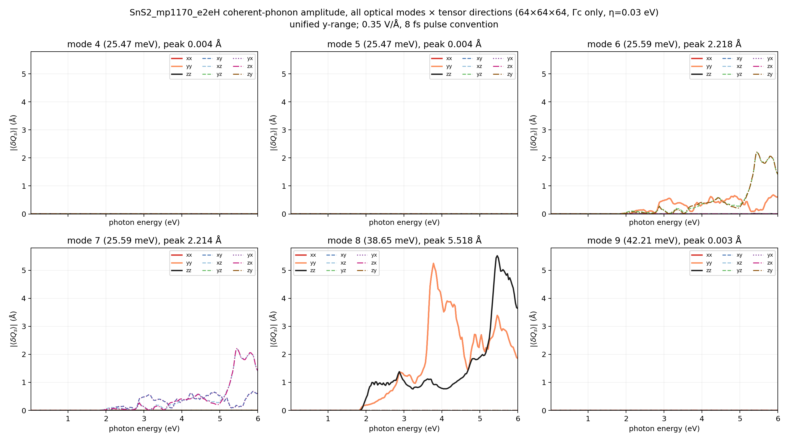
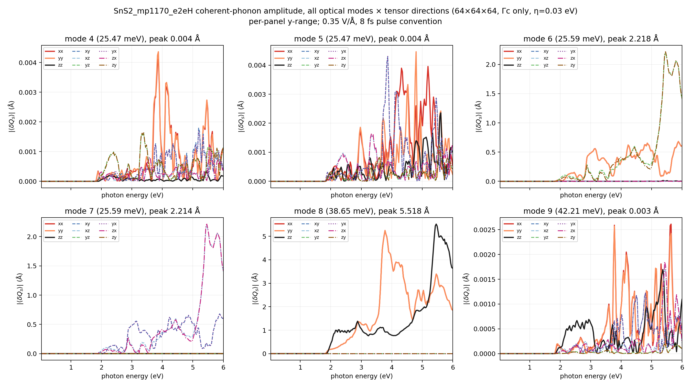
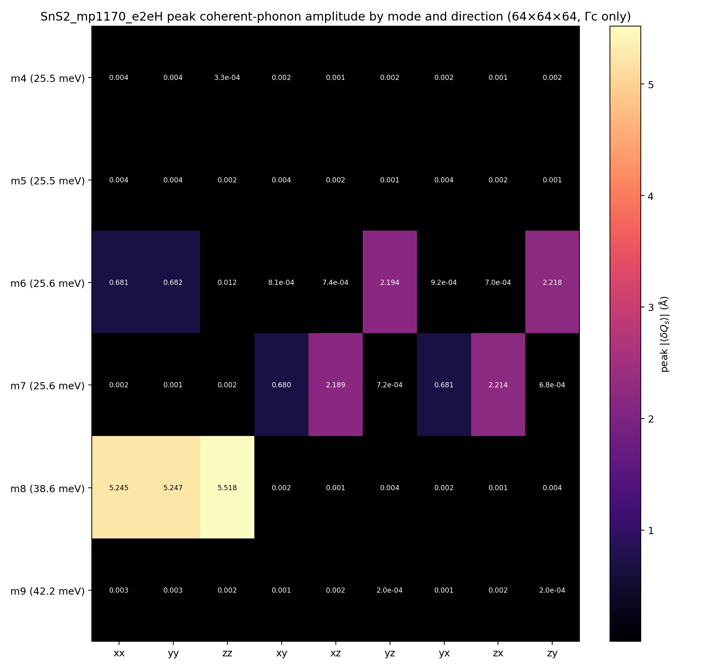
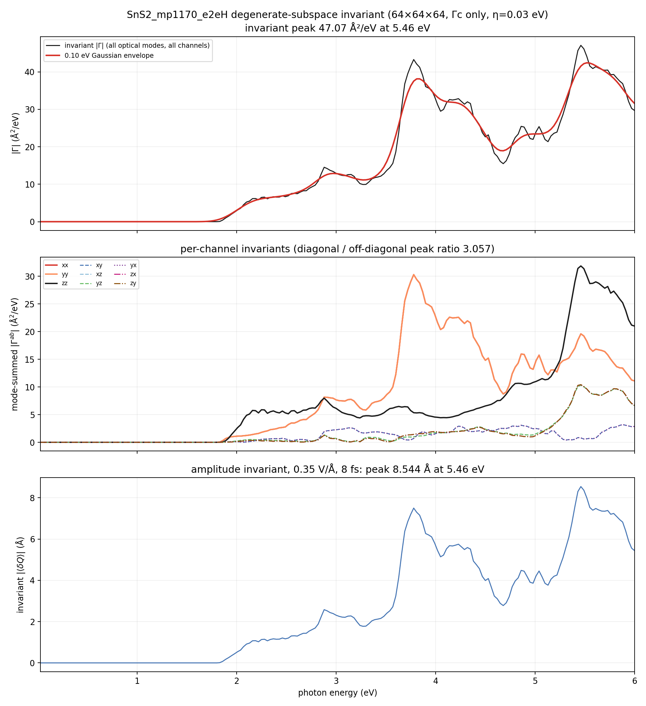
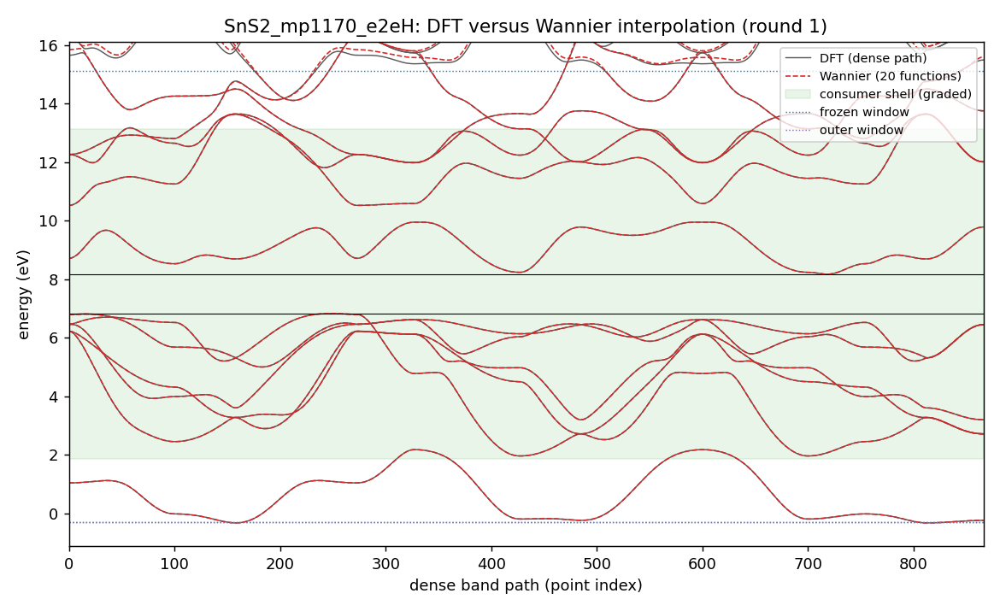
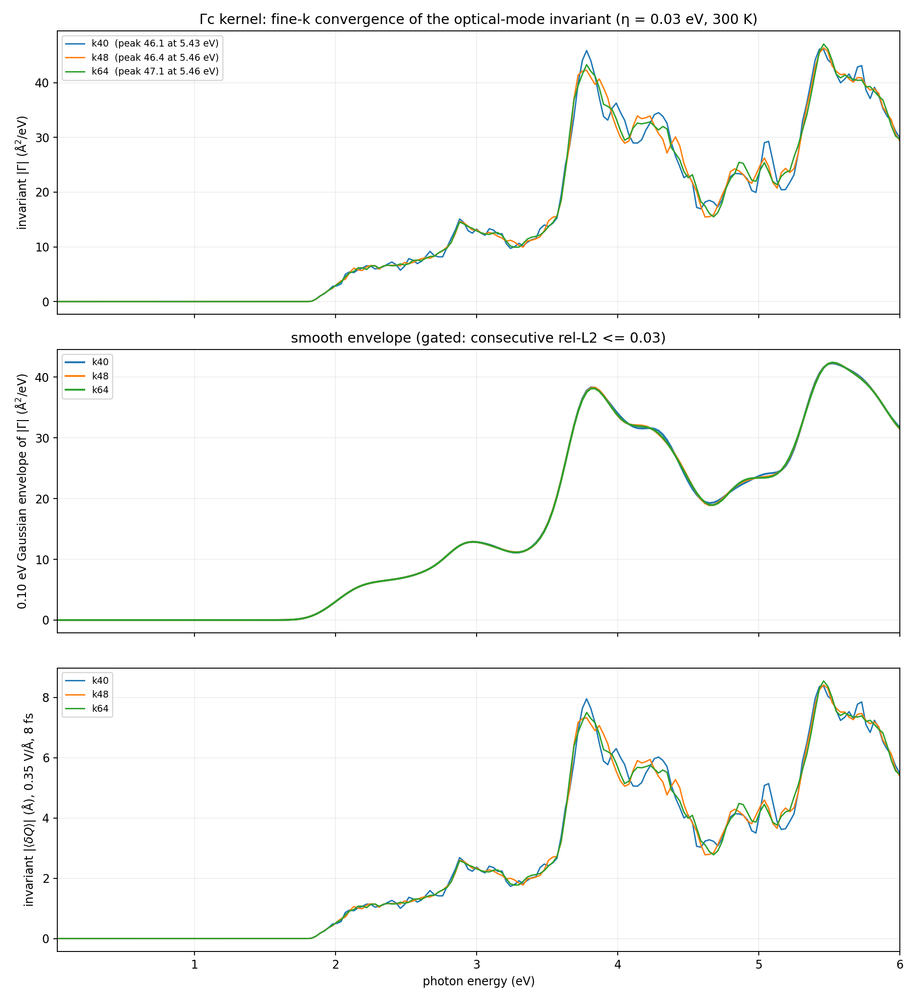
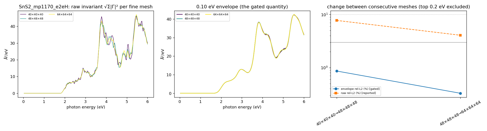

# SnS2_mp1170_e2eH coherent-phonon report — Gamma-only DFPT, scalar Wannier state, 0.03–6 eV Γc kernel

Generated 2026-10-15T16:32:31+02:00 by `workflow/lib/report.py` from the files under `<cophon>/benchmarks/cophon-bench-v1/e2e_library/SnS2_mp1170_e2eH`. Every number below is read from a result or gate file; nothing is typed in by hand.

**Outcome: SnS2_mp1170_e2eH has a Γc coherent-phonon kernel on the 64×64×64 fine k-mesh.** 6 optical Γ-point modes (25.47, 25.47, 25.59, 25.59, 38.65, 42.21 meV) over 0.03–6.00 eV at 300 K with 0.03 eV smearing. The basis-independent invariant peaks at 5.46 eV (47.07 Ų/eV); under the 0.35 V/Å, 8 fs pulse convention the invariant amplitude peak is 8.544 Å at 5.46 eV (largest single mode 5.518 Å). First non-zero response at 1.80 eV. Between the last two meshes (k48 → k64) the 0.10 eV envelope changes by 0.33 % (limit 3 %; raw spectrum 4.1 %), so the kernel is converged on the envelope.

Scope: Γc only (no Γe vertex correction), scalar-relativistic, PBE gap, Gamma-only DFPT (one q-point, `ldisp = .true.`, `nq = 1 1 1`); velocities from EPW's `vme = 'dipole'` route (the full velocity i[H,r], non-local pseudopotential commutator included, computed on the coarse mesh and Wannier-interpolated; origin-free).

## Standard all-mode result (64×64×64)

| Quantity (64×64×64, 0.03 eV smearing, 300 K) | Value |
|---|---|
| Invariant \|Γ\| peak | 47.07 Ų/eV at 5.46 eV |
| Envelope (0.10 eV) peak | 42.41 Ų/eV at 5.52 eV |
| Invariant amplitude peak (0.35 V/Å, 8 fs) | 8.544 Å at 5.46 eV |
| Per-mode amplitude peaks (basis-dependent split) | 0.004 / 0.004 / 2.218 / 2.214 / 5.518 / 0.003 Å |
| Mode-summed channel peaks, diagonal (xx, yy, zz) | 30.30–31.87 Ų/eV |
| Mode-summed channel peaks, off-diagonal (xy, xz, yz, yx, zx, zy) | 3.20–10.43 Ų/eV |
| Diagonal / off-diagonal peak ratio | 3.057 |
| First non-zero response | 1.80 eV |
| Photon grid | 0.03–6.00 eV, 200 points |

## Electronic structure and Wannier state

| Quantity | Value |
|---|---|
| PBE band edges (VBM / CBM) | 6.831 / 8.175 eV (gap 1.344 eV) |
| Consumer shell (must be interpolated well) | 1.88 … 13.13 eV |
| Frozen / outer window | -0.31 … 15.13 eV / -0.31 … 27.37 eV |
| Wannier functions | 20 (Sn:s;p, S:p;d); recipe source: v1.1 |
| Accepted Wannier round | round 1 (1 round gate on file, including any before an electron recompute); max spread 2.74 Ų, band RMS 1.3 meV, worst 8.5 meV in the shell (limits 10 Ų, 50 / 25 meV) |
| EPW-side interpolation (same shell, from the EPW1 Wannier files) | RMS 1.3 meV, worst 8.4 meV → PASS |

## Γ-point phonons (DFPT)

| Mode | ω (cm⁻¹) | ω (meV) |
|---|---:|---:|
| optical 4 | 205.55 | 25.48 |
| optical 5 | 205.55 | 25.48 |
| optical 6 | 206.38 | 25.59 |
| optical 7 | 206.38 | 25.59 |
| optical 8 | 311.72 | 38.65 |
| optical 9 | 340.56 | 42.22 |

Acoustic sum rule applied (dynmat.x); acoustic modes after ASR -0.00, 0.00, 0.00 cm⁻¹ (raw 5.61, 5.76, 5.76 cm⁻¹). ε∞ diagonal 8.75, 8.75, 6.60; largest |Z*| 4.92; polar: True. Gate: PASS. Softness: stiff (tier 0).

## Velocity-route check

Wannier centres sit up to 5.47 Å from the cell origin (b·r max 0.98); EPW's `wannier` velocity route would carry an origin-dependent error of about 16 % at worst (6.6 % on average) for this cell — above the warning level.

| Adopted mesh | Production route | Other route | Envelope difference | Tensor difference | Invariant peak (production / other) | Forbidden-channel ratio (production / other) | Verdict |
|---|---|---|---:|---:|---|---|---|
| k64 | dipole | wannier | 2.9 % (limit 5 %) | 6.4 % | 47.07 / 48.69 Ų/eV | 3.057 / 3.178 | PASS |

Reading: the two velocity routes agree.

## Fine-k convergence

Convergence is judged on the 0.10 eV Gaussian envelope of the invariant (gate: consecutive rel-L2 <= 0.03); the raw rel-L2 is reported, not gated.

| Meshes | raw rel-L2 | raw Pearson | envelope rel-L2 | envelope peak | gate |
|---|---:|---:|---:|---|---|
| 40×40×40 → 48×48×48 | 0.078 | 0.994 | 0.009 | 42.27 → 42.39 Ų/eV, 5.52 → 5.52 eV | PASS |
| 48×48×48 → 64×64×64 | 0.041 | 0.998 | 0.003 | 42.39 → 42.41 Ų/eV, 5.52 → 5.52 eV | PASS |

Per-mesh overlay of the raw invariant, its envelope, and the change between consecutive meshes (the top 0.2 eV of the window is excluded from the gate):

## What was done

1. **intake**: ACCEPTED — SnS2 sg 164 nbnd 33
2. **relax**: SKIPPED — relax disabled by config
3. **electron**: ACCEPTED, job 22865103 (small, COMPLETED) — gap 1.344 eV; PDOS 5 shells; trim: 7 bands excluded (gap 4.031 eV); v1.1 recipe from the superset stage
4. **wannier**: ACCEPTED, job 22868005 (small, COMPLETED) — round 1: score 0.104 <= 0.9 (W7); wout_present=ok; final_state=ok; num_wann_in_wout=ok; spread_max=ok; plateau_drift=ok; localisation_converged=ok; ran_out_of_steps=ok; all_done=ok; disentanglement_settled=ok; comparison_present=ok; comparator_build=ok; dense_reference_certified=ok; band_rms_meV=ok; band_worst_meV=ok; grids_equal=ok
5. **phonon**: ACCEPTED, job 22867962 (debug, COMPLETED) — max 340.56 cm-1; polar=True; softness stiff -> tier 0
6. **epw1**: ACCEPTED, job 22869230 (small, COMPLETED) — restart written; EPW bands within the shell bars
7. **kernel**: ACCEPTED, job 22872755 (small, COMPLETED) — converged at k64: envelope change 0.0033 <= 0.03 with previous 0.0086 <= 0.1; velocity-route check PASS (envelope 2.9 %, tensor 6.4 %)
8. **report**: PENDING
9. **anharmonic**: SKIPPED — tier 0: softness stiff
10. **rekernel**: SKIPPED — tier 0: softness stiff
11. **superset**: ACCEPTED, job 22866146 (small, COMPLETED) — superset 22 functions; round-1 recipe v1.1 default: 20 functions (reduced), Pmin 12

Wannier recipe (round 1, source v1.1: ['superset: d dropped from Sn (27 functions > 26 kept bands)', "Pmin (kept bands at or below target top + 2 eV = 15.13 eV, worst k) = 12; PDOS picks ['S:p', 'Sn:p', 'Sn:s'] = 10", 'added S:d: P = 20']): 20 functions, projections ['Sn:s;p', 'S:p;d'], exclude_bands [1, 2, 3, 4, 5, 6, 7], outer window [-0.3109, 27.374] eV, frozen window [-0.3109, 15.131] eV, consumer shell [1.875, 13.131] eV.

Electronic policy: ecutwfc 72 Ry, ecutrho 288 Ry, SCF mesh [10, 10, 6], NSCF mesh [10, 10, 6], nbnd 33, relax `none`, spacegroup P-3m1 (164), nat 3.

## Validation gates

| Gate file | Status | Key numbers | Reasons |
|---|---|---|---|
| `gate_electron` | PASS | — | — |
| `gate_epw1` | PASS | — | — |
| `gate_kernel_k40` | PASS | — | — |
| `gate_kernel_k48` | PASS | — | — |
| `gate_kernel_k64` | PASS | — | — |
| `gate_kernel_k64_eta030` | PASS | — | — |
| `gate_phonon` | PASS | optical_max_cm1 340.6; acoustic_cm1_asr [-0.0, 0.0, 0.0]; max_abs_zstar 4.919; polar True | — |
| `gate_route_check` | PASS | — | — |
| `gate_superset` | PASS | — | — |
| `gate_wannier_round1` | PASS | — | — |

Standing limits: Wannier spreads <= 10 Ų, band RMS <= 50 meV and worst <= 25 meV in the consumer shell, Γ acoustic modes within 1 cm⁻¹ after ASR, envelope rel-L2 <= 0.03.

## Scope, limits, and next safe action

- **Γc only.** The triangle term Γc is computed; the vertex correction Γe is absent.
- **Scalar-relativistic, PBE gap.** No spin-orbit coupling and no gap correction; the onset follows the PBE gap, so absolute peak positions cannot be compared with experiment without a scissor.
- **Gamma-only DFPT.** Phonons are computed at q = 0 only; the LO–TO splitting is not resolved at exactly Γ and no off-Γ stability check exists in this route.
- **Forbidden-channel residual.** Diagonal / off-diagonal mode-summed peak ratio 3.057; which channels are symmetry-forbidden depends on the point group and must be judged for this material.
- **Convergence.** Envelope rel-L2 0.0033 and raw rel-L2 0.041 between 48×48×48 and 64×64×64.

## Run record

- Workflow baseline at creation: v2.0.13 (sealed 2026-10-15, manifest `38fbfe4df2f3…`, tree clean)
- Cell policy: pbe (cell relaxed with PBE, internal coordinates and every later stage with PBE); production cell: input
- Phonon tier: 0 (softness stiff, lowest optical mode 205.55 cm⁻¹, threshold 60.0 cm⁻¹)
- Material workflow dir: `<cophon>/benchmarks/cophon-bench-v1/e2e_library/SnS2_mp1170_e2eH`
- LUMI run root: `/scratch/project_<id>/<user>/theory2code/cphon/runs/SnS2_mp1170_e2eH/wf`
- Job ledger: `JOB_LEDGER.md` (one row per submitted job)
- Jobs: electron 22865103 (small, COMPLETED); epw1 22869230 (small, COMPLETED); kernel 22872755 (small, COMPLETED); phonon 22867962 (debug, COMPLETED); superset 22866146 (small, COMPLETED); wannier 22868005 (small, COMPLETED)
- Kernel files (SHA-256): k40 `0bab07b7bf00…`; k48 `98dd441135ca…`; k64 `57504265f4e9…`
- 2026-10-15T13:28:05+02:00: kernel:COLLECTED — k48: 31 files pulled
- 2026-10-15T13:28:05+02:00: kernel:PENDING — k48 accepted; ladder continues with k64
- 2026-10-15T13:28:09+02:00: ROUTE — kernel: small — estimated start in 1.2 h; standard 18.22 h; small 1.22 h
- 2026-10-15T13:28:14+02:00: kernel:SUBMIT — job 22871669 on small in /scratch/project_<id>/<user>/theory2code/cphon/runs/SnS2_mp1170_e2eH/wf/kernel
- 2026-10-15T14:01:45+02:00: kernel:COLLECTED — k64: 41 files pulled
- 2026-10-15T14:01:45+02:00: kernel:PENDING — converged at k64: envelope change 0.0033 <= 0.03 with previous 0.0086 <= 0.1; velocity-route check queued at k64
- 2026-10-15T14:01:49+02:00: ROUTE — kernel: small — estimated start in 0.9 h; standard 17.73 h; small 0.93 h
- 2026-10-15T14:01:54+02:00: kernel:SUBMIT — job 22872755 on small in /scratch/project_<id>/<user>/theory2code/cphon/runs/SnS2_mp1170_e2eH/wf/kernel
- 2026-10-15T16:32:29+02:00: kernel:COLLECTED — k64_eta030: 51 files pulled
- 2026-10-15T16:32:29+02:00: kernel:ACCEPTED — converged at k64: envelope change 0.0033 <= 0.03 with previous 0.0086 <= 0.1; velocity-route check PASS (envelope 2.9 %, tensor 6.4 %)
