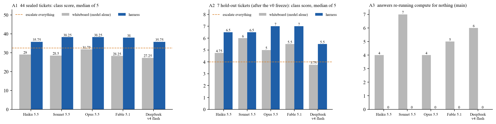
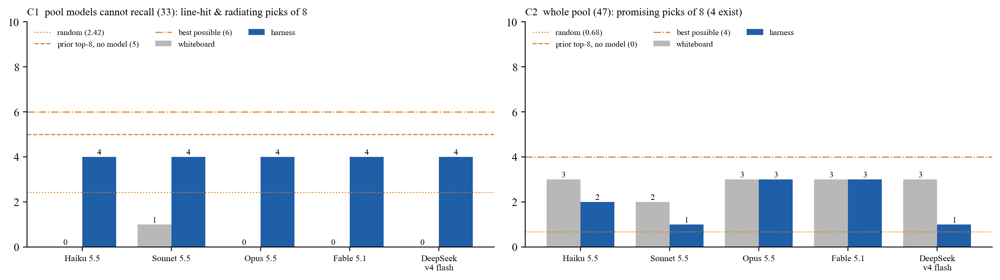
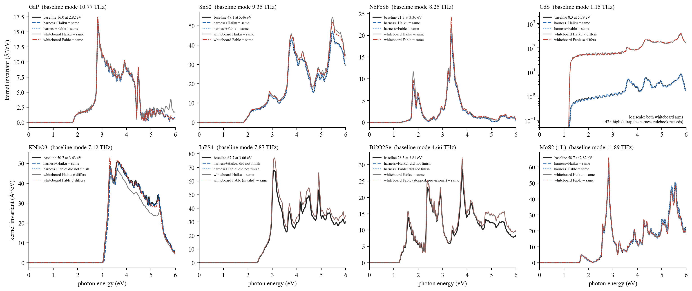
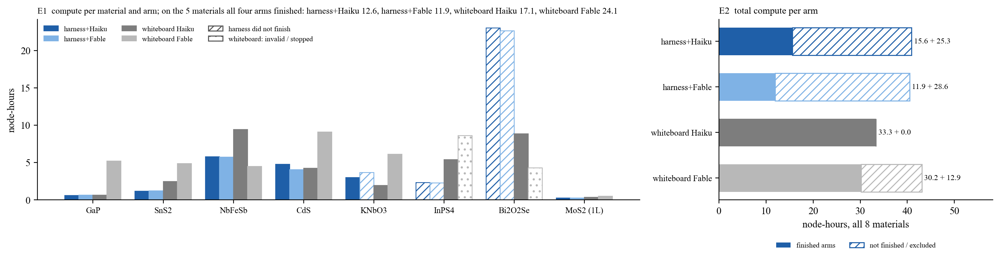

# cophon-bench v1：相干声子太赫兹材料 AI 研发系统的第二组能力基准

版本 v1.0.1（2026-10-18：v1.0 收尾，同日公开发布）· Atomost · cophon 项目 · 线 5（基准）
作者：Claude Opus 5.5（agent，基准会话），所有者 10-18 决定公开发布。所有数字出自 `tables/` 下的判分表；表由冻结的判分器生成，图由 `cophon_bench/figures_v1.py` 从表生成。

---

## 一页读完

v0（10-15）用三条飞行和一批离线题回答了两个问题：同一个模型放进 harness 和不放进去差多少；harness 里换最便宜的模型，能不能达到最强模型单干的水平。v1 要把 v0 里靠推断的地方换成测量：端到端扩成 8 个材料、四条臂（harness 加 Haiku、harness 加 Fable、白板 Haiku、白板 Fable），晶胞封进题目；运维题加 7 张冻结后才出现的留出工单、重复从 3 次加到 5 次；选材池新算 10 个不按先验挑的材料。v1 新增 1417 份离线模型答案、94 次工单中继调用、16 条白板臂，用了 205 节点时集群计算，模型花费 694 美元（list 价）。

v1 没有全部跑完。LUMI 在 10-17 14:00 因安全原因关闭，没有恢复日期；所有者 10-18 决定把不需要 LUMI 的部分跑完后直接结束。因此少了三样：白板 Fable 的 InPS4（第一次的结果作废，重跑没能开始）和 Bi2O2Se（停在它自己标为临时的 64³ 结果上），以及 Wannier 题第 3 轮的判分（答案收齐了，打分作业要在 LUMI 上跑）。


图 1 · 三道题的主指标。A 运维决策；C 选材，只看模型记不住的 33 个材料；E 端到端，每条臂 8 个材料的结局和模型花费。

- 运维决策（A，44 张主集工单，每个模型 5 次取中位数）：harness 里的 Haiku 35.75 分，白板的 Fable 28.25 分，满分 44；同一个模型进 harness 高 6.5 到 9.75 分。白板臂每个模型有 4 到 7 张票会白白重提计算，harness 臂一张都没有。7 张 v0 冻结后才出现的留出工单上，每个模型仍然是 harness 高（0.5 到 2 分），harness 加 Haiku 6.5 分，白板 Fable 5.5 分。
- 选材（C，模型记不住的 33 个材料：主动学习循环自己发现的 23 个加为扩池随机新算的 10 个）：harness 臂五个模型 8 个里都命中 4 个，白板臂 0 到 1 个。在全部 47 个里挑"有希望"的材料，前沿模型两边一样（各 3 个），白板拿分靠记得住的几个明星材料。为扩池随机新算的 10 个材料只有 1 个命中、没有一个"有希望"。
- 端到端（E，8 个材料）：harness 两条臂跑完的 11 条全部和基准答案相同；白板两条臂跑完的 14 条里 4 条不同，两种模型都错在 CdS 和 KNbO3。CdS 是白板踩了一个 harness 规则库里写着的陷阱，核高了 47 倍；KNbO3 是三个几乎等高的峰里挑错了最高的那个，整条谱其实很接近。
- 但 harness 有 5 条没跑完（16 条里），全部卡在 Wannier 相关的门上，这是 v1 最大的反面结果；白板臂一条都没有卡住。Bi2O2Se 的两条 harness 臂各烧了约 23 节点时才停下。
- 四条臂都跑完的 5 个材料上，harness 加 Haiku 用 12.6 节点时、0.09 美元模型费，白板 Haiku 17.1 节点时、16 美元，白板 Fable 24.1 节点时、122 美元。

两个角度的结论：角度一（harness 加 Claude 对白板 Claude）在 A 上成立，留出工单上也成立；在 C 上，模型记不住的材料上成立，全池上部分成立；在 E 上，harness 跑完的全对、更省，但 16 条里 5 条没跑完，白板一条没卡，所以只部分成立。角度二（harness 把便宜模型抬到前沿水平）在 A 上成立，在 C 上部分成立；在 E 上 harness 加 Haiku 跑完的 6 个全对、模型费 0.18 美元，但白板 Haiku 自己也把 8 个材料都算完了，harness 给便宜模型的是对、省、可复现，不是从做不到到做得到。B 没有新结果，D 不重跑。这份基准没有证明的东西列在附录 A。

---

## 1. v1 比 v0 多了什么

v0 的报告附录列了它不能证明的八件事。v1 针对其中能用一轮工作补上的几件：

| v0 的缺口 | v1 的做法 | 结果 |
|---|---|---|
| 端到端只有 3 个材料，harness 加 Fable 一臂是推断 | 8 个材料，四条臂都实测；晶胞由基准封存，两边都不许改 | 做了；两格缺（InPS4、Bi2O2Se 的白板 Fable） |
| SnS2 三条臂用了三个晶胞，峰位跟着晶胞跑 | 晶胞封进题目（`labels/cells/`），白板任务书写明不得改动晶胞 | 做了；判分器逐条核对，交了核文件的 27 条臂晶胞偏差都是 0.0 % |
| 多峰谱按单一最大值判分太脆 | 改成前两峰规则：臂的最高峰落在基线前两峰之一的 ±0.15 eV 内、峰高 ±25 %、模式频率 ±5 % | 做了；KNbO3 仍然在边界上（见 3.5） |
| 运维题的工单都在 v0 冻结前，可能被模型记住 | 加 7 张冻结后才出现的留出工单；重复 5 次 | 做了；留出集上每个模型仍是 harness 高（见 3.1） |
| 选材池是循环按旧先验挑的，有偏 | 从 78 个有先验、没算过核的材料里按化学分层随机抽 10 个新算核，扩池到 47 个 | 做了，46.9 节点时；随机抽的 10 个只有 1 个命中（见 3.3） |
| Wannier 题只跑了两轮 | 第 3 轮：每个模型带着自己前两轮的结果再答 | 答案收齐（137 份），没判分 |
| 白板隔离只是审计 | 白板臂在 docker 沙箱里跑，只挂白板目录和 ssh 配置 | 做了；沙箱之外的漏洞见附录 A.3 |

## 2. 基准怎么设计

规矩和 v0 一样：标签和判分器在任何白板运行之前冻结（`FREEZE_v1.sha256`，112 个文件；选材扩池后第二阶段冻结 `FREEZE_v1_stage2.sha256`，27 个文件）；判分一律用流水线自己的门和校验器，不用模型当裁判；冻结后的每一处改动写进 `FREEZE_NOTE.md`。被测的 harness 是 kernel_pipeline v2.0.12，飞行中途部分驱动进程换成了 v2.0.13，两者只差报告里的位移振幅，不影响判分（`FREEZE_NOTE.md` 10-15 11:45）。基准运行期间 harness 的代码没有改；发现的不足交给线 2 的交接单（`records/handoffs/2026-10-15-bench-v1-harness-findings-for-line2.md`）。

| 题 | v1 的池子 | 重复 | 判分 | 算力 |
|---|---|---|---|---|
| A 运维决策 | 44 张主集（与 v0 逐字节相同，v0 的 3 次答案沿用为第 1–3 次）+ 7 张留出集 | 5 | 同 v0：最佳 1、可接受 0.5、错 0、不答 −1 | 0 |
| B Wannier 投影 | v0 的 16 个材料，第 3 轮 | 3 | 流水线的 Wannier 门 | 未判 |
| C 选材 | 37 个 v0 候选 + 10 个新算的 = 47 个 | 5 | 同 v0（筛选打分 v2.1 的主分、"有希望"、命中激光线且辐射） | 扩池 46.9 节点时 |
| D 峰位预测 | 不重跑，沿用 v0 作阴性对照 | — | — | 0 |
| E 端到端 | 8 个材料 × 4 臂 = 32 条 | 1 | 前两峰规则（见上）；臂的核文件用流水线自己的解析器重算 | 157.8 节点时 |

E 的 8 个材料：GaP、SnS2、NbFeSb（v0 的三个）加 CdS、KNbO3、InPS4、Bi2O2Se、MoS2 单层，由所有者在 10 个候选里定。基线是材料库里封存的生产核，由 `pillar_e.py baselines` 重算后封进 `labels/E_baselines.json`。harness 臂在基准自己的材料库（`e2e_library/`）里由监督器无人值守地跑，卡住时开工单，工单由中继交给操作员模型（Haiku 或 Fable）在全新上下文里作答，校验通过的答案由监督器应用；升级给人的和连续三次无效的留给人，每次算一次人工触碰。白板臂是所有者启动的无头会话，在 docker 沙箱里拿到结构、论文、作者的实现笔记、同一套 QE/EPW 工具链和超算，上限每条 20 节点时、120 美元、600 轮、3 天。

## 3. 结果

### 3.1 运维决策（A）



图 2 · A1 主集 44 张工单，A2 留出集 7 张，A3 会白白重提计算的答案数。虚线是"所有票都升级给所有者"这个保守策略的得分。

**主集（44 张）。** harness 臂五个模型 35.75 到 38.25 分，白板臂 27.25 到 31.75 分，中间隔着"全部升级"的 32.5 分。同一个模型进 harness 高 6.5（Opus）到 9.75 分（Fable、Sonnet）。白板臂每个模型有 4 到 7 张票会白白重提计算，harness 臂零张。前 3 次就是 v0 的答案，多跑的 2 次让每个分数变动不超过 1.25 分，两臂之间的差距没有变。

只看 19 张必须自己拿主意的决策票（最佳动作不是升级的那些），最佳动作数是：Fable 和 Opus 两边都是 14，Sonnet 白板 11、harness 13，Haiku 白板 6、harness 9，DeepSeek 白板 13、harness 15，与 v0 的 3 次逐个相同。v0 的读法不变：在"判断"上 harness 对前沿模型几乎没有增量，它在 A 上的价值是知道边界、动作合法、不浪费算力，以及把 Haiku 和 Sonnet 拉近前沿。

**留出集（7 张）。** 这 7 张是 v0 冻结（10-14 12:04）之后的飞行里才出现的真实工单，harness 的规则不可能照着它们写，用来回答"规则是照着这些票调的"这个质疑。7 张里 3 张的最佳动作是升级，"全部升级"得 4 分。harness 臂 5.5 到 7 分（Fable、Opus 7 分，Haiku、Sonnet 6.5 分，DeepSeek 5.5 分），白板臂 3.75 到 6 分（Sonnet 6 分，Fable 5.5 分，Opus 5 分，Haiku 4.75 分，DeepSeek 3.75 分），每个模型都是 harness 高。

差距大多是半分。4 张决策票里有 2 张（H05、H06）是"什么都没坏"的票：核的网格阶梯收敛了或正在往下走，最佳动作是说明情况、不动手，等待算可接受。harness 里的 Fable 和 Opus 10 次都选说明，Haiku 10 次里 8 次，Sonnet 和 DeepSeek 各 5 次；白板的 Fable 和 Haiku 10 次都选等待，每张丢半分；白板 Opus 在 H06 上 5 次都升级给所有者，按标签是错。另外 2 张（Wannier 第 2 轮没过后改卡片的提案、同一轮重提）白板 Haiku 10 次全对，白板 Fable 卡片提案 5 次全对、同一轮重提 5 次里 2 次对，另 3 次升级给所有者（可接受）。所以在新票上白板模型没有犯大错，harness 的优势是更常选中最佳动作、不白烧算力。DeepSeek 是例外：它在 harness 里 5 次有 4 次在 H03 上重提计算，按中位数是唯一在留出集上烧算力的 harness 模型（harness 加 Haiku 在同一张票上也有 1 次）。留出集只有 7 张，单个分数的差别不宜细读，能读的是方向：每个模型都是 harness 高，没有反过来的。

过程交代：Fable 白板这次新答的 90 份里有 14 份 JSON 漏了结尾的右括号，冻结的判分器按原有的容错规则补回了 13 份，剩下 1 份（主集 T02 第 5 次）按不答计 −1 分，与 v0 的处理一致。

### 3.2 Wannier 投影（B）

第 3 轮的提示词 137 份（每个模型、每次重复、每个前两轮没过的材料一份，带着它自己前两轮的投影块和分数）全部答完；其中一份 Fable 答案第一次超过 900 秒的时限，按同样的设置重答一次后收齐，超时的原件留在 `results/b/_r3_timeout/`。判分要把每个投影块跑成一次 wannier90 打包作业，作业在 LUMI 上，LUMI 关闭，所以 v1 没有 B 的新结果。v0 的两轮结果（`cophon-bench-v0/tables/B_table.md`）仍然是 B 的现行结论。第 3 轮的答案在 `results/b/B_whiteboard_r3/`，LUMI 恢复后可以用 `b_drive.py stage` 补判，补判时 r1、r2 与 r3 在同一个集群上，可比。

### 3.3 选材（C）



图 3 · 从 47 个候选里挑 8 个。C1 只看模型记不住的 33 个材料（循环自己发现的 23 个加随机新算的 10 个），命中数是"有商用激光线共振且被驱动模式辐射"的个数；C2 全池里挑中"有希望"的个数。三条参考线是随机 8 个的期望、harness 代码按先验分数取前 8、按新版评分的最优 8 个。

**扩池告诉我们的。** 池子从 37 个扩到 47 个。新加的 10 个是从 78 个有先验、循环没挑去算的材料里按化学分层随机抽的，用 46.9 节点时算了核。这 10 个里只有 1 个（LiZnPS4）命中激光线且被驱动模式辐射，没有一个"有希望"；循环自己挑去算的那 23 个里命中 9 个。样本小，但方向清楚：循环的先验确实把好材料挑在了前面，v0 担心的"池子是按先验挑的、题目偏向 harness"，扩池后看偏差主要在好的一边，随机补材料并不能让题目更难分。

**模型记不住的 33 个材料（C1）。** 循环自己发现的 23 个加随机新算的 10 个，有 10 个命中、1 个"有希望"（LiAsS2）。harness 臂五个模型都命中 4 个，白板臂 0 到 1 个。白板模型 8 个里只有 2 到 4 个落在这 33 个里，其余挑的是池里另外 14 个模型记得住的材料，KNbO3、BaTiO3、LiNbO3 最多，其次是 GaP、ZnS、NbOI2、ZnO；落在 33 个里的多是 CdS、PbTiO3、CdTe 这样熟悉的化合物，三个都不命中。要看清的是，harness 臂的命中主要来自它的先验代码：不用模型、只按先验分数取前 8 就命中 5 个，比五个模型都多一个。模型在 harness 里的增量只在前沿模型身上：Fable 和 Opus 挑中了 LiAsS2，主分合计 6.3 和 5.7，先验代码是 4.2；Haiku、Sonnet、DeepSeek 主分合计 3.2，略低于先验代码。

**全池 47 个（C2）。** 4 个"有希望"的是 BaTiO3、KNbO3、LiNbO3 和 LiAsS2。白板模型靠记忆拿到前三个里的 2 到 3 个；harness 臂 1 到 3 个，Fable、Opus 两边都是 3 个。命中激光线且辐射的个数 harness 4 到 5 个，白板 2 到 3 个；主分合计 harness 加 Fable 14.3、加 Opus 13.7，白板 Fable 12.9、Opus 12.7；harness 加 Haiku 11.2，低于白板 Fable。有 4 份答案不合法：白板 DeepSeek 2 次推理用光了输出长度、没给出名单，白板 Sonnet 1 次只给了 7 个，harness 加 Sonnet 1 次先给了一个占位名再改口、判分器只读第一份。判分器照 v0 的规则把它们按实际给出的材料计分（没给名单的记零），中位数取全部 5 次。

C 的读法和 v0 一样：harness 在 C 上的优势大部分是它的先验，模型在上面加的不多；但白板模型脱离了记忆就几乎命中不了这些材料，这一点在扩池之后更清楚了。

### 3.4 峰位预测（D）

按设计不重跑。v0 的结论不变：harness 让每个模型多对 1 到 3 个，前沿模型白板已经和 harness 的定位器一样好，这道题不能拿来证明 harness 的优势，作阴性对照。

### 3.5 端到端（E）



图 4 · 8 个材料的核不变量谱。黑线是基线；蓝色两条是 harness 臂，灰色和红色是白板臂。图例里写了每条臂按冻结规则的判定；"invalid"和"stopped"两条画成浅色，不计数。CdS 用对数坐标。

每条臂的结局（`tables/E_ledger.md`，判定来自冻结的 `pillar_e.py`）：

| 臂 | 跑完 | 相同 | 不同 | 没跑完 | 作废或停下 | 跑完的节点时 | 模型花费（list 价） | 人工触碰 |
|---|---|---|---|---|---|---|---|---|
| harness + Haiku | 6/8 | 6 | 0 | 2 | 0 | 15.6 | $0.18 | 4 |
| harness + Fable | 5/8 | 5 | 0 | 3 | 0 | 11.9 | $36.80 | 5 |
| 白板 Haiku | 8/8 | 6 | 2 | 0 | 0 | 33.3 | $34.35 | 0 |
| 白板 Fable | 6/8 | 4 | 2 | 0 | 2 | 30.2 | $241.87 | 0 |

模型花费是整条臂的全部花费，白板 Fable 的 241.87 美元里有作废的 InPS4（22.67 美元）和停下的 Bi2O2Se（66.51 美元）。

**对的那部分。** harness 跑完的 11 条全部和基准答案相同，谱与基线的最大偏差除 KNbO3 外都在 3 % 以内。白板跑完的 14 条里 10 条相同，这 10 条的峰高比基线高 5 % 到 16 %，在 25 % 的容差以内。四条臂都跑完的 5 个材料（GaP、SnS2、NbFeSb、CdS、MoS2）上，harness 两条臂 5 对 5，白板两条臂各 4 对 5。

**CdS：白板踩了陷阱。** 两条白板臂的峰位（5.79 eV）和最强模式（1.15 THz）都对，峰高却是 377 和 393 Ų/eV，基线是 8.3，差约 47 倍，而且两条白板臂彼此一致，一开始我们分不清哪边错。查下去是白板错了：两条白板臂声子那一步的 SCF 用的 FFT 网格是 50×50×90，EPW 读的 NSCF 是 50×50×81，扰动势沿 c 轴被打乱，各模式混在一起。证据是 C6v 对称性下本应为零的两个静默 B1 模式，harness 核里峰值 0.1 和 0.2，白板核里 144 到 162。这正是 harness 规则库里的一条规则，它是 10 月 2 日在同一个材料上查出来、写进规则的。这一格是 harness 把攒下的经验用上了的直接例子。

**KNbO3：规则边界。** KNbO3 的谱在 3.3、3.6、4.0 eV 有三个几乎等高的峰。基线最高的是 3.63 eV（50.7），第二是 3.96 eV（45.6），3.3 eV 的峰比 45.6 低一点，不在前两峰里。两条白板臂的最高峰都落在 3.3 eV，按规则判"不同"。可是白板 Fable 的第二峰 3.62 eV / 51.6 和基线最高峰几乎重合，整条谱与基线的最大偏差 6.9 %，是三条跑完的臂里最小的（harness 加 Haiku 26 %，白板 Haiku 19.5 %）。harness 加 Haiku 判"相同"，它的谱偏差反而大。可能的原因是它松弛内坐标用的泛函与基线不同（`FREEZE_NOTE.md` 10-15 11:45 记过这条路线差别），Wannier 也多做了一轮，我们没有单独核查。这一格应当读作"规则在近乎并列的峰上不稳"，不能读作白板 Fable 算错了物理。

**没跑完的那部分。** harness 16 条里 5 条没跑完，都停在 Wannier 相关的门上：

- 4 条（InPS4 加 Haiku，Bi2O2Se 两条，KNbO3 加 Fable）的 Wannier 本身过了门，到了 EPW 第一步，EPW 自己重新做的 Wannier 化落在另一个极小值，散开度与 wannier90 的结果对不上，过不了一致性门。工单给操作员的合法动作只有重提、重判和升级，重提只会复现，操作员模型（Haiku 和 Fable 都一样）正确地升级给了构建层。这是交接单第 7 条。
- 1 条（InPS4 加 Fable）的 Wannier 用完了 3 轮预算，第 3 轮能带已经对上，只差两个函数的散开度（10.81、10.52 Ų，门槛 10）。

所有者 10-16 定了收掉的规则：操作员升级或没有合法的新动作时，这条臂记为"harness 没跑完"，不再重提。白板臂同一批材料一条都没有卡住，它们的流程里没有这道一致性门。门是流水线的质量保证，这次它挡住的是 harness 自己的东西，要线 2 去查 EPW 内部的 Wannier 化为什么和 wannier90 不一致，或者门的容差该怎么定。

Bi2O2Se 的两条 harness 臂各用了约 23 节点时才停下，超过设计里每材料 10 节点时的上限。其中一部分是流水线看到声子"偏软"后自动做的非谐检查，结论是拟合不可信、只用简谐，白板臂不做这一步。上限写在设计里，但基准在运行中没有执行它。



图 5 · 算力。E1 每个材料每条臂的节点时，斜线是 harness 没跑完的臂，点纹是白板 Fable 作废或停下的臂；标题给出四条臂都跑完的 5 个材料上的合计。E2 每条臂 8 个材料的总节点时，分成跑完的和没跑完的两段。

**成本。** 四条臂都跑完的 5 个材料上：

| 臂 | 节点时 | 模型花费（list 价） | 墙钟（每个材料） |
|---|---|---|---|
| harness + Haiku | 12.6 | $0.09 | 1.5–7.9 h |
| harness + Fable | 11.9 | $10.28 | 1.5–8.6 h |
| 白板 Haiku | 17.1 | $16.32 | 1.0–12.2 h |
| 白板 Fable | 24.1 | $122.04 | 1.3–35.5 h |

白板 Fable 的墙钟最长 35.5 小时（GaP）和 29.9 小时（SnS2），是因为会话撞上订阅额度被切断，等额度恢复后续跑，中间的等待也算在墙钟里。

把没跑完的也算上，8 个材料的总节点时是 harness 加 Haiku 40.9、harness 加 Fable 40.5、白板 Haiku 33.3、白板 Fable 43.1（含作废和停下的两条）。v0 测到 harness 的算力是白板 Fable 的 1/3.6；v1 在四条臂都跑完的材料上，harness 是白板的 0.5 到 0.75 倍，算上没跑完的就不省了，多出来的主要花在 Bi2O2Se 上。

**白板 Haiku 比预想的好。** v0 没有白板 Haiku 臂，我们默认便宜模型单干做不下来。v1 里它 8 个材料全部跑完，6 个对，错的两个和白板 Fable 错得一样，花费是白板 Fable 的七分之一。这说明在这 8 个材料上，"从结构算到核"本身已经不是只有前沿模型才做得到的事。harness 在 E 上给便宜模型带来的，是 CdS 那种陷阱不会踩、过程可复现、模型费接近零，而不是"做得出来与做不出来"的差别。

**两格缺失。**

- InPS4 的白板 Fable：任务书模板给同一材料的两种模型写了同一个 LUMI 远程目录（这是基准自己的配置错）。Fable 臂被额度切断后续跑，把白板 Haiku 臂留在那里的整套计算当成自己前一段的成果接着用，20 个作业里 18 个是 Haiku 的作业号。它的结果按规则是"相同"，但不是独立的，作废。所有者批准重跑，重跑等 LUMI 时 LUMI 关闭了。
- Bi2O2Se 的白板 Fable：64³ 的临时结果已经交付，判分器重算是 3.81 eV / 32.1 Ų/eV / 4.66 THz，对基线 3.81 / 28.5 / 4.66 判"相同"（`tables/E_table_excluded.md`），它在等 96³ 和 128³ 的作业确认收敛时 LUMI 关闭，10-18 由基准停下。它自己没有宣布完成，所以不计数；停机不是它的错，所以也不算它失败。

其余各臂对同一远程目录的处理，我们逐条查过转录和作业号：Fable 臂看到别人的文件后都另开了子目录；SnS2 的白板 Haiku 臂读了 Fable 第一段留下的 Wannier 失败记录，有轻度信息泄漏，它的结果照常计分、在这里注明。

### 3.6 费用与算力

| 项 | 数 |
|---|---|
| 模型答案 | 1417 份离线答案（A 1230、B 第 3 轮 137、C 第二阶段 50）；工单中继 94 次调用（E 66 次、扩池 28 次）；16 条白板臂 |
| 模型花费（list 价） | $694：A $298、B $53、C $30、E 中继 $37、扩池中继 $0.25、白板臂 $276；按模型 Fable $544、Opus $80、Haiku $37、Sonnet $32、DeepSeek $0.87 |
| 超算 | E harness 臂 81.4 节点时（Bi2O2Se 两条各约 23）；E 白板臂 76.4（自报，见下）；扩池 46.9；harness 第一次尝试 0.1；A、B、C 答题零；合计 204.8 节点时 |
| 人工 | E harness 臂 9 次人工触碰（加 Haiku 4 次、加 Fable 5 次）；白板臂 0 次 |

明细在 `tables/COSTS.md`，由 `cophon_bench/costs_v1.py` 生成。A 主集第 1–3 次是 v0 的答案，花费算在 v0 里，这里不重复。Fable 一个模型占了模型花费的 78 %，主要是白板臂（242 美元）和 A 的答题（206 美元）。Claude 的调用走所有者的订阅，list 价是按 API 价格折算的数；订阅额度在 10-15 和 10-17 各用尽一次，离线作答因此拖到 10-18 才收齐。

harness 臂的节点时出自流水线自己的台账（来自 sacct）；白板臂的节点时取自各臂交付的 RESULT.json，是它们自己从作业记录里算的，LUMI 关闭后没法再用 sacct 核对。

## 4. 结论

角度一，harness 加 Claude 对白板 Claude：

- 运维决策：同一个模型进 harness 高 6.5 到 9.75 分，不再白烧算力；冻结后才出现的 7 张留出工单上，每个模型也是 harness 高，规则不是照着题目调出来的。
- 选材：模型记不住的材料上 harness 命中 4 个，白板 0 到 1 个；全池里前沿模型持平，白板靠记忆。harness 的优势主要来自它的先验代码。
- 端到端：harness 跑完的 11 条全部与基准答案相同，CdS 上避开了白板两种模型都踩的陷阱；四条臂都跑完的 5 个材料上，harness 用白板一半到四分之三的算力；模型费 harness 加 Haiku 比两条白板臂低两到三个数量级（0.09 美元对 16 和 122 美元），harness 加 Fable 比白板 Fable 低一个数量级。但 harness 16 条里 5 条没跑完，都卡在 Wannier 相关的门上，白板一条都没卡。这是 v1 最重要的反面结果，也是线 2 接下来要修的地方。

角度二，harness 把便宜模型抬到前沿水平：Haiku 在 harness 里的运维分（35.75）超过白板的每一个模型（最高是 Opus 的 31.75），留出集上 6.5 对白板 Fable 的 5.5；选材在模型记不住的材料上 4 对白板 Fable 的 0；端到端跑完的 6 个全对，模型费合计 0.18 美元。v1 同时测出白板 Haiku 自己也能把 8 个材料全部算完、6 个对，所以在端到端上 harness 给便宜模型的是"对、省、可复现"，不是"从做不到到做得到"。v0 里"端到端算力省 3.6 倍"的说法在 v1 上缩小为跑完的材料上省四分之一到一半，算上没跑完的就不省。

这组基准证明的是"在这条流水线、这批材料、这几个模型上"的事。它没有证明的事见附录 A，下一版要补的见 A.4。

---

## 附录 A · 能力边界、harness 的不足与过程披露

### A.1 这份基准不能证明的

1. **harness 跑得完。** v1 端到端 16 条 harness 臂里 5 条没跑完。在"难"的材料上（d 壳层、层状、多个自由内坐标），harness 的门比白板更容易把自己卡住。
2. **墙钟更快。** 跑完的材料上 harness 墙钟和白板 Haiku 差不多；白板 Fable 慢是因为订阅额度，不是因为算得慢。
3. **省钱的程度可以外推。** 跑完的 5 个材料上 harness 省算力，算上没跑完的就不省。样本是 8 个材料、每臂 1 次。
4. **Wannier 题第 3 轮的结果。** 没判分。
5. **物理上对不对。** 基准判的是"与封存答案一致"，不是"与实验一致"。CdS 一例里我们查实了基线是对的，其余材料没有独立核查。
6. **运维题在没见过的票上的泛化有多强。** 留出集只有 7 张，每个模型都是 harness 高，方向一致，但单个分数的差别不宜细读。
7. **推广到别的流水线、别的实验室。** 一个 harness、一个实验室，模型版本是 2026-10 的快照，没有外部复跑。

### A.2 过程里发现的 harness 不足（交线 2，`records/handoffs/2026-10-15-bench-v1-harness-findings-for-line2.md`）

1. `--relax fixed` 仍按变胞步判压强，还会触发"第二次变胞"（已查实）。三个材料的 harness 臂因此重建，0.13 节点时单列。
2. fixed 路线用晶胞泛函松内坐标，与两步法不一致（已查实，影响小；KNbO3 的谱偏差可能与此有关）。
3. Manneback 上两个作业几秒内死掉，被当成物理失败。
4. LUMI 每用户作业上限引起的工单噪声。
5. 监督器在决定生效前反复重开同一张工单，后来的答案覆盖先前的（已查实，影响大）。
6. "差一点、多迭代一轮"的提案没有真的加迭代次数，下一轮与上一轮逐字相同（已查实）。
7. Wannier 已收的材料过不了 EPW 第一步的散开度一致性门，工单只给"重提、重判、升级"（已查实现象，原因待查）。v1 五条没跑完的臂里四条是这一条。
8. 作业数组在单节点分区排了一整天，没有改道，也没有告警。
9. CdS 的核高度差 47 倍：查实是白板踩了规则库里的这条规则，harness 正确，不需要修。

另记一条：Bi2O2Se 的 harness 臂用到 23 节点时，设计里的每材料上限没有在运行中执行。这是基准的执行缺口，不是 harness 的缺陷。

### A.3 冻结后的改动与过程中的事故（详见 `FREEZE_NOTE.md`）

- 三个材料的 harness 臂第一次尝试卡在 relax 门，原因是基准配置的泛函与封存晶胞的来源不一致，重建（10-15 11:45）。
- 运行中 harness 版本 v2.0.12 与 v2.0.13 混跑，只差报告里的振幅，判分不受影响（10-15 11:45）。
- 运行器两次没认出新的订阅额度提示（"Fable 上限"10-15，"每周额度"10-17），各改一行；12 份 Fable 空回复移出、重答（10-15 17:05、10-17 07:57）。
- 白板任务书的远程目录不分模型，InPS4 白板 Fable 作废（10-17 20:58）。下一版模板改为每条臂一个远程目录。
- docker 沙箱隔离了本机文件系统，但两条臂共用一个集群账户和远程根目录，沙箱管不到集群那一侧。v2 要在集群侧也分开。
- LUMI 10-17 14:00 关闭，v1 在 10-18 按所有者决定结束（`DECISION.log` 10-18 07:10）。Bi2O2Se 白板 Fable 臂在 LUMI 上还有两个排队的作业（22931791、22931793），LUMI 恢复后要取消。

### A.4 下一版要做的

白板远程目录按臂分开；基准运行中执行每条臂的算力上限；B 第 3 轮补判；线 2 修完交接单第 5、6、7 条后，把 v1 没跑完的 5 条 harness 臂重跑一次，看同一批材料能不能全部跑完；E 的判分规则对近乎并列的峰要有说法（例如把"峰高在基线最高峰 ±5 % 以内的峰都算候选"写进规则，冻结前定）。

---

## 附录 B · 复现与文件索引

本目录（`benchmarks/cophon-bench-v1/`）是自包含的：

```
report/REPORT.md, SUMMARY.en.md, figures/     本报告、英文摘要与图（图由 ../cophon_bench/figures_v1.py 生成）
DESIGN.md                                      v1 的设计
FREEZE_v1.sha256, FREEZE_v1_stage2.sha256      两次冻结的清单
FREEZE_NOTE.md                                 冻结后改动的披露
design/                                        E 候选与基线说明、选材扩池抽样名单、用 v1 规则重判 v0 的判分器自检
labels/                                        E 基线与封存晶胞、C 第二阶段标签
prompts/                                       A 两臂、B 第 3 轮、C 第二阶段的提示词
results/a, results/b, results/c2, results/e    模型答案；E 的中继记录、逐臂判分（grades/ 计数，grades_excluded/ 不计数）
tables/                                        判分表（A、C2、E_table、E_ledger、COSTS）
e2e_library/                                   harness 臂与扩池材料的基准材料库（大的原始输出只在本机）
whiteboard/                                    白板任务书模板、沙箱 Dockerfile；arms/ 下是 17 条白板臂的交付件与完整转录（原始输出只在本机）
logs/                                          运行日志、隔离审计脚本
```

判分不需要集群：

```
PY=kernel_pipeline/.venv/bin/python; V=benchmarks/cophon-bench-v1; B=benchmarks/cophon_bench
$PY $B/pillar_a.py grade $V/results/a $V/tables --ext $B/tickets_ext --holdout $B/tickets_holdout
$PY $B/pillars_cd.py grade $V/labels/C_stage2 $V/results/c2 <输出目录>        # 表复制为 tables/C2_table.md
$PY $B/e_close_v1.py                                                           # E 的逐臂判分、E_table、E_ledger
$PY $B/costs_v1.py                                                             # 费用与算力表 COSTS
$PY $B/figures_v1.py
```

项目的日常记录在仓库根目录的 `DECISION.log`、`RUNNING.log`（2026-10-15 到 10-18，带"线5"字段的条目）。
