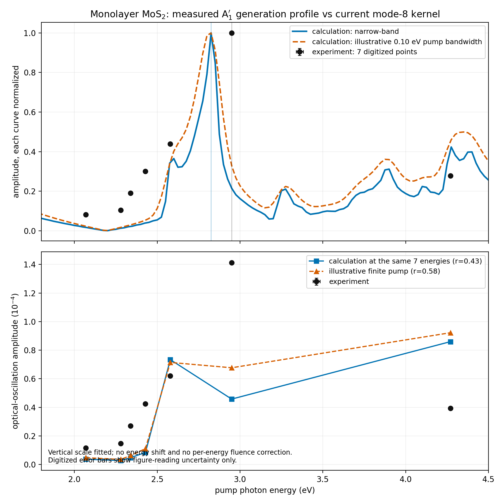

# Experimental benchmarks for the coherent-phonon kernel

## Plain answer

**One experiment can test a calculation we already have: monolayer MoS2.** It measures
the same out-of-plane vibration while changing the pump photon energy from 2.0 to 4.3 eV.
That is the closest available measurement to our mode-8 spectrum.

The first comparison is a **partial match, not a validation pass**. Both experiment and
calculation put the strongest response in the 2.8-3.0 eV region. However, our calculated
vibration is 396.6 cm-1 versus about 406 cm-1 measured, and the seven-point energy profile
is only moderately similar without adding fitted energy shifts. We must not hide the
remaining mismatch.

## Ranked choices

| Rank | Experiment | Can we use it now? | What it tests | Honest limit |
|---:|---|---|---|---|
| 1 | Trovatello *et al.* (2020), monolayer MoS2 | **Yes, now** | Mode identity, mode frequency, and pump-energy shape for the out-of-plane A1' vibration | Optical modulation is not an absolute atomic displacement; individual pump fluences are unpublished; strong bound electron-hole pairs are absent from our current kernel |
| 2 | Völzer *et al.* (2025), monolayer WS2/WSe2/MoSe2 | **As soon as one matching calculation is complete** | Frequency, phase, lifetime, fluence response, and full time traces; raw and processed data are public | Different materials from our completed MoS2 calculation; the reported high-fluence behavior is not a weak-field test |
| 3 | Huang *et al.* (2022), bulk SnSe | **After a bulk-Pnma SnSe calculation** | Quantitative atomic movements from several X-ray peaks at a 1.55 eV pump | Our paper calculation is a monolayer with a different structure; the experiment enters a large structural instability |
| 4 | Fischer *et al.* (2025), bulk BiTeI | **After a matched SOC, doped BiTeI calculation** | Same fully symmetric mode under several pump photon energies; amplitude is linear with fluence | The paper finds hot carriers, including below-gap carrier motion, dominate; that is not solely our equilibrium light-driven kernel |
| 5 | Yee *et al.* (2002), bulk GaN | **Scope check only** | Shows coherent A1(LO) and E2 modes far below the band gap | It is an off-resonant Raman process. Our present resonant kernel is expected to be zero there, so it should not fit this signal |
| 6 | 2025 tetragonal BaTiO3 thin-film study | **After a matching film/phase calculation** | Reconstructs an 8 pm Ti-O change at a 4.66 eV pump; raw X-ray data are public | Our result is low-temperature rhombohedral bulk BaTiO3; the film experiment mainly follows carrier and heating effects over picoseconds |

## What the present MoS2 comparison actually says

- **Right vibration:** measured A1' at about 406 cm-1; calculated mode 8 at 49.18 meV,
  or 396.6 cm-1. The calculation is 9.4 cm-1 (2.3%) low.
- **Right main energy region:** the largest experimental point is 2.949 eV; the current
  calculation's main peak in the measured window is 2.825 eV, 0.124 eV lower. Because the
  experiment has only seven pump energies, 2.949 eV is a largest sampled point, not a
  precisely fitted peak position.
- **Only partial full-curve agreement:** at the same seven energies, after fitting one
  vertical scale, the unshifted narrow-band calculation has Pearson correlation 0.43 and
  relative error 0.69. An illustrative 0.10 eV pump bandwidth gives correlation 0.58 and
  relative error 0.59. These numbers are diagnostics, not pass criteria.
- **No hidden alignment:** the reported result applies no shift to the energy axis. A freely
  fitted shift would make seven points look better but would not be an independent test.

## Why absolute displacement cannot be claimed from this paper

The MoS2 experiment measured a change in transmitted probe light. It did not calibrate the
motion in angstrom. Because the probe was always fixed at 2.9 eV, its response provides a
useful common ruler for the *shape* of the pump-energy scan, but not the absolute atom motion.
The authors also adjusted incident fluence to hold the non-oscillating signal fixed and give
only an approximate fluence (about 10 microjoules per square centimetre), not a value for
each point. A strict comparison to our response per electric-field squared therefore needs
the original pump spectra and fluence log from the authors.

## Best next calculation and best next experiment request

1. Use the existing MoS2 result as the first benchmark, but label it `partial_match`.
2. Ask the Trovatello authors for the seven raw amplitudes, their errors, each pump spectrum,
   and the incident fluence at each pump energy. That would remove the largest experimental
   ambiguity.
3. Add electron-hole attraction and spin-orbit coupling before treating the MoS2 resonance
   position/shape as a decisive theory test.
4. If choosing a new material for data-rich validation, calculate monolayer WS2, WSe2, or
   MoSe2 next. The Völzer dataset is openly licensed and already contains raw through fitted
   time traces, amplitudes, phase, and uncertainty.
5. If absolute atom motion is the priority, calculate **bulk Pnma SnSe**, not the current
   monolayer. The X-ray experiment is the stronger ruler for displacement.

## Audit files

- MoS2 digitized data, vector source figure, script, figure, and numeric metrics:
  `MoS2_Trovatello_2020/`
- Open-access paper copies: `papers/`
- Public-data documentation: `open_data/`
- DOI list and download provenance: `SOURCES.md`
- Integrity record: `SHA256SUMS`
