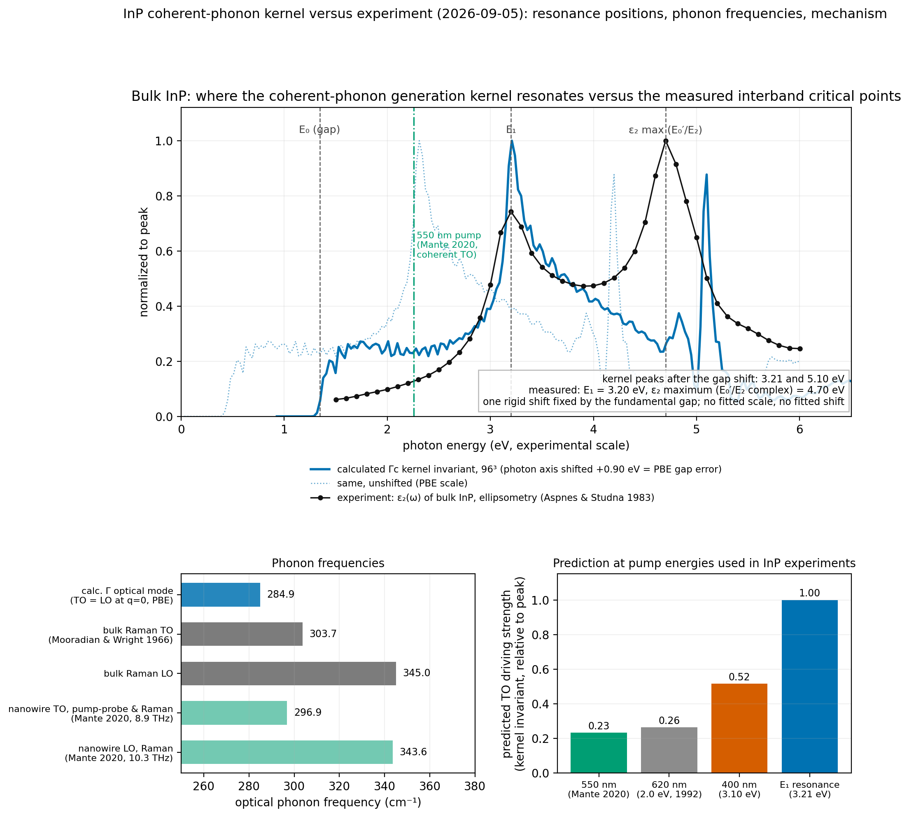

# InP: calculated coherent-phonon kernel versus experiment (2026-09-05)

**Status: resonance-structure and mechanism consistency, not an amplitude validation.** No
published experiment scans the pump photon energy of a coherent phonon in bulk InP, so the
MoS₂-style pump-scan comparison is not possible. What can be tested with published data is
(1) where the kernel resonates, (2) the phonon frequency, and (3) whether the generation
mechanism the kernel describes is the one observed. All three are consistent; none fixes the
absolute amplitude.

## 1. Resonance positions against the measured interband critical points

The kernel's resonant denominators are the interband transition energies, so its peaks must sit
at the measured critical points if the electronic structure is right. The calculated spectrum
(96³ fine mesh, 0.03 eV smearing, Γc only) was placed on the experimental energy scale with one
rigid shift equal to the PBE band-gap error, 1.344 − 0.446 = 0.898 eV. Nothing else was fitted.

| Feature | Calculated (PBE scale) | After the gap shift | Measured (ellipsometry, Aspnes & Studna 1983) | Difference |
|---|---:|---:|---:|---:|
| Main resonance | 2.31 eV | **3.21 eV** | E₁ = **3.20 eV** (ε₂ peak) | +0.01 eV |
| Second resonance | 4.20 eV | 5.10 eV | ε₂ maximum 4.70 eV (E₀′/E₂ complex; E₂ is usually quoted near 5.0–5.1 eV) | +0.40 eV vs the ε₂ maximum |
| Onset | 0.36 eV | 1.26 eV | E₀ = 1.344 eV (3σ smearing tail below the gap) | as expected |

The main resonance lands on E₁ to within 10 meV once the fundamental gap is corrected, which is a
non-trivial check because E₁ (Λ-line transitions) and E₀ (Γ) are independent quantities. The
second resonance sits 0.4 eV above the broad ε₂ maximum: the E₀′/E₂ complex spans 4.7–5.1 eV and
PBE errors are not uniform across the zone, so this is the expected level of agreement without a
k-dependent correction.

## 2. Phonon frequency

| | cm⁻¹ | meV | Difference from calculation |
|---|---:|---:|---:|
| Calculated Γ optical mode (retained scalar DFPT; TO = LO at exactly q = 0) | 284.9 | 35.33 | – |
| Bulk Raman TO (Mooradian & Wright 1966) | 303.7 | 37.65 | calc −6.2 % |
| Bulk Raman LO | 345.0 | 42.8 | LO–TO splitting not resolved at q = 0 |
| InP nanowire TO, pump-probe and Raman (Mante 2020, 8.9 THz) | 296.9 | 36.8 | calc −4.0 % |
| InP nanowire LO, Raman (Mante 2020, 10.3 THz) | 343.6 | 42.6 | – |

A 4–6 % softening is typical of PBE phonons in III-V compounds; the producer's phonon convergence
was not independently assessed here.

## 3. Mechanism: does experiment see the process the kernel describes?

The only located time-domain coherent-TO-phonon measurement on InP (Mante et al., ACS Photonics
2020; nanowires, 550 nm / 35 fs pump, 720 nm probe) finds that the coherent TO amplitude does
not change with doping from nominally intrinsic to 4.6×10¹⁹ cm⁻³ (their Fig. 4b) and concludes
that the TO mode is generated and detected through second-order processes, i.e. the intrinsic,
Raman-type light–lattice coupling. That is exactly the bulk kernel computed here. The modes
inside the Reststrahlen band (surface phonon polaritons, and the classic surface-field-driven LO
phonon of Pfeifer et al. 1992 in GaAs) scale with the surface field and lie outside the kernel's
scope. The symmetry the kernel predicts (only crossed field pairs drive the TO modes) is the
standard zincblende Raman selection rule.

Prediction from the kernel at pump energies used in InP experiments (invariant relative to its
E₁ peak): 550 nm (2.25 eV) 0.23; 620 nm (2.0 eV) 0.26; 400 nm (3.10 eV) 0.52; E₁ resonance
(3.21 eV) 1.00. A pump tuned to E₁ should therefore drive the TO mode about 4× more strongly
than the 550 nm pump of Mante et al., under the same fluence. This is a testable statement.

## What was done

- Fetched the tabulated InP optical constants of Aspnes & Studna (public-domain copy in the
  refractiveindex.info database), converted them to ε₂(E) with an auditable script, and located
  the ε₂ maxima directly from the data (`inp_aspnes1983_eps.csv`, `metrics.json`).
- Read the open manuscript of Mante et al. 2020 (arXiv:1909.02238) and the open copy of Pfeifer
  et al. 1992 (Konstanz KOPS); extracted only statements and numbers that appear in the text or
  figure captions; no figure was digitized (the nanowire data use a single pump energy).
- Compared the 2026-09-04 96³ kernel (`materials/InP/REPORT.md`) via `compare_inp.py`, which
  writes the figure and `metrics.json`.

## Limits

- No amplitude comparison: no bulk-InP experiment reports a calibrated coherent-phonon amplitude
  versus pump energy, and the detection observable (reflectivity modulation) is not computed.
- The kernel is Γc only, scalar-relativistic (InP spin-orbit splitting 0.11 eV omitted), PBE with
  a rigid scissor, 0.03 eV smearing, without excitonic effects (weak in bulk InP).
- LO–TO splitting is not resolved at exactly q = 0; the nanowire experiment differs from bulk
  (TO red-shifted by 7 cm⁻¹; field enhancement in 100 nm wires).
- The E₀′/E₂ region is compared only against the position of the ε₂ maximum.

## Files

`compare_inp.py`, `inp_experiment_vs_current.png`, `metrics.json`, `InP_Aspnes1983_nk.yml`,
`inp_aspnes1983_eps.csv`, `SOURCES.md`, `papers/`, `SHA256SUMS`.
